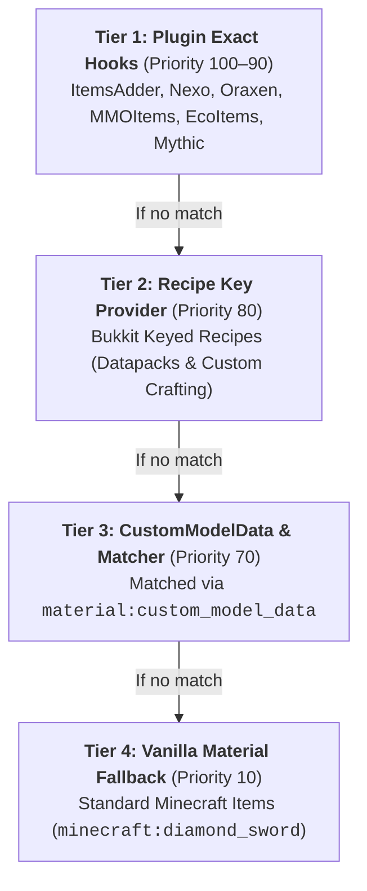

# Custom Items & Third-Party SPI

In modern Minecraft servers, custom weapons, tools, and armors are rarely simple vanilla items. Plugins such as **ItemsAdder**, **Nexo**, **Oraxen**, **MMOItems**, **EcoItems**, and **MythicMobs** introduce hundreds of custom items that share common vanilla materials (such as `DIAMOND_SWORD`, `BOW`, or `NETHERITE_CHESTPLATE`), differentiated only by `CustomModelData`, persistent NBT/PDC tags, or custom recipe keys.

If a plugin only inspects raw Bukkit materials, restricting `DIAMOND_SWORD` would inadvertently restrict *every* custom sword on your server, or conversely, custom swords would bypass progression rules entirely.

CraftingBlueprints solves this with the **`ItemIdentifierProvider` Service Provider Interface (SPI)**—an extensible, soft-depend matching engine that identifies custom items with zero hard dependencies.

---

## Supported Plugin Namespaces

You can target custom items directly in the `blueprint:` field or in recipe restrictions (`restricted-items:`):

| Provider | Syntax Pattern | Example Target | Description |
| :--- | :--- | :--- | :--- |
| **ItemsAdder** | `ia:<namespace>:<id>` | `ia:rpgweapons:ruby_sword` | Matches items created via ItemsAdder's `CustomStack` API. |
| **Nexo** | `nexo:<id>` | `nexo:mythril_axe` | Matches items created via Nexo's `NexoItems` API. |
| **Oraxen** | `oraxen:<id>` | `oraxen:titanium_chestplate` | Matches custom items registered in Oraxen. |
| **MMOItems** | `mmoitems:<TYPE>:<ID>` | `mmoitems:SWORD:EXCALIBUR` | Matches items created via MMOItems and MythicLib. |
| **EcoItems** | `ecoitems:<id>` | `ecoitems:titan_drill` | Matches items created by EcoItems via Paper PDC (`ecoitems:item`). |
| **MythicMobs** | `mythicmobs:<id>` | `mythicmobs:skeleton_king_crown` | Matches items generated by MythicMobs via PDC (`mythicmobs:type`). |
| **CustomModelData** | `cmd:<material>:<model_data>` | `cmd:diamond_sword:10042` | Matches any vanilla item carrying an exact `CustomModelData` integer. |
| **Recipe Keys** | `recipe:<namespace>:<key>` | `recipe:customcrafting:titan_blade` | Matches custom Bukkit / datapack `Keyed` recipe identifiers. |
| **Vanilla Material** | `<material>` / `minecraft:<material>` | `diamond_sword` | Vanilla Bukkit Material fallback. |

---

## Four-Tier Priority Hierarchy

When a player places items into a workstation, CraftingBlueprints resolves potential candidate identifiers in descending order of specificity:



---

## The First-Match-Wins Binding Rule

To guarantee fairness and prevent exploit loops, CraftingBlueprints adheres to the **First-Match-Wins Binding Rule**:

$$\text{Candidates} = [\text{CustomExact}, \text{RecipeKey}, \text{CustomModelData}, \text{VanillaMaterial}]$$

1. **Candidate Scanning**: The engine iterates through the candidates in descending priority order.
2. **First Match Elected**: The first candidate that matches an active blueprint or a configured recipe restriction becomes the **Binding Requirement** ($R_{\text{bind}}$).
3. **Evaluation Halts Immediately**: Lower-tier candidates are completely ignored.
4. **Single-Blueprint Guarantee**: The player is required to possess and consume charges for **only** $R_{\text{bind}}$. A player is never charged twice for crafting a single item.

### Example Scenario: Custom Ruby Sword vs. Vanilla Diamond Sword

```
Setup:
  Server restricts: ["ia:rpgweapons:ruby_sword", "diamond_sword"]
  Ruby Sword is an ItemsAdder item using DIAMOND_SWORD with CustomModelData 10042.

Player Attempts to Craft Ruby Sword:
  Candidates:
    1. ia:rpgweapons:ruby_sword  (Tier 1 - Matches active blueprint!) -> ELECTED BINDING REQUIREMENT
    2. cmd:diamond_sword:10042   (Tier 3 - Ignored)
    3. diamond_sword             (Tier 4 - Ignored)

Outcome:
  - If the player owns the "ia:rpgweapons:ruby_sword" blueprint: Craft succeeds; 1 ruby sword use deducted.
  - If the player owns ONLY the vanilla "diamond_sword" blueprint: Craft is BLOCKED.
    The vanilla blueprint does NOT grant access to the specialized custom weapon.
```

---

## Blueprint Configuration Examples

### ItemsAdder Custom Weapon Blueprint

```yaml
# yaml-language-server: $schema=./blueprint.schema.json
singles:
  ruby_greatsword_blueprint:
    blueprint: ia:rpgweapons:ruby_sword
    name: "<red><bold>Ruby Greatsword Blueprint</bold></red>"
    lore:
      - "<gray>A master schematic for forging the fiery"
      - "<gray>ItemsAdder Ruby Greatsword."
      - ""
      - "<yellow>Target:</yellow> <white>{blueprint_target}</white>"
      - "<yellow>Charges:</yellow> <aqua>{uses} crafts</aqua>"
    permanent: false
    uses: 3
    station: CRAFTING_TABLE
    item:
      material: PAPER
      custom_model_data: 801
      glowing: true
    extra:
      tier: "MYTHIC"
```

### Nexo Mythril Battleaxe Blueprint

```yaml
# yaml-language-server: $schema=./blueprint.schema.json
singles:
  mythril_battleaxe_blueprint:
    blueprint: nexo:mythril_axe
    name: "<aqua><bold>Nexo Mythril Battleaxe Blueprint</bold></aqua>"
    lore:
      - "<gray>An elven schematic for forging light mythril armaments."
      - "<green>Access: Permanent Unlock</green>"
    permanent: true
    uses: 0
    station: CRAFTING_TABLE
    item:
      material: NETHER_STAR
      custom_model_data: 902
      glowing: true
```

### Generic CustomModelData Fallback

If you use a custom resource pack without an external item manager plugin:

```yaml
# yaml-language-server: $schema=./blueprint.schema.json
singles:
  paladin_claymore_blueprint:
    blueprint: cmd:diamond_sword:10042
    name: "<gold><bold>Paladin Claymore Blueprint</bold></gold>"
    lore:
      - "<gray>Requires the Paladin Claymore CustomModelData."
    permanent: true
    uses: 0
    item:
      material: PAPER
      custom_model_data: 10042
```

---

## Configuration & Fallback Policy (`config.yml`)

The item matching SPI behavior can be tuned in `plugins/CraftingBlueprints/config.yml`:

```yaml
# ==============================================================================
# ITEM MATCHER & CUSTOM ITEMS (SPI)
# ==============================================================================
item-matching:
  # Master toggle for custom item inspection
  enabled: true

  # Fallback policy: if a custom item (e.g. ItemsAdder/Nexo weapon) does NOT have
  # its own custom blueprint, should it fall back to requiring the base vanilla
  # material blueprint if that vanilla material is restricted?
  # - true (recommended): Prevents players from crafting OP custom swords just because
  #   an admin forgot to write an explicit custom blueprint for them.
  # - false: Custom items without explicit blueprints are freely craftable.
  fallback-to-vanilla: true

  # Enable or disable individual provider hooks
  providers:
    itemsadder:
      enabled: true
      priority: 100
    nexo:
      enabled: true
      priority: 100
    oraxen:
      enabled: true
      priority: 100
    mmoitems:
      enabled: true
      priority: 100
```

---

## Soft-Depend Safety & Zero Crashes

CraftingBlueprints does **not** hardcode class dependencies to any third-party plugin:

- Every external provider is encapsulated in a decoupled adapter class.
- Adapters are initialized **only** when `Bukkit.getPluginManager().isPluginEnabled("<PluginName>")` returns `true`.
- If ItemsAdder, Nexo, or Oraxen is not installed on your server, CraftingBlueprints loads cleanly with **zero `ClassNotFoundException` errors and zero console warnings**.
