# Map Blueprints & Theme Presets

CraftingBlueprints allows physical blueprint items to be rendered directly onto in-game Minecraft maps (`Material.FILLED_MAP`). Rather than handing players ordinary paper or generic icons, players hold tactile, photorealistic technical schematics complete with architectural grids, coordinate crosshairs, ornamental borders, and wax authentication seals.

**Crucially, in-game map blueprints are 100% supported in the free base version of CraftingBlueprints.**

* **Base Edition (Free for Everyone)**: You can render blueprints on in-game maps by applying any of the built-in theme presets (`map: { theme: <name> }`). Themes automatically configure harmonious backgrounds, borders, grids, badges, and wax seals with zero manual graphic design.
* **Extended Edition (Supporter Upgrade)**: Created for users who wish to support the ongoing development of the project, unlocking deep cosmetic customization such as importing custom $128\times128$ PNG backgrounds, mathematical Guilloché rosettes, custom stamp text, and Bayer $4\times 4$ dithered typography gradients.

---

## 1. Enabling In-Game Map Blueprints

To render physical blueprints as maps, enable the map graphics engine in your server's `plugins/CraftingBlueprints/config.yml`:

```yaml
# ==============================================================================
# MAP GRAPHICS & DRAFTING ENGINE
# ==============================================================================
# When true, physical blueprints are represented as in-game filled maps.
# Blueprints without an explicit map: block use the "technical" cyanotype default.
images-on-maps: true
```

After modifying `config.yml`, execute `/cb reload` or restart your server.

!!! tip "Zero Resource Packs Required"
    Map rendering operates entirely server-side using native Minecraft palette packets (`byte[16384]`). Players do not need to install client-side resource packs, mods, OptiFine, or custom item textures.

---

## 2. Configuring Themes in Blueprint YAML

To assign a visual theme to any blueprint, declare the `map:` configuration block with `theme:`:

```yaml
# yaml-language-server: $schema=./blueprint.schema.json
# ==============================================================================
# blueprints/weapons/iron_sword.yml
# ==============================================================================

singles:
  iron_broadsword_blueprint:
    blueprint: IRON_SWORD
    name: "<white><bold>Iron Broadsword Blueprint</bold></white>"
    lore:
      - "<gray>Standard infantry armory schematic.</gray>"
      - "<dark_gray>Common tier forging permit.</dark_gray>"
    permanent: true
    map:
      theme: steel      # Assigns the dark slate 'Steel' theme preset
```

### Compact Inline Syntax
You can also specify the theme name directly as an inline scalar:

```yaml
singles:
  iron_broadsword_blueprint:
    blueprint: IRON_SWORD
    map: steel
```

### Cascading Themes via Folder & File Defaults
You can set a default theme for an entire directory or category folder using `default:` or `file_default:`. All blueprints within that file or folder will inherit the theme automatically:

```yaml
# yaml-language-server: $schema=./blueprint.schema.json
# blueprints/armor/defaults.yml
default:
  map:
    theme: verdigris    # All armor blueprints in this folder use 'verdigris'
```

---

## 3. Recommended Server Rarity Tier Progression

To establish a clear, immersive progression hierarchy across your server, CraftingBlueprints provides tailored themes for every loot tier. Below is the recommended canonical configuration:

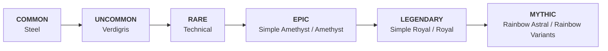

| Rarity Tier | Recommended Theme | Visual Style & Atmosphere |
| :--- | :--- | :--- |
| **Common** | `steel` | Dark industrial slate, clean bracket frame, high contrast white lettering, minimal box stamp. |
| **Uncommon** | `verdigris` | Oxidized copper and deep forest patina, chamfer frame, spring-green accents. |
| **Rare** | `technical` | Classic cyanotype engineering blueprint, drafting grid with measurement ticks, blue wax seal. |
| **Epic** | `simple_amethyst` / `amethyst` | Arcane runic violet, enchanted purple wax seal, subtle mysticism and anvil iconography. |
| **Legendary** | `simple_royal` / `royal` | Gilded amber and gold, ornamental rosette frame, gold wax seal, prestige radiance. |
| **Mythic** | `rainbow_astral` / `rainbow` *(or any rainbow variant)* | Celestial deep void canvas, chromatic rainbow star border, radiant contour glow. |

### Production Tier Configuration Example
Here is a complete, copy-paste production file demonstrating how to organize server tiers using reusable templates and theme presets:

```yaml
# yaml-language-server: $schema=./blueprint.schema.json
# ==============================================================================
# blueprints/tiers/progression_tiers.yml
# ==============================================================================

templates:
  tier_common:
    map:
      theme: steel
    extra:
      tier: "<white>Common</white>"

  tier_uncommon:
    map:
      theme: verdigris
    extra:
      tier: "<green>Uncommon</green>"

  tier_rare:
    map:
      theme: technical
    extra:
      tier: "<aqua>Rare</aqua>"

  tier_epic:
    map:
      theme: simple_amethyst
    extra:
      tier: "<light_purple>Epic</light_purple>"

  tier_legendary:
    map:
      theme: simple_royal
    extra:
      tier: "<gold>Legendary</gold>"

  tier_mythic:
    map:
      theme: rainbow_astral
    extra:
      tier: "<gradient:#FF0080:#7928CA:#00DFD8>Mythic</gradient>"

singles:
  starter_pickaxe:
    blueprint: STONE_PICKAXE
    name: "<white>Mining Apprentice Permit</white>"
    templates: [tier_common]

  ranger_bow:
    blueprint: BOW
    name: "<green>Elven Scout Bow</green>"
    templates: [tier_uncommon]

  diamond_cleaver:
    blueprint: DIAMOND_SWORD
    name: "<aqua>Glacial Frost Cleaver</aqua>"
    templates: [tier_rare]

  void_chestplate:
    blueprint: NETHERITE_CHESTPLATE
    name: "<light_purple>Void Walker Cuirass</light_purple>"
    templates: [tier_epic]

  excalibur_blade:
    blueprint: NETHERITE_SWORD
    name: "<gold>Sovereign Blade</gold>"
    templates: [tier_legendary]

  astral_annihilator:
    blueprint: MACE
    name: "<gradient:#FF0080:#00DFD8>Celestial Star Smasher</gradient>"
    templates: [tier_mythic]
```

---

## 4. Complete Visual Theme Gallery

Every theme below is rendered using the exact same item (`DIAMOND_SWORD`) to allow direct visual comparison of canvas colors, border styles, drafting grids, and authentication seals.

### 4.1 Server Rarity Progression Themes

These themes are calibrated for standard RPG item progression, providing balanced contrast and instant visual recognition across item tiers.

<div class="theme-grid">

  <div class="theme-card">
    
    <h4>Steel</h4>
    <code>theme: steel</code>
    <p>Dark industrial slate canvas with clean bracket corners and crisp white stamp.</p>
  </div>

  <div class="theme-card">
    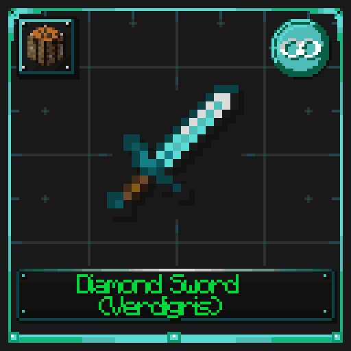
    <h4>Verdigris</h4>
    <code>theme: verdigris</code>
    <p>Oxidized copper patina canvas with chamfer borders and emerald green accents.</p>
  </div>

  <div class="theme-card">
    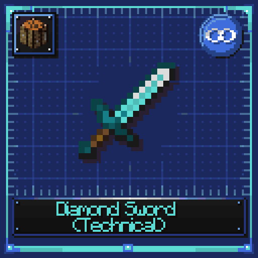
    <h4>Technical</h4>
    <code>theme: technical</code>
    <p>Classic cyanotype engineering blueprint with full drafting grid and coordinate ticks.</p>
  </div>

  <div class="theme-card">
    
    <h4>Lapis</h4>
    <code>theme: lapis</code>
    <p>Deep oceanic navy background with geometric diamond frame and cobalt seal.</p>
  </div>

  <div class="theme-card">
    
    <h4>Simple Amethyst</h4>
    <code>theme: simple_amethyst</code>
    <p>Deep runic violet canvas with arcane border geometry and purple wax seal.</p>
  </div>

  <div class="theme-card">
    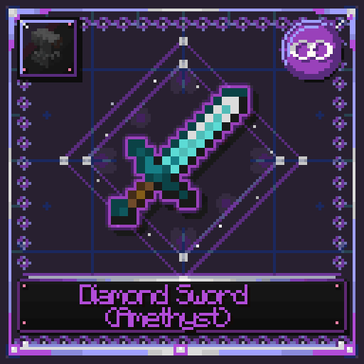
    <h4>Amethyst</h4>
    <code>theme: amethyst</code>
    <p>Void grimoire texture with anvil badge, runic frame, and vibrant magenta glow contour.</p>
  </div>

  <div class="theme-card">
    
    <h4>Simple Royal</h4>
    <code>theme: simple_royal</code>
    <p>Royal dark amber canvas with golden rosette frame, gold wax seal, and gilded aura.</p>
  </div>

  <div class="theme-card">
    
    <h4>Royal</h4>
    <code>theme: royal</code>
    <p>Imperial gold texture with ornate rosette geometry, smithing badge, and golden radiance.</p>
  </div>

</div>

---

### 4.2 Mythic Rainbow Collection

The Mythic collection features chromatic multi-color star frames and iridescent aura contours designed for pinnacle endgame achievements.

<div class="theme-grid">

  <div class="theme-card">
    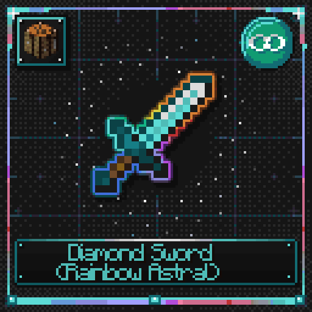
    <h4>Rainbow Astral</h4>
    <code>theme: rainbow_astral</code>
    <p>Deep space void canvas with crafting badge and chromatic rainbow cycling star border.</p>
  </div>

  <div class="theme-card">
    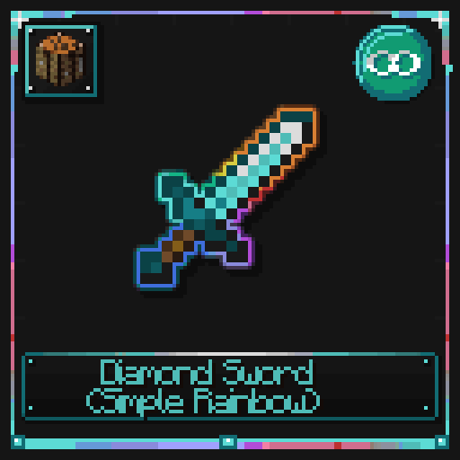
    <h4>Simple Rainbow</h4>
    <code>theme: simple_rainbow</code>
    <p>Clean obsidian dark canvas framed by vibrant chromatic rainbow star borders.</p>
  </div>

  <div class="theme-card">
    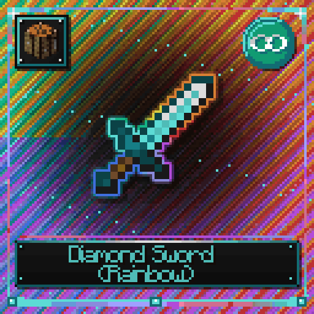
    <h4>Rainbow</h4>
    <code>theme: rainbow</code>
    <p>Full-canvas procedural prism gradient with dynamic rainbow star frame and edge glow.</p>
  </div>

  <div class="theme-card">
    
    <h4>Rainbow Holofoil</h4>
    <code>theme: rainbow_holofoil</code>
    <p>Shimmering holographic foil canvas with cyan-to-rose chromatic gradient frame.</p>
  </div>

  <div class="theme-card">
    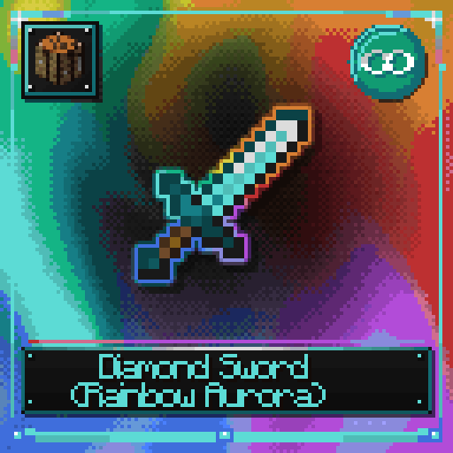
    <h4>Rainbow Aurora</h4>
    <code>theme: rainbow_aurora</code>
    <p>Northern lights sky canvas with celestial cyan tints and vibrant rainbow contour.</p>
  </div>

  <div class="theme-card">
    
    <h4>Rainbow Nebula</h4>
    <code>theme: rainbow_nebula</code>
    <p>Cosmic interstellar lavender canvas with violet glow accents and rainbow contour.</p>
  </div>

  <div class="theme-card">
    
    <h4>Rainbow Bismuth</h4>
    <code>theme: rainbow_bismuth</code>
    <p>Crystalline stepped bismuth hopper crystal canvas with diamond frame geometry.</p>
  </div>

  <div class="theme-card">
    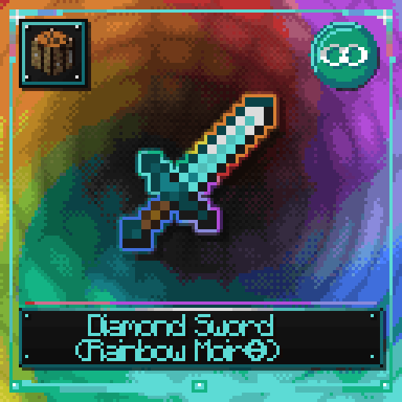
    <h4>Rainbow Moire</h4>
    <code>theme: rainbow_moire</code>
    <p>Optical wave interference pattern with seafoam teal star border and rainbow glow.</p>
  </div>

</div>

---

### 4.3 Thematic & Workstation Presets

These presets capture specific environmental and gameplay themes, such as desert ruins, subterranean forges, frozen glaciers, or nether blood altars.

<div class="theme-grid">

  <div class="theme-card">
    
    <h4>Forge</h4>
    <code>theme: forge</code>
    <p>Volcanic iron canvas with blazing orange chamfer border and fiery wax seal.</p>
  </div>

  <div class="theme-card">
    
    <h4>Desert</h4>
    <code>theme: desert</code>
    <p>Weathered antique parchment with warm earth-brown chamfer borders and antique seal.</p>
  </div>

  <div class="theme-card">
    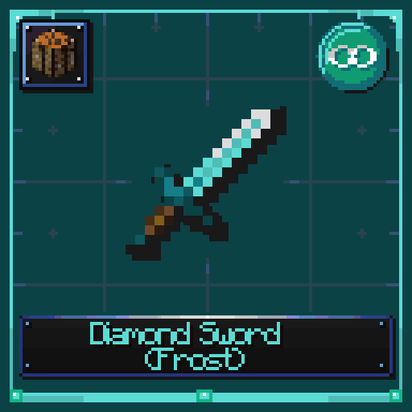
    <h4>Frost</h4>
    <code>theme: frost</code>
    <p>Arctic glacial blue canvas with frozen cyan diamond geometry and icy wax seal.</p>
  </div>

  <div class="theme-card">
    
    <h4>Crimson</h4>
    <code>theme: crimson</code>
    <p>Nether blood forge canvas with fiery red runic borders and crimson wax seal.</p>
  </div>

  <div class="theme-card">
    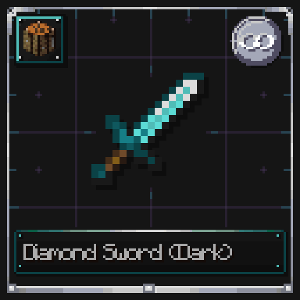
    <h4>Dark</h4>
    <code>theme: dark</code>
    <p>Minimal stealth charcoal canvas with slate gray chamfer borders and subtle box stamp.</p>
  </div>

  <div class="theme-card">
    
    <h4>Emerald</h4>
    <code>theme: emerald</code>
    <p>Lush forest emerald canvas with spring green chamfer borders and emerald seal.</p>
  </div>

  <div class="theme-card">
    
    <h4>Astral</h4>
    <code>theme: astral</code>
    <p>Celestial deep space void canvas with cyan star border, crafting badge, and cyan seal.</p>
  </div>

</div>

---

## 5. Free Base Edition vs. Extended Supporter Edition

CraftingBlueprints is developed with a clear philosophy: **the core plugin and all gameplay progression features are 100% free and accessible for everyone**. All built-in map themes, workstation tracking, recipe restrictions, and database sync will always remain completely free in the base edition.

The **Extended Edition** is available for server administrators and community members who want to **support the ongoing development of the project**, unlocking advanced artistic and cosmetic customization:

| Capability | Base Edition (Free for Everyone) | Extended Edition (Supporter Upgrade) | Documentation Reference |
| :--- | :---: | :---: | :--- |
| **In-game Map Rendering** (`images-on-maps: true`) | :white_check_mark: 100% Free | :white_check_mark: Included | This page |
| **All Built-In Theme Presets** (`theme: <name>`) | :white_check_mark: 100% Free | :white_check_mark: Included | This page |
| **Automated Durability Stamps** (Uses, Time, $\infty$) | :white_check_mark: Preset Styles | :white_check_mark: Fully Customizable | [Durability & Limits](durability-and-limits.md) |
| **Flyweight Map ID Optimization** (Zero world bloat) | :white_check_mark: 100% Free | :white_check_mark: Included | [Storage Overview](../storage/sqlite-storage.md) |
| **Custom 128x128 PNG Backgrounds** (`background_image`) | :x: | :white_check_mark: Supporter Feature | [Extended Backgrounds](../extended/backgrounds-and-textures.md) |
| **Algorithmic Guilloché Security Rosettes** | :x: | :white_check_mark: Supporter Feature | [Extended Frames](../extended/frames-and-stamps.md) |
| **Bayer 4x4 Typography Gradient Shading** | :x: | :white_check_mark: Supporter Feature | [Extended Typography](../extended/typography-and-contours.md) |
| **Procedural Item Outline Glows** (`outline_color`) | :x: *(Theme preset defaults)* | :white_check_mark: Supporter Feature | [Extended Contours](../extended/typography-and-contours.md) |
| **Bespoke Wax Seal Text & Temporal Capsules** | :x: *(Preset defaults)* | :white_check_mark: Supporter Feature | [Extended Stamps](../extended/frames-and-stamps.md) |

---

## 6. High-Performance Architecture (Zero World Bloat)

In Minecraft, creating new map items naively via standard server APIs allocates sequential map IDs (Map #1, Map #2, Map #3...), generating a separate `map_<id>.dat` file on disk for every item held by a player. If 1,000 players craft blueprints, a naive server generates thousands of redundant files, leading to severe world save bloat and backup bottlenecks.

### The Flyweight Map Registry Solution
CraftingBlueprints uses an internal **Flyweight Map Registry**:

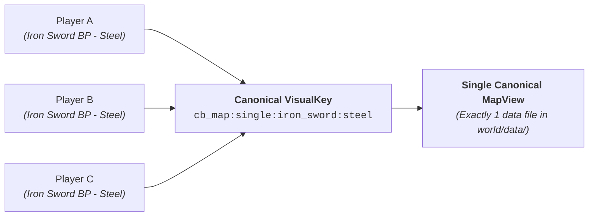

* **One MapView per Distinct Aesthetic**: All players holding an `iron_sword` blueprint configured with the `steel` theme share the exact same underlying `MapView`.
* **Zero World Bloat**: No matter how many thousands of blueprints are distributed across your player base, the number of map IDs on your server remains strictly equal to the number of distinct blueprints you configured.
* **Asynchronous Compositing**: Map palette byte buffers (`byte[16384]`) are composited on asynchronous background threads, ensuring zero main-thread tick lag during player crafting or login.

---

## 7. Diagnostics & Administration

Validate your theme configurations without restarting your server:

```text
/cb validate
```

If a blueprint declares an invalid or mistyped theme name, the validator warns you immediately and suggests the closest valid theme. Blueprints safely fall back to the default `technical` theme if an unknown key is entered.

To reload updated configurations in real-time:

```text
/cb reload
```
