# Map Blueprints & Theme Presets

CraftingBlueprints allows physical blueprint items to be rendered directly onto in-game Minecraft maps (`Material.FILLED_MAP`). Rather than handing players ordinary paper or generic icons, players hold tactile, photorealistic technical schematics complete with architectural grids, coordinate crosshairs, ornamental borders, and wax authentication seals.

**Crucially, in-game map blueprints are supported in both CraftingBlueprints Standard Edition and Extended Edition.**

* **Standard Edition (Theme Presets)**: You can render blueprints on in-game maps by applying any of the **26 pre-calibrated theme presets** (`map: { theme: <name> }`). Themes automatically configure harmonious backgrounds, borders, grids, badges, and wax seals with zero manual graphic design.
* **Extended Edition (Deep Technical Drafting)**: Unlocks layer-by-layer granular customization, including importing custom $128\times128$ PNG backgrounds, custom Guilloché mathematical rosettes, custom stamp text, and Bayer $4\times 4$ dithered typography gradients.

---

## 1. Enabling In-Game Map Blueprints

To render physical blueprints as maps, enable the map graphics engine in your server's `plugins/CraftingBlueprints/config.yml`:

```yaml
# ==============================================================================
# MAP GRAPHICS & DRAFTING ENGINE
# ==============================================================================
# When true, physical blueprints are represented as in-game filled maps.
# Blueprints without an explicit map: block use the "technical" cyanotype default.
images-on-maps: true
```

After modifying `config.yml`, execute `/cb reload` or restart your server.

!!! tip "Zero Resource Packs Required"
    Map rendering operates entirely server-side using native Minecraft palette packets (`byte[16384]`). Players do not need to install client-side resource packs, mods, OptiFine, or custom item textures.

---

## 2. Configuring Themes in Blueprint YAML

To assign a visual theme to any blueprint, declare the `map:` configuration block with `theme:`:

```yaml
# yaml-language-server: $schema=./blueprint.schema.json
# ==============================================================================
# blueprints/weapons/iron_sword.yml
# ==============================================================================

singles:
  iron_broadsword_blueprint:
    blueprint: IRON_SWORD
    name: "<white><bold>Iron Broadsword Blueprint</bold></white>"
    lore:
      - "<gray>Standard infantry armory schematic.</gray>"
      - "<dark_gray>Common tier forging permit.</dark_gray>"
    permanent: true
    map:
      theme: steel      # Assigns the dark slate 'Steel' theme preset
```

### Compact Inline Syntax
You can also specify the theme name directly as an inline scalar:

```yaml
singles:
  iron_broadsword_blueprint:
    blueprint: IRON_SWORD
    map: steel
```

### Cascading Themes via Folder & File Defaults
You can set a default theme for an entire directory or category folder using `default:` or `file_default:`. All blueprints within that file or folder will inherit the theme automatically:

```yaml
# yaml-language-server: $schema=./blueprint.schema.json
# blueprints/armor/defaults.yml
default:
  map:
    theme: verdigris    # All armor blueprints in this folder use 'verdigris'
```

---

## 3. Recommended Server Rarity Tier Progression

To establish a clear, immersive progression hierarchy across your server, CraftingBlueprints provides tailored themes for every loot tier. Below is the recommended canonical configuration:

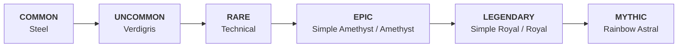

| Rarity Tier | Recommended Theme | Alternative Presets | Visual Style & Atmosphere |
| :--- | :--- | :--- | :--- |
| **Common** | `steel` | `technical_slate`, `dark` | Dark industrial slate, clean bracket frame, high contrast white lettering, minimal box stamp. |
| **Uncommon** | `verdigris` | `emerald`, `verdigris_botanical` | Oxidized copper and deep forest patina, chamfer frame, spring-green accents. |
| **Rare** | `technical` | `lapis`, `frost` | Classic cyanotype engineering blueprint, drafting grid with measurement ticks, blue wax seal. |
| **Epic** | `simple_amethyst` | `amethyst`, `void_grimoire`, `crimson` | Arcane runic violet, enchanted purple wax seal, subtle mysticism and anvil iconography. |
| **Legendary** | `simple_royal` | `royal`, `gold`, `imperial_gold` | Gilded amber and gold, ornamental rosette frame, gold wax seal, prestige radiance. |
| **Mythic** | `rainbow_astral` | `rainbow`, `rainbow_holofoil`, `rainbow_aurora` | Celestial deep void canvas, chromatic rainbow star border, radiant contour glow. |

### Production Tier Configuration Example
Here is a complete, copy-paste production file demonstrating how to organize server tiers using reusable templates and theme presets:

```yaml
# yaml-language-server: $schema=./blueprint.schema.json
# ==============================================================================
# blueprints/tiers/progression_tiers.yml
# ==============================================================================

templates:
  tier_common:
    map:
      theme: steel
    extra:
      tier: "<white>Common</white>"

  tier_uncommon:
    map:
      theme: verdigris
    extra:
      tier: "<green>Uncommon</green>"

  tier_rare:
    map:
      theme: technical
    extra:
      tier: "<aqua>Rare</aqua>"

  tier_epic:
    map:
      theme: simple_amethyst
    extra:
      tier: "<light_purple>Epic</light_purple>"

  tier_legendary:
    map:
      theme: simple_royal
    extra:
      tier: "<gold>Legendary</gold>"

  tier_mythic:
    map:
      theme: rainbow_astral
    extra:
      tier: "<gradient:#FF0080:#7928CA:#00DFD8>Mythic</gradient>"

singles:
  starter_pickaxe:
    blueprint: STONE_PICKAXE
    name: "<white>Mining Apprentice Permit</white>"
    templates: [tier_common]

  ranger_bow:
    blueprint: BOW
    name: "<green>Elven Scout Bow</green>"
    templates: [tier_uncommon]

  diamond_cleaver:
    blueprint: DIAMOND_SWORD
    name: "<aqua>Glacial Frost Cleaver</aqua>"
    templates: [tier_rare]

  void_chestplate:
    blueprint: NETHERITE_CHESTPLATE
    name: "<light_purple>Void Walker Cuirass</light_purple>"
    templates: [tier_epic]

  excalibur_blade:
    blueprint: NETHERITE_SWORD
    name: "<gold>Sovereign Blade</gold>"
    templates: [tier_legendary]

  astral_annihilator:
    blueprint: MACE
    name: "<gradient:#FF0080:#00DFD8>Celestial Star Smasher</gradient>"
    templates: [tier_mythic]
```

---

## 4. Complete Visual Theme Gallery (26 Themes)

Every theme below is rendered using the exact same item (`DIAMOND_SWORD`) to allow direct visual comparison of canvas colors, border styles, drafting grids, and authentication seals.

### 4.1 Server Rarity Progression Themes

These themes are calibrated for standard RPG item progression, providing balanced contrast and instant visual recognition across item tiers.

| Preview | Theme & Identifiers | Aesthetic Parameters | Recommended In-Game Use |
| :---: | :--- | :--- | :--- |
| 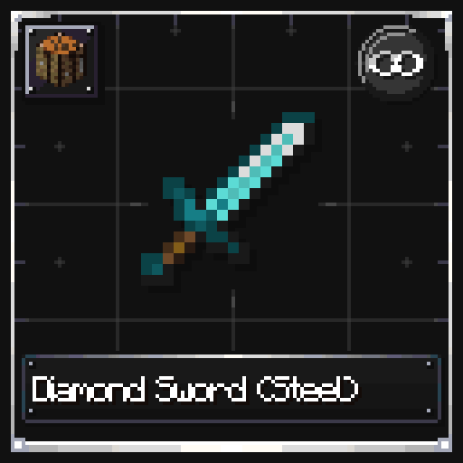{ width="160" } | **Steel**<br/>`theme: steel`<br/>*Aliases:* `common`, `tier_common`, `technical_slate` | • **Canvas:** Deep slate `#101010`<br/>• **Frame:** Bracket `#cbd5e1`<br/>• **Grid:** Charcoal `#2F2E2E` (ticks & reticle)<br/>• **Stamp:** White Box `[INF]` | **Common Tier**: Stone/Iron equipment, apprentice tools, basic permits. |
| { width="160" } | **Verdigris**<br/>`theme: verdigris`<br/>*Aliases:* `uncommon`, `tier_uncommon`, `verdigris_botanical` | • **Canvas:** Forest patina `#0c261c`<br/>• **Frame:** Chamfer `#34d399`<br/>• **Title:** Emerald green<br/>• **Stamp:** Green Box `[INF]` | **Uncommon Tier**: Copper/Bronze gear, bows, utility tools, herbalism. |
| { width="160" } | **Technical**<br/>`theme: technical`<br/>*Aliases:* `blueprint`, `cyanotype` | • **Canvas:** Cyanotype navy `#122a54`<br/>• **Frame:** Diamond `#38bdf8`<br/>• **Grid:** Full drafting grid & coordinate ticks<br/>• **Stamp:** Blue Wax Seal `(∞)` | **Rare Tier**: Diamond equipment, Redstone mechanisms, Crafter schematics. |
| 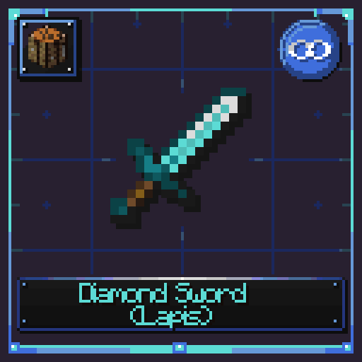{ width="160" } | **Lapis**<br/>`theme: lapis`<br/>*Aliases:* `rare`, `tier_rare`, `nautical_astrolabe` | • **Canvas:** Deep oceanic navy `#0e1c3a`<br/>• **Frame:** Diamond `#60a5fa`<br/>• **Title:** Aqua blue<br/>• **Stamp:** Cobalt Wax Seal `(∞)` | **Rare Tier Alternative**: Nautical exploration, Tridents, Turtle master gear. |
| 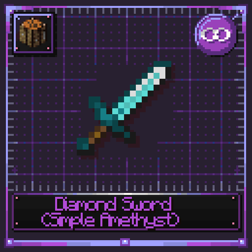{ width="160" } | **Simple Amethyst**<br/>`theme: simple_amethyst`<br/>*Aliases:* `runic`, `mystery`, `arcane` | • **Canvas:** Deep runic violet `#360647`<br/>• **Frame:** Runic `#A46BDC`<br/>• **Grid:** Violet `#460857`<br/>• **Stamp:** Purple Wax Seal `(∞)` | **Epic Tier**: Enchantment schematics, potion brewing, arcane mystery scrolls. |
| { width="160" } | **Amethyst**<br/>`theme: amethyst`<br/>*Aliases:* `epic`, `tier_epic`, `void_grimoire` | • **Canvas:** Void grimoire `#1c183c`<br/>• **Frame:** Runic `#c084fc`<br/>• **Badge:** Anvil icon<br/>• **Outline:** Magenta glow contour (`#D416FF`) | **Epic Tier Elite**: Master anvil forging, Netherite upgrades, grimoires. |
| 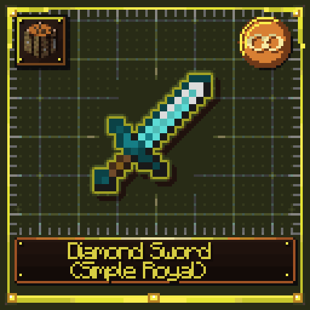{ width="160" } | **Simple Royal**<br/>`theme: simple_royal`<br/>*Aliases:* `royal_blue` | • **Canvas:** Royal amber `#2B280D`<br/>• **Frame:** Rosette `#facc15`<br/>• **Outline:** Gilded aura `#BBC01B`<br/>• **Stamp:** Gold Wax Seal `(∞)` | **Legendary Tier**: Sovereign armor, royal armory bundles, high-value weapons. |
| 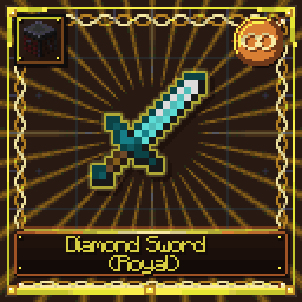{ width="160" } | **Royal**<br/>`theme: royal`<br/>*Aliases:* `legendary`, `tier_legendary`, `gold`, `imperial_gold` | • **Canvas:** Imperial gold texture `#28200c`<br/>• **Frame:** Ornate Rosette `#facc15`<br/>• **Badge:** Smithing icon<br/>• **Outline:** Gold radiance (`#ECF15B`) | **Legendary Tier Elite**: Server boss relics, custom artifacts, royal crown gear. |

---

### 4.2 Mythic Rainbow Collection

The Mythic collection features chromatic multi-color star frames and iridescent aura contours designed for pinnacle endgame achievements.

| Preview | Theme & Identifiers | Aesthetic Parameters | Recommended In-Game Use |
| :---: | :--- | :--- | :--- |
| { width="160" } | **Rainbow Astral**<br/>`theme: rainbow_astral` | • **Canvas:** Celestial void `#05141c`<br/>• **Frame:** Star (Rainbow chromatic cycling)<br/>• **Badge:** Crafting table<br/>• **Outline:** Dynamic rainbow contour | **Mythic Tier Primary**: Universal endgame weapons, omni-tools, supreme rewards. |
| { width="160" } | **Simple Rainbow**<br/>`theme: simple_rainbow` | • **Canvas:** Obsidian dark `#0e1222`<br/>• **Frame:** Star (Rainbow chromatic border)<br/>• **Stamp:** Cyan Box `[INF]`<br/>• **Outline:** Dynamic rainbow contour | **Mythic Tier Clean**: Clean dark aesthetic with vibrant rainbow accents. |
| { width="160" } | **Rainbow**<br/>`theme: rainbow`<br/>*Aliases:* `mythic`, `tier_mythic` | • **Canvas:** Procedural prism gradient<br/>• **Frame:** Star (Rainbow border)<br/>• **Stamp:** Cyan Wax Seal `(∞)`<br/>• **Outline:** Rainbow edge glow | **Mythic Tier Classic**: Full-canvas chromatic brilliance, crate jackpot prizes. |
| 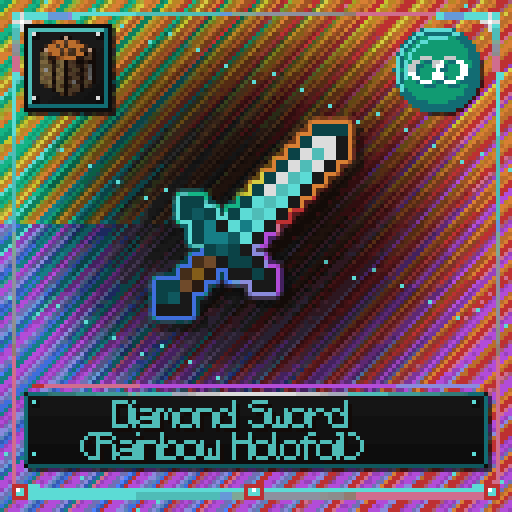{ width="160" } | **Rainbow Holofoil**<br/>`theme: rainbow_holofoil`<br/>*Aliases:* `holofoil`, `mythic_holofoil` | • **Frame:** Prismatic foil `#00f5ff` to `#f43f5e`<br/>• **Canvas:** Shimmering holographic foil<br/>• **Outline:** Rainbow contour | **Collectible / Event Tier**: Limited-edition event items, holographic trading cards. |
| { width="160" } | **Rainbow Aurora**<br/>`theme: rainbow_aurora`<br/>*Aliases:* `aurora`, `mythic_aurora` | • **Canvas:** Northern lights sky `#38bdf8`<br/>• **Frame:** Star border with aurora tint<br/>• **Outline:** Rainbow contour | **Celestial Tier**: Flying mounts, Elytras, celestial staves, winter holiday drops. |
| 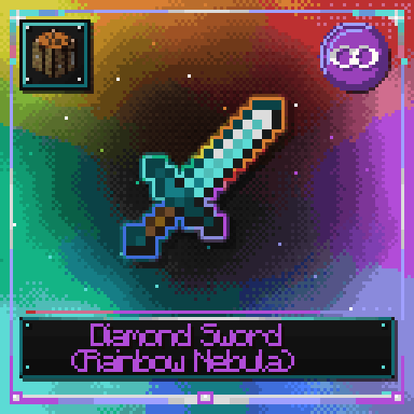{ width="160" } | **Rainbow Nebula**<br/>`theme: rainbow_nebula`<br/>*Aliases:* `nebula`, `mythic_nebula` | • **Canvas:** Cosmic interstellar lavender `#c084fc`<br/>• **Frame:** Star border with violet glow<br/>• **Outline:** Rainbow contour | **Cosmic Tier**: Dimensional portal keys, End City conqueror schematics. |
| 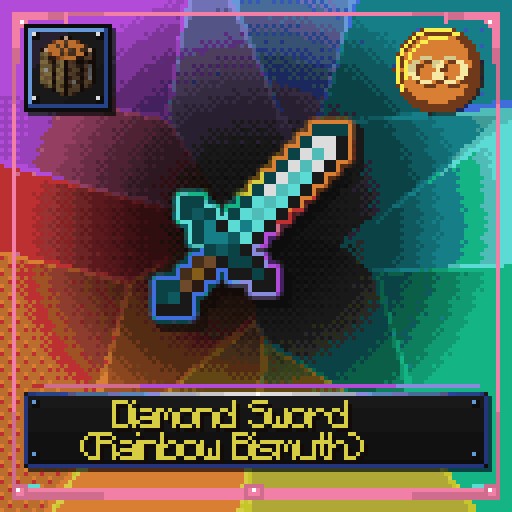{ width="160" } | **Rainbow Bismuth**<br/>`theme: rainbow_bismuth`<br/>*Aliases:* `bismuth`, `mythic_bismuth` | • **Canvas:** Crystalline stepped hopper crystals<br/>• **Frame:** Diamond `#f472b6`<br/>• **Stamp:** Gold Wax Seal `(∞)` | **Crystal / Gem Tier**: Custom jewelcrafting, socketed gear, alchemy elixirs. |
| { width="160" } | **Rainbow Moire**<br/>`theme: rainbow_moire`<br/>*Aliases:* `moire`, `mythic_moire` | • **Canvas:** Optical wave interference pattern<br/>• **Frame:** Star border with teal accent `#2dd4bf`<br/>• **Outline:** Rainbow contour | **Temporal / Arcane Tier**: Time-warp gear, warp scrolls, dimension keys. |

---

### 4.3 Thematic & Workstation Presets

These presets capture specific environmental and gameplay themes, such as desert ruins, subterranean forges, frozen glaciers, or nether blood altars.

| Preview | Theme & Identifiers | Aesthetic Parameters | Recommended In-Game Use |
| :---: | :--- | :--- | :--- |
| 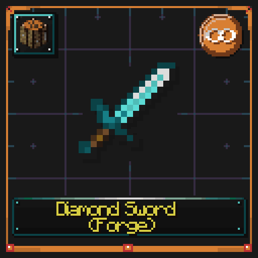{ width="160" } | **Forge**<br/>`theme: forge`<br/>*Aliases:* `dwarven`, `dwarven_forge` | • **Canvas:** Volcanic iron `#1e1e24`<br/>• **Frame:** Chamfer blazing orange `#f97316`<br/>• **Stamp:** Ember Wax Seal `#ea580c` | Blast Furnace schematics, fiery weapons, heavy blacksmithing. |
| 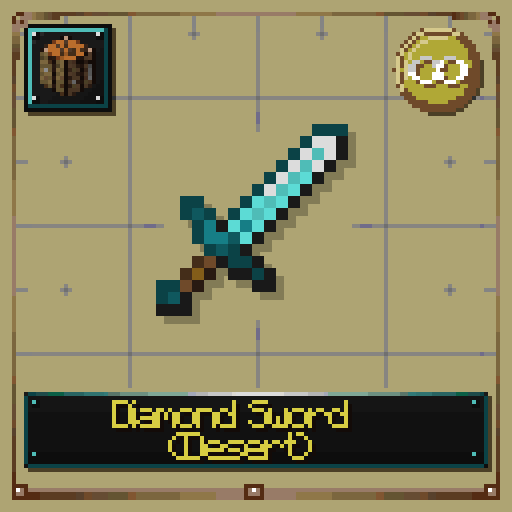{ width="160" } | **Desert**<br/>`theme: desert`<br/>*Aliases:* `antique`, `parchment`, `sandstone`, `cartography` | • **Canvas:** Weathered parchment `#bcac84`<br/>• **Frame:** Chamfer earth-brown `#705634`<br/>• **Stamp:** Antique Gold Wax Seal `#c49a45` | Ancient ruins, archaeology brushes, treasure maps, RPG scrolls. |
| { width="160" } | **Frost**<br/>`theme: frost`<br/>*Aliases:* `glacial` | • **Canvas:** Arctic glacial blue `#103542`<br/>• **Frame:** Diamond ice-cyan `#22d3ee`<br/>• **Stamp:** Cyan Wax Seal | Ice magic, snowy biome loot, frost walker gear. |
| 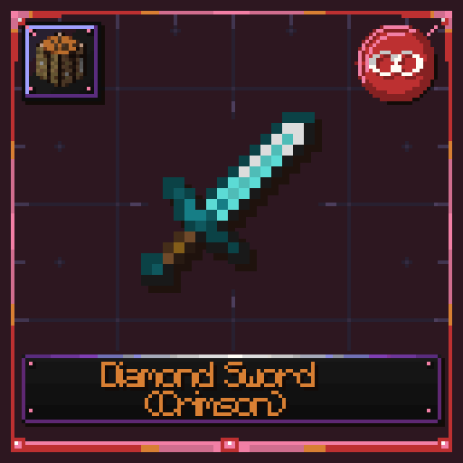{ width="160" } | **Crimson**<br/>`theme: crimson`<br/>*Aliases:* `blood_forge` | • **Canvas:** Nether crimson `#361618`<br/>• **Frame:** Runic blood-red `#ef4444`<br/>• **Stamp:** Crimson Wax Seal | Nether fortress loot, blood magic, berserker axes. |
| { width="160" } | **Dark**<br/>`theme: dark`<br/>*Aliases:* `dark_fantasy`, `carbon`, `slate` | • **Canvas:** Minimal charcoal `#14151a`<br/>• **Frame:** Chamfer steel-gray `#94a3b8`<br/>• **Stamp:** Slate Gray Box `[INF]` | Stealth equipment, assassin daggers, OP Prison permits. |
| 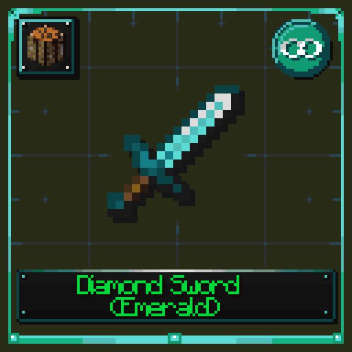{ width="160" } | **Emerald**<br/>`theme: emerald`<br/>*Aliases:* `botanical` | • **Canvas:** Deep emerald `#122e1c`<br/>• **Frame:** Chamfer vibrant green `#34d399`<br/>• **Stamp:** Emerald Wax Seal | Village trade blueprints, farming gear, nature alchemy. |
| 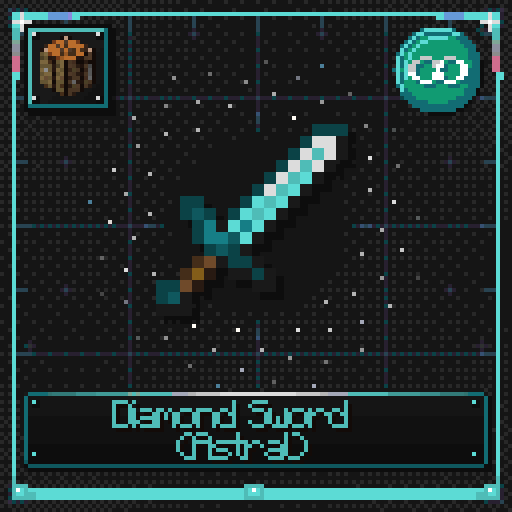{ width="160" } | **Astral**<br/>`theme: astral` | • **Canvas:** Deep space void `#05141c`<br/>• **Frame:** Star border cyan `#67e8f9`<br/>• **Stamp:** Cyan Wax Seal | Star charting, Beacon upgrades, Elytra forging. |
| 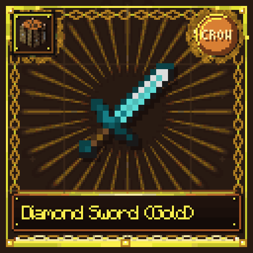{ width="160" } | **Gold**<br/>`theme: gold` *(Resolves to Royal)* | • **Canvas:** Imperial gold texture<br/>• **Frame:** Ornate Rosette `#facc15`<br/>• **Stamp:** Gold Wax Seal | Guild master rewards, luxury casino prizes. |
| 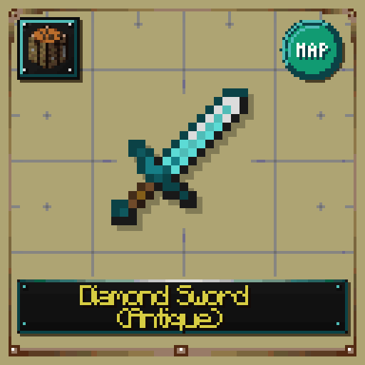{ width="160" } | **Antique**<br/>`theme: antique` *(Resolves to Desert)* | • **Canvas:** Weathered parchment `#bcac84`<br/>• **Frame:** Chamfer earth-brown `#705634`<br/>• **Stamp:** Wax Seal `#c49a45` | Ancient civilization relics, dungeon library discoveries. |
| 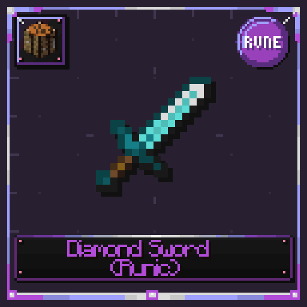{ width="160" } | **Runic**<br/>`theme: runic` *(Resolves to Simple Amethyst)* | • **Canvas:** Runic purple `#360647`<br/>• **Frame:** Runic violet `#A46BDC`<br/>• **Stamp:** Purple Wax Seal | Enchanting permits, mysterious scrolls, spell catalysts. |

---

## 5. Standard Edition vs. Extended Edition Boundaries

To keep administrative workflows simple and predictable, CraftingBlueprints cleanly delineates what is possible in the Standard Edition versus the Extended Edition:

| Capability | Standard Edition | Extended Edition | Documentation Reference |
| :--- | :---: | :---: | :--- |
| **In-game Map Rendering** (`images-on-maps: true`) | :white_check_mark: Supported | :white_check_mark: Supported | This page |
| **26 Built-In Theme Presets** (`theme: <name>`) | :white_check_mark: Supported | :white_check_mark: Supported | This page |
| **Automated Durability Stamps** (Uses, Time, $\infty$) | :white_check_mark: Preset Styles | :white_check_mark: Fully Customizable | [Durability & Limits](durability-and-limits.md) |
| **Flyweight Map ID Optimization** (Zero world bloat) | :white_check_mark: Supported | :white_check_mark: Supported | [Storage Overview](../storage/sqlite-storage.md) |
| **Custom 128x128 PNG Backgrounds** (`background_image`) | :x: | :white_check_mark: Supported | [Extended Backgrounds](../extended/backgrounds-and-textures.md) |
| **Algorithmic Guilloché Security Rosettes** | :x: | :white_check_mark: Supported | [Extended Frames](../extended/frames-and-stamps.md) |
| **Bayer 4x4 Typography Gradient Shading** | :x: | :white_check_mark: Supported | [Extended Typography](../extended/typography-and-contours.md) |
| **Procedural Item Outline Glows** (`outline_color`) | :x: *(Theme preset defaults)* | :white_check_mark: Granular Math | [Extended Contours](../extended/typography-and-contours.md) |
| **Bespoke Wax Seal Text & Temporal Capsules** | :x: *(Preset defaults)* | :white_check_mark: Fully Customizable | [Extended Stamps](../extended/frames-and-stamps.md) |

---

## 6. High-Performance Architecture (Zero World Bloat)

In Minecraft, creating new map items naively via standard server APIs allocates sequential map IDs (Map #1, Map #2, Map #3...), generating a separate `map_<id>.dat` file on disk for every item held by a player. If 1,000 players craft blueprints, a naive server generates thousands of redundant files, leading to severe world save bloat and backup bottlenecks.

### The Flyweight Map Registry Solution
CraftingBlueprints uses an internal **Flyweight Map Registry**:

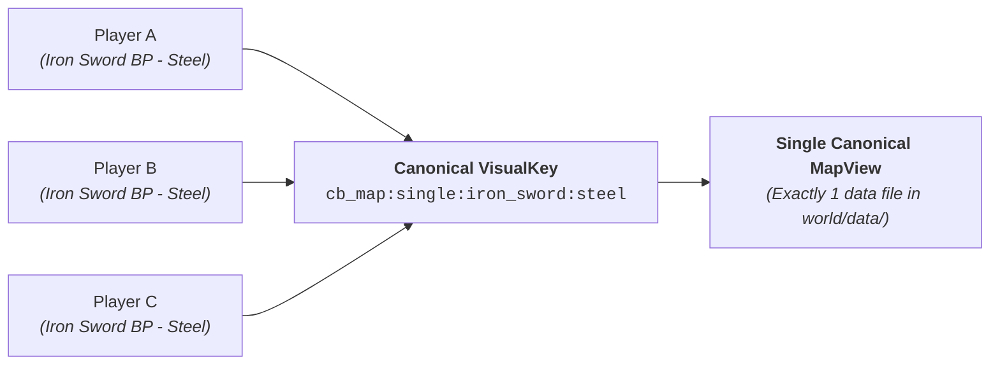

* **One MapView per Distinct Aesthetic**: All players holding an `iron_sword` blueprint configured with the `steel` theme share the exact same underlying `MapView`.
* **Zero World Bloat**: No matter how many thousands of blueprints are distributed across your player base, the number of map IDs on your server remains strictly equal to the number of distinct blueprints you configured.
* **Asynchronous Compositing**: Map palette byte buffers (`byte[16384]`) are composited on asynchronous background threads, ensuring zero main-thread tick lag during player crafting or login.

---

## 7. Diagnostics & Administration

Validate your theme configurations without restarting your server:

```text
/cb validate
```

If a blueprint declares an invalid or mistyped theme name (e.g. `theme: stel`), the validator warns you immediately and suggests the closest valid theme (e.g. `steel`). Blueprints safely fall back to the default `technical` theme if an unknown key is entered.

To reload updated configurations in real-time:

```text
/cb reload
```
