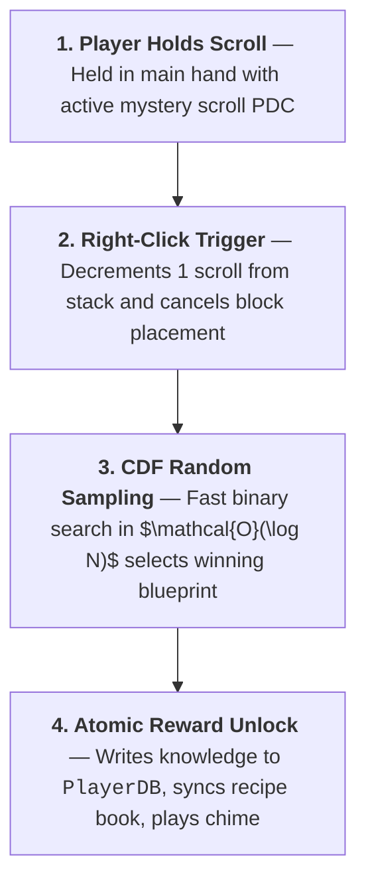

# Arcane Mystery Scrolls & Crate Rolls

Mystery scrolls (`mysteries:`, domain type 2 / `MYSTERY_TYPE`) are rollable items that grant a random blueprint from a weighted probability pool when right-clicked by a player.

Unlike static packages that unlock fixed items, mystery scrolls introduce excitement, RNG risk-reward loops, and jackpot mechanics. They are designed for dungeon loot chests, trial chambers, world boss drops, seasonal crate keys, and vote rewards.

---

## Declaring a Mystery Scroll (`mysteries:`)

Mystery scrolls are declared under the `mysteries:` section of any blueprint configuration file.

```yaml
# yaml-language-server: $schema=./blueprint.schema.json
# ==============================================================================
# CraftingBlueprints - Arcane Mystery Scrolls Configuration
# ==============================================================================

mysteries:
  # ----------------------------------------------------------------------------
  # Ancient Bastion Mystery Scroll (Dungeon Tier Loot)
  # ----------------------------------------------------------------------------
  bastion_mystery_scroll:
    name: "<yellow><bold>Ancient Bastion Mystery Scroll</bold></yellow>"
    lore:
      - "<gray>An enchanted, unrevealed schematic sealed by piglin mages."
      - "<gray>Right-click in hand to break the magical seal and roll a reward!"
      - ""
      - "<yellow>Possible Rewards:</yellow> <white>{pool_size} Schematics</white>"
      - "<yellow>Rarity Tier:</yellow> <gold>{tier}</gold>"
      - ""
      - "<green>Shop Price:</green> <gold>${price}</gold>"
      - "<dark_gray>Single use. Consumed upon rolling.</dark_gray>"
    price: 15000.0
    sell_price: 3750.0
    item:
      material: BOOK
      custom_model_data: 6001
      glowing: true
    extra:
      tier: "MYTHIC"
      category: "mystery_scrolls"
    pool:
      # Common Reward (~60% chance)
      - id: diamond_pickaxe_permit
        weight: 60

      # Uncommon Reward (~25% chance)
      - weight: 25
        blueprint: DIAMOND_CHESTPLATE
        name: "<aqua>Diamond Chestplate Schematic</aqua>"
        permanent: true
        uses: 0

      # Rare Reward (~12% chance)
      - id: speed_alchemy_pass
        weight: 12

      # Mythic Jackpot Reward (~3% chance)
      - id: netherite_chestplate_blueprint
        weight: 3
```

---

## Cumulative Distribution Sampling (CDF)

To prevent statistical bias and guarantee high performance even with hundreds of pool entries, CraftingBlueprints evaluates rolls using **Cumulative Distribution Function (CDF) Sampling**:

$$\text{Total Pool Weight } W = \sum_{i=1}^{N} w_i$$

$$\text{Individual Probability } P(i) = \frac{w_i}{W} \times 100\%$$

```
Weighted Pool Distribution:
  Item 1 (diamond_pickaxe_permit):    weight: 60  ->  60 / 100 = 60.0%
  Item 2 (diamond_chestplate):        weight: 25  ->  25 / 100 = 25.0%
  Item 3 (speed_alchemy_pass):        weight: 12  ->  12 / 100 = 12.0%
  Item 4 (netherite_chestplate):      weight: 3   ->   3 / 100 =  3.0%
  ---------------------------------------------------------------------
  Total Pool Weight (W):                     100               100.0%
```

### High-Performance $O(\log N)$ Sampling

Rather than performing slow linear iteration, CraftingBlueprints compiles the weights into a prefix-sum array and uses **binary search**:

```
Prefix Sum Array: [ 60, 85, 97, 100 ]
Random Sample r in [0, 100):
  If r = 72 -> Binary search locates bucket index 1 (DIAMOND_CHESTPLATE).
```

This guarantees $\mathcal{O}(\log N)$ rolling performance, ensuring that even large community crate pools execute in microseconds without impacting server tick rates (TPS).

---

## Referenced vs. Inline Pool Rewards

Just like packages, mystery scroll reward pools support both referenced IDs and inline blueprint definitions:

```yaml
pool:
  # 1. Reference an existing single blueprint ID
  - id: diamond_pickaxe_permit
    weight: 60

  # 2. Reference an existing package bundle ID
  - id: blacksmith_master_pack
    weight: 5

  # 3. Define an inline single blueprint directly inside the pool
  - weight: 25
    blueprint: NETHERITE_SWORD
    name: "<red><bold>Flame-Forged Netherite Blade</bold></red>"
    permanent: false
    uses: 5
    station: CRAFTING_TABLE
```

!!! note "Packages Inside Mystery Rolls"
    If a mystery roll lands on a referenced package item (such as `blacksmith_master_pack` above), the player unlocks all blueprints bundled within that package simultaneously!

---

## Right-Click Redemption & Player UX

When a player acquires an Arcane Mystery Scroll, the rolling workflow is smooth, tactile, and secure:



1. **Anti-Dupe Validation**: CraftingBlueprints verifies that the item in hand carries the persistent NBT identifier `MYSTERY_TYPE` and consumes exactly 1 item before triggering the roll.
2. **Audio-Visual Feedback**: Upon redemption, the player hears an experience orb / dragon breath chime, accompanied by magical enchantment particle rings.
3. **Chat Announcement**: The player receives a formatted MiniMessage announcement displaying the exact schematic won.

---

## Dynamic Lore Indicators

Mystery scrolls support special dynamic placeholders in their `lore:` block:

| Placeholder | Description | Example Output |
| :--- | :--- | :--- |
| `{pool_size}` | Total count of reward options in the pool. | `4 Schematics` |
| `{price}` | Vault purchase price. | `15000.00` |
| `{sell_price}` | Vault sell value. | `3750.00` |

---

## Administrative Commands

### Giving Mystery Scrolls
To give a mystery scroll to a player via console, quest reward script, or crate engine:

```text
/cb give <player> <mystery_id> [amount]
```

#### Example:
```text
/cb give Steve bastion_mystery_scroll 2
```

Steve receives two physical `Ancient Bastion Mystery Scroll` items, which stack cleanly up to 64 in his inventory.

!!! tip "World Loot & Dungeon Injection"
    Mystery scrolls can be injected directly into natural dungeon chests, Nether Fortress corridors, and 1.21 Trial Chamber vaults using the World Loot Table engine (`plugins/CraftingBlueprints/loot.yml`).
