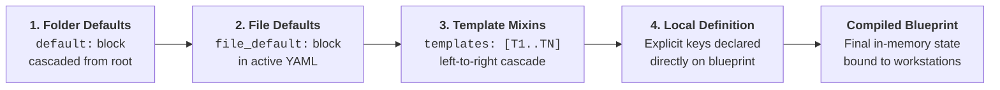

# Reusable Templates (Mixins) & Scoping

Authoring dozens of blueprints with identical visual models, price structures, and expiration rules leads to configuration bloat and maintenance errors. If you decide to adjust a tier's price or change a resource pack model ID, editing 50 separate blueprint files is error-prone.

CraftingBlueprints solves this with a **Declarative Template Composition Engine**. You can author modular template mixins, combine them via multi-template inheritance, and rely on deterministic deep-merge precedence.

---

## Defining Templates (`templates:`)

Templates are non-instantiated configuration blocks defined under a `templates:` section. They can reside at the top of any blueprint file or inside dedicated template files (e.g., `blueprints/templates/global_templates.yml`).

A template can declare any subset of blueprint properties:

```yaml
# yaml-language-server: $schema=./blueprint.schema.json
# ==============================================================================
# CraftingBlueprints - Shared Mixin Templates
# ==============================================================================

templates:
  # ----------------------------------------------------------------------------
  # Visual Mixins (Resource Pack Models & Materials)
  # ----------------------------------------------------------------------------
  visual_ancient_scroll:
    item:
      material: PAPER
      custom_model_data: 1001
      glowing: true

  visual_legendary_relic:
    item:
      material: NETHER_STAR
      custom_model_data: 5002
      glowing: true

  # ----------------------------------------------------------------------------
  # Durability Mixins (Lifecycle Rules)
  # ----------------------------------------------------------------------------
  usage_three_crafts:
    permanent: false
    time: 0
    uses: 3

  usage_weekly_pass:
    permanent: false
    time: 7d
    uses: 0

  usage_permanent:
    permanent: true
    time: 0
    uses: 0

  # ----------------------------------------------------------------------------
  # Economy & Metadata Mixins (Vault & Third-Party Tags)
  # ----------------------------------------------------------------------------
  tier_epic_economy:
    price: 10000.0
    sell_price: 2500.0
    extra:
      tier: "EPIC"
      tradeable: true
      required_guild_rank: "BLACKSMITH"

  tier_legendary_economy:
    price: 35000.0
    sell_price: 8750.0
    extra:
      tier: "LEGENDARY"
      tradeable: false
      required_guild_rank: "GRANDMASTER"
```

---

## Single vs. Multi-Template Inheritance

A blueprint inherits templates using either the `template:` property (for a single mixin) or `templates:` (for an ordered list of mixins):

```yaml
# yaml-language-server: $schema=./blueprint.schema.json
singles:
  # Single Template Inheritance
  apprentice_dagger:
    template: visual_ancient_scroll
    blueprint: IRON_SWORD
    name: "<green>Apprentice Dagger Blueprint</green>"

  # Multi-Template Mixin Composition
  titan_greatsword:
    templates:
      - visual_legendary_relic
      - tier_legendary_economy
      - usage_three_crafts
    blueprint: NETHERITE_SWORD
    name: "<gradient:#FF0000:#FFAA00><bold>Titan Greatsword Blueprint</bold></gradient>"
    lore:
      - "<gray>A mythical schematic forged in the Nether core."
      - ""
      - "<yellow>Target:</yellow> <white>{blueprint_target}</white>"
      - "<yellow>Guild Rank:</yellow> <gold>{required_guild_rank}</gold>"
      - "<yellow>Charges:</yellow> <aqua>{uses} crafts remaining</aqua>"
      - ""
      - "<green>Purchase Cost:</green> <gold>${price}</gold>"
```

In `titan_greatsword`, the blueprint inherits:

1. `material: NETHER_STAR`, `custom_model_data: 5002`, and `glowing: true` from `visual_legendary_relic`.
2. `price: 35000.0`, `sell_price: 8750.0`, `tier: "LEGENDARY"`, and `required_guild_rank: "GRANDMASTER"` from `tier_legendary_economy`.
3. `permanent: false`, `uses: 3`, and `time: 0` from `usage_three_crafts`.

---

## Hierarchical Lexical Scoping

To keep large configuration repositories organized and avoid accidental naming collisions across departments, templates follow **downward lexical scoping**:

```	ext
plugins/CraftingBlueprints/blueprints/
├── global_templates.yml             <-- Global Scope: Visible everywhere
├── weapons/
│   ├── weapon_templates.yml         <-- Folder Scope: Visible ONLY in weapons/ and subfolders
│   ├── swords.yml                   <-- Can use global + weapon templates
│   └── legendary/
│       └── mythic_blades.yml        <-- Can use global + weapon templates
└── armor/
    ├── armor_templates.yml          <-- Visible ONLY in armor/
    └── chestplates.yml              <-- CANNOT access weapon_templates!
```

### Lexical Scoping Rules:

1. **Global Templates (Root Scope)**:
   Any template declared in a `.yml` file at the root of `blueprints/` is globally visible to every blueprint across all directories.

2. **Folder-Scoped Templates**:
   A template declared inside a subfolder (e.g. `blueprints/weapons/`) is visible **only** to files inside `blueprints/weapons/` and any of its child folders (e.g. `weapons/legendary/`). It is completely invisible to sibling folders like `armor/` or `potions/`.

3. **Template Shadowing (Nearest-Ancestor Resolution)**:
   If a template with the same name is declared at both the root level and inside a subfolder, blueprints inside that subfolder resolve the **nearest ancestor definition**. The subfolder template shadows the global template.

4. **Out-of-Scope Warning**:
   If a blueprint references a template declared in a sibling or inaccessible folder, the loader ignores the invalid reference and emits an informative warning during `/cb validate`:
   ```text
   [CraftingBlueprints] Warning in 'armor/chestplates.yml' at blueprint 'netherite_chestplate':
   template 'weapon_base' was not found in the current scope.
   Templates declared in 'weapons/' are not accessible outside their directory hierarchy.
   ```

---

## Cascading Deep-Merge Precedence

When CraftingBlueprints compiles a blueprint, it merges configurations using a strict five-stage cascading pipeline:

$$\text{Folder Defaults} \;\longrightarrow\; \text{File Defaults} \;\longrightarrow\; \text{Inherited Templates (Left-to-Right)} \;\longrightarrow\; \text{Blueprint Local Config}$$



### Field-Specific Merge Rules

| Data Type | Target Fields | Merging Behavior |
| :--- | :--- | :--- |
| **Maps / Dictionaries** | `item`, `extra` | **Recursive Deep-Merge**: Keys defined in later stages overwrite matching keys from earlier stages. Distinct keys are merged additively. |
| **Lists** | `lore`, `blueprints`, `pool` | **Full Replacement**: A non-empty list declared in a later stage completely replaces any previous list. Lists do not concatenate. |
| **Scalars** | `name`, `blueprint`, `permanent`, `uses`, `time`, `price`, `sell_price`, `station` | **Scalar Overwrite**: The latest defined scalar value wins. |
| **Explicit Target** | `blueprint` | **Highest Priority**: An explicit `blueprint:` target declared on the item always overrides any template target. |

### Concrete Merge Example

Consider the following cascade:

```yaml
# yaml-language-server: $schema=./blueprint.schema.json
# In folder defaults
default:
  price: 5000.0
  item:
    material: PAPER
    glowing: false
  extra:
    guild: "adventurers"
    taxable: true

# In templates:
templates:
  relic_style:
    item:
      material: NETHER_STAR
      glowing: true
    extra:
      tier: "MYTHIC"

# In local blueprint definition:
singles:
  dragon_slayer_blade:
    template: relic_style
    blueprint: NETHERITE_SWORD
    price: 45000.0
    extra:
      taxable: false
```

#### Final Compiled State:

- `blueprint`: `NETHERITE_SWORD` (from local definition)
- `price`: `45000.0` (local override replaced default `5000.0`)
- `item.material`: `NETHER_STAR` (template replaced default `PAPER`)
- `item.glowing`: `true` (template replaced default `false`)
- `extra.guild`: `"adventurers"` (retained from folder defaults)
- `extra.tier`: `"MYTHIC"` (added from template)
- `extra.taxable`: `false` (local override replaced default `true`)

---

## Domain Sanitization on Packages & Mystery Scrolls

Templates can be shared safely across all blueprint types (`singles:`, `packages:`, `mysteries:`).

If a template defines fields that do not apply to the target domain model, CraftingBlueprints **safely ignores the non-applicable fields** without throwing errors or corrupting data:

| Field in Template | Behavior on `SingleItem` | Behavior on `PackageItem` | Behavior on `MysteryItem` |
| :--- | :--- | :--- | :--- |
| `blueprint` | Applied | Ignored | Ignored |
| `permanent`, `uses`, `time` | Applied | Ignored (consumed on open) | Ignored (rolled on open) |
| `blueprints` | Ignored | Applied | Ignored |
| `pool` | Ignored | Ignored | Applied |
| `item`, `price`, `sell_price`, `extra` | Applied | Applied | Applied |
| `name`, `lore` | Applied | Applied | Applied |

!!! tip "Shared Visual and Economic Tiers"
    Because templates sanitize domain-specific fields, you can author universal tier templates (such as `tier_legendary`) that define `price`, `sell_price`, `item.custom_model_data`, and `extra.tier`. You can then apply `tier_legendary` across single swords, bundled package kits, and randomized mystery scrolls interchangeably.
