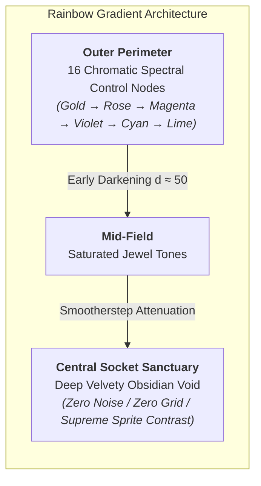

!!! important "CraftingBlueprints Extended Exclusive Feature"
    The technical drafting engine, procedural Guilloché frames, custom background textures, status stamps, and gradient typography described on this page require **CraftingBlueprints Extended**. On the Standard Edition, blueprints function as standard physical items without custom map graphics.

# Textures, Gradients & Custom 128x128 PNGs

The background canvas (Layer 1) establishes the atmosphere and prestige of a blueprint. CraftingBlueprints Extended ships with **25 pre-calibrated procedural textures**, **5 fine-art rainbow masterpieces**, and support for importing your own custom $128\times128$ pixel PNG graphics.

---

## The 25 Pre-Calibrated Procedural Textures

All procedural textures are pre-calibrated against Minecraft's native 128-color map palette using ordered Bayer matrix stippling. This eliminates visual noise, muddy compression artifacts, and color banding.

You can activate any texture by setting `map.theme: "<name>"` or `map.background_image: "texture_<name>.png"`:

| Theme Identifier | Visual Tone & Body Color | Key Visual Characteristics | Best Used For |
| :--- | :--- | :--- | :--- |
| `technical` / `blueprint` | Classic Naval Navy (`#122a54`) | Isometric drafting grid, vernier measurement ticks, clean white Cartesian linework. | Engineering schematics, vanilla utility tools, Crafter automation. |
| `technical_slate` | Gunmetal Charcoal (`#1e293b`) | Dual-frequency micrometer grid, sub-pixel registration ticks, archival paper grain. | Modern SMP gear, iron and diamond weapons. |
| `forge` / `dwarven` | Volcanic Basalt Slate (`#1e1e24`) | Dark masonry pavers, cooled volcanic basalt, molten bronze accent guidelines. | Weapons, heavy tools, smithing table templates. |
| `crimson` / `blood_forge` | Netherite Crimson (`#361618`) | Heated ruby accents, netherrack charcoal texture, ancient debris ember veins. | Netherite armor, high-damage weapons, boss gear. |
| `royal` / `imperial_gold` | 24k Imperial Amber (`#28200c`) | Twin banknote Guilloché rosettes, continuous gold filigree pedestal, 32-ray radiant sunburst. | End-game milestone schematics, server rank kits. |
| `simple_royal` | Amber Gold (`#2b280d`) | Clean drafting grid with amber-gold guidelines and luminous item outline halos. | Gold-tier weapons, trade guild licenses. |
| `desert` / `parchment` | Warm Aged Papyrus (`#bcac84`) | Interlocking cellulose paper fibers, warm papyrus tone, antique explorer map aesthetic. | Archaeology rewards, ancient scrolls, desert temples. |
| `antique` / `cartography` | Weathered Sandstone (`#a8956e`) | Aged cartographic coordinate lines, perimeter latitude hash marks, weathered edges. | Treasure maps, quest exploration schematics. |
| `amethyst` / `void_grimoire`| Deep Void Amethyst (`#1c183c`) | Gothic grimoire filigree, interlocking alchemical chains, ethereal amethyst backlighting. | Enchanting table recipes, spell tomes, magic armor. |
| `runic` / `arcane` | Twilight Violet (`#360647`) | Clean drafting grid in mystical violet with glowing runic corner geometry. | Anvil enchantment blueprints, arcane scrolls. |
| `emerald` / `botanical` | Deep Forest Jade (`#122e1c`) | Logarithmic spiral acanthus vines, mint green drafting lines, botanical copper inlays. | Potion brewing recipes, farming tools, ranger gear. |
| `verdigris_botanical` | Patinated Bronze (`#0d3326`) | Oxidized bronze sheen, geometric diamond mesh accents, muted forest surface. | Druid weapons, rare herbalism schematics. |
| `frost` / `glacial` | Arctic Polar Teal (`#103542`) | Diamond cyan trim, frosted crystal lattice lines, icy polar vignette. | Frost walker boots, trident recipes, ice realm kits. |
| `lapis` / `nautical_astrolabe`| Oceanic Sapphire (`#0e1c3a`) | 16-point nautical compass rose, trigonometric orbital rings, celestial latitude arcs. | Maritime navigation tools, fishing gear, conduits. |
| `dark` / `obsidian` | Deep Carbon Obsidian (`#14151a`) | Sleek netherite carbon slate, brushed steel hairline rules, minimal aesthetic. | Assassin blades, stealth gear, hardcore SMP. |
| `steel` | Tempered Steel (`#101010`) | Utilitarian carbon surface, brushed steel corner brackets, white technical typography. | Common Tier I starter tools and basic survival weapons. |
| `astral` / `rainbow_astral` | Celestial Singularity (`#05141c`) | Deep star chart background, 4-point nexus stars, cyan iridescent pedestal rail. | Mythic gear, ender dragon rewards. |

---

## The 5 Rainbow Masterpieces (Fine-Art Generative Meshes)

For server milestones, mythic crate jackpots, and supreme seasonal rewards, CraftingBlueprints Extended includes **5 Fine-Art Rainbow Masterpieces**.

These canvases are generated using **2D Continuous Gradient Meshes** emitting a full spectral rainbow that transitions smoothly into a velvety, pitch-free obsidian focal socket ($r \le 22\text{ px}$) to ensure central item sprites remain razor-sharp:



1. **Holographic Foil (`rainbow_holofoil`)**:  
   Physical $45^\circ$ trading-card *Secret Rare* holographic diffraction sheen with micro-stardust glitter flecks, transitioning from brilliant metallic rainbow reflection to dark iridescent titanium.

2. **Deep Astral Nebula (`rainbow_nebula`)**:  
   Multi-octave cosmic gas clouds, interstellar dust filaments, and naturally twinkling star constellations.

3. **Celestial Aurora (`rainbow_aurora`)**:  
   Fluid, undulating curtains of atmospheric rainbow light flowing inward from all four canvas borders.

4. **Guilloché Moiré (`rainbow_moire`)**:  
   Banknote-grade wave interference ribbons flowing across the canvas in silky rainbow harmonics.

5. **Prismatic Bismuth (`rainbow_bismuth`)**:  
   Natural gemstone crystal growth facets radiating multi-color bismuth iridescence.

---

## Custom 128x128 PNG Backgrounds

You can import any custom image, server logo, clan watermark, or hand-painted artwork:

### Directory Structure & Resolution
Place custom PNG images in:
```
plugins/CraftingBlueprints/images/backgrounds/
```

- **Format**: PNG (Portable Network Graphics).
- **Dimensions**: **Exactly $128 \times 128$ pixels**.
- **Color Depth**: 8-bit RGBA (supports transparent and semi-transparent alpha channels).

### Configuring a Custom Background

```yaml
# yaml-language-server: $schema=./blueprint.schema.json
singles:
  custom_guild_broadsword:
    blueprint: NETHERITE_SWORD
    name: "<gold><bold>Guild Champion Broadsword</bold></gold>"
    map:
      enabled: true
      background_image: "backgrounds/guild_crest_canvas.png"
      background_color: "#163a70"    # Shines through transparent regions of the PNG
      frame: rosette
      frame_color: "gold"
      stamp:
        style: wax_seal
        text: "GUILD"
        border_color: "gold"
```

### Transparency & Underlay Color Tinting
When your custom PNG contains transparent or semi-transparent pixels:

1. The canvas is filled with `background_color` (hex or named color).
2. The PNG is alpha-composited on top.
3. The configured color shines naturally through transparent areas, allowing a single PNG stencil to be reused across different server tiers (e.g. Blue for Rare, Gold for Legendary).

---

## Procedural Overlays Stack (`overlays:`)

To create infinite visual depth without duplicating image files, you can stack procedural filter layers on Layer 1.5:

```yaml
# yaml-language-server: $schema=./blueprint.schema.json
map:
  theme: "forge"
  overlays:
    # Layer A: Vignette darkening along outer edges
    - image: "backgrounds/vignette_dark.png"
      mode: "multiply"
      opacity: 0.65

    # Layer B: Gold alchemical transmutation ring stencil
    - image: "backgrounds/arcane_circle_stencil.png"
      mode: "mask"
      color: "#ffd700"
      opacity: 0.80
      invert: false
```

### Supported Filter Modes:

| Mode | Filter Operation | Visual Result |
| :--- | :--- | :--- |
| `mask` | Extracts ITU-R BT.601 pixel luminance ($L$). White applies color; black is transparent. | Transforms grayscale sketches or stencils into colored glowing runes. |
| `alpha_mask` | Uses the source alpha channel to apply a flat solid color. | Recountours silhouette shapes into solid badges. |
| `tint` / `colorize` | Modulates source RGB channels with the target color. | Preserves texture bevels and highlights while shifting hue. |
| `multiply` | Mathematical pixel multiplication: $\frac{A \times B}{255}$. | Ambient occlusion, corner vignettes, and paper grunge. |
| `normal` | Standard Porter-Duff source-over alpha blending. | Direct overlay of icons, crests, or decals. |
