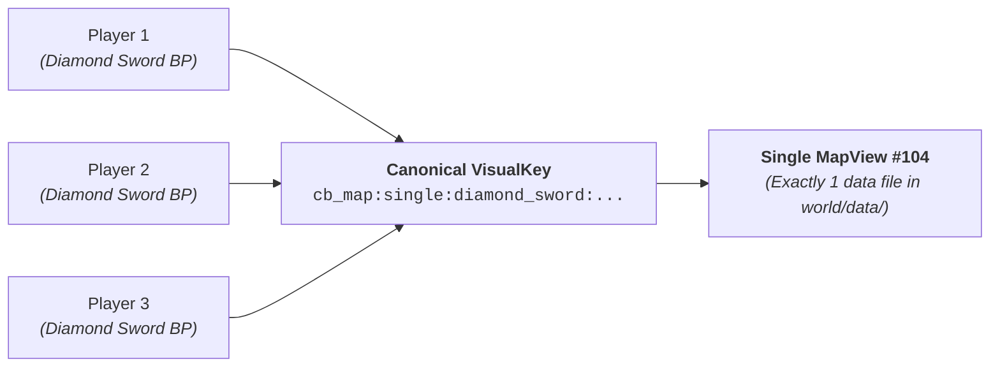

!!! important "CraftingBlueprints Extended Exclusive Feature"
    The technical drafting engine, procedural Guilloché frames, custom background textures, status stamps, and gradient typography described on this page require **CraftingBlueprints Extended**. On the Standard Edition, blueprints function as standard physical items without custom map graphics.

# Technical Drafting Engine Overview

In **CraftingBlueprints Extended**, physical blueprint items are transformed into photorealistic, high-resolution architectural schematics rendered directly onto in-game Minecraft maps (`Material.FILLED_MAP`).

Rather than displaying static, generic paper icons, players hold tactile, custom-drafted blueprints featuring engineering grids, isometric measurement scales, procedural banknote security borders, authentic wax seals, and dithered gradient typography.

---

## The Visual Transformation

```mermaid
flowchart LR
    subgraph Standard["Standard Edition (Physical Item)"]
        direction TB
        S1["<b>Material:</b> <code>PAPER</code>"]
        S2["<b>Name:</b> Netherite Chestplate"]
        S3["<b>Lore:</b> Crafting Schematic"]
        S4["<i>Standard inventory sprite</i>"]
    end

    subgraph Extended["Extended Edition (Map Drafting)"]
        direction TB
        E1["<b>Material:</b> <code>FILLED_MAP</code> (128×128)"]
        E2["• 25 Procedural Textures"]
        E3["• Isometric Drafting Grid"]
        E4["• Guilloché Security Frame"]
        E5["• Wax Seal / Status Stamp"]
        E6["• Bayer Dithered Typography"]
    end

    Standard ==>|Upgrades To| Extended
```



When held in a player's hand, placed in an Item Frame on a workshop wall, or inspected in a chest, Extended blueprints render custom $128\times128$ pixel art with zero client-side resource packs required.

---

## Enabling Map Drafting

Map drafting is enabled globally in your `plugins/CraftingBlueprints/config.yml`:

```yaml
# ==============================================================================
# EXTENDED EDITION - ADVANCED MAP GRAPHICS & DRAFTING ENGINE
# ==============================================================================
# Renders physical blueprints as technical architectural schematics on maps.
images-on-maps: true
```

### Transparent Fallback
If a blueprint defines a `map:` configuration block but the server runs CraftingBlueprints Standard Edition, the loader safely and transparently ignores the `map:` block. The blueprint functions normally as a physical item without errors.

---

## The Flyweight Map Registry (`BlueprintMapRegistry`)

In Minecraft, creating a new map item via standard Bukkit APIs (`Bukkit.createMap(...)`) assigns a new sequential integer ID (e.g. Map #1, Map #2, Map #3) and writes a corresponding `map_<id>.dat` file into your `world/data/` folder.

### The Problem of Naive Map Generation
On an active server with hundreds of players crafting or trading blueprints:

- Granting 5,000 diamond sword blueprints naively generates 5,000 separate `map_*.dat` files.
- Each file consumes disk I/O, leading to severe world save bloat and backup bottlenecks.

### The Flyweight Solution
CraftingBlueprints Extended solves this with the **Flyweight Map Registry**:



1. **Deterministic Visual Signature (`VisualKey`)**:
   Every unique visual configuration computes a normalized `VisualKey` combining its domain type, target material, theme, corner geometry, badge, and watermark.

2. **Canonical MapView Reuse**:
   Exactly **one** Bukkit `MapView` is allocated per unique `VisualKey`. Whether 1 player or 10,000 players possess the Diamond Sword Blueprint, they all share Map ID `#104`.

3. **Zero World Bloat**:
   World save data remains lightweight, cleanly bounded, and completely immune to map explosion.

4. **Local Registry State**:
   All active mappings are saved in `plugins/CraftingBlueprints/data/map_registry.json`.

---

## Asynchronous Native Palette Compositor

Rendering $128\times128$ pixel graphics on Minecraft maps presents a major performance challenge. Minecraft maps do not support arbitrary 24-bit RGB colors; they are restricted to an indexed palette of 128 colors.

Standard Bukkit `canvas.drawImage(...)` calculates Euclidean color distance on every pixel on the main server thread, executing over 2.3 million calculations per map and causing severe server tick lag (TPS drops).

### The 3-State Non-Blocking Pipeline:

```mermaid
flowchart LR
    Worker["<b>Worker Thread Pool (Async Compositor)</b><br/>• Renders 7 modular visual layers<br/>• Precomputes quantization &amp; Floyd-Steinberg<br/>• Output: Native <code>byte[16384]</code> palette buffer"] -->|Cached in LRU Memory (~8 MB)| Main["<b>Main Server Thread (FlyweightPaletteRenderer)</b><br/>• Blits <code>byte[16384]</code> directly to canvas<br/>• Execution time: <b>&lt; 0.02 ms</b> per tick<br/>• ZERO CPU lag spikes or tick stutter"]
```

- **Non-Blocking Guarantee**: All image loading, layer blending, procedural geometry, and color dithering execute strictly on asynchronous background worker threads.
- **Microsecond Blitting**: The main server thread simply copies the pre-computed `byte[16384]` array into Minecraft's network packet buffer in $< 0.02\text{ ms}$.

---

## Cross-Server Map Virtualization & Persistence

On multi-server networks (Velocity, BungeeCord, MySQL synchronization), local Map IDs differ across servers. Map ID `#104` might be a Diamond Sword on Survival-01, but Map ID `#104` on the Hub server might be the Spawn Navigation Map.

### The Re-linking Handshake (`MapRelinkListener`)
CraftingBlueprints injects the blueprint's canonical `VisualKey` into the item's `PersistentDataContainer` (PDC).

When a player changes servers or opens an inventory:

1. The engine reads the `visual_key` from the item's PDC.
2. It queries the local server's `BlueprintMapRegistry` for the canonical Map ID on that specific server.
3. If the item's local Map ID doesn't match the local server's canonical ID, it updates the item's `MapMeta` in-place.
4. **Result**: Blueprints render with 100% visual fidelity across all servers on your network without ever clashing or corrupting local maps.

### Container & Item Frame Persistence
Custom Bukkit map renderers are volatile in-memory objects that vanilla Minecraft forgets when chunks unload or servers restart.

CraftingBlueprints Extended includes an automated **Lifecycle & Container Event Restoration Engine**:

- **Chests, Barrels & Shulker Boxes**: Opening any container automatically restores active renderers to stored maps.
- **Item Frames & Glow Item Frames**: Blueprints mounted on walls retain their photorealistic rendering permanently across server reboots.
