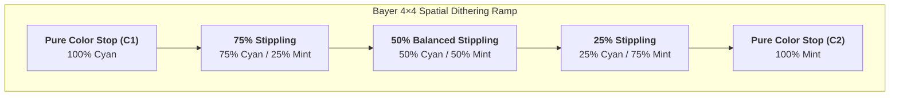
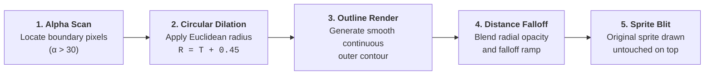

!!! important "CraftingBlueprints Extended Exclusive Feature"
    The technical drafting engine, procedural Guilloché frames, custom background textures, status stamps, and gradient typography described on this page require **CraftingBlueprints Extended**. On the Standard Edition, blueprints function as standard physical items without custom map graphics.

# Typography & Item Contours

The nameplate banner (Layer 6) and central item silhouette contour (Layer 3) ensure your blueprints are instantly legible, visually punchy, and aesthetically refined. CraftingBlueprints Extended features a **Bayer $4\times 4$ Dithered Typography Engine** and the **`ItemOutlineRenderer` Procedural Contour System**.

---

## The Color Banding Problem on Minecraft Maps

Minecraft maps are constrained to an indexed palette of only 128 colors. When naive rendering engines interpolate RGB text gradients (such as fading from `#00AAFF` Cyan to `#00FFAA` Mint):

- The math produces intermediate RGB shades that do not exist in Minecraft's map palette.
- Nearest-neighbor color snapping quantizes adjacent shades to the same flat color or muddy brownish-gray blocks.
- **The Result**: Disjointed color steps, harsh letter-by-letter banding, and dirty typography.

---

## The Solution: Bayer $4\times 4$ Ordered Dithered Typography

CraftingBlueprints Extended completely eliminates typography banding using a normalized **$4\times 4$ Bayer Ordered Dithering Kernel**:

$$T(x, y) = \frac{M[y \pmod 4][x \pmod 4] + 0.5}{16}$$



### How It Works:

1. Between each pair of color stops $C_k$ and $C_{k+1}$ across the text span, the engine evaluates local progress $f \in [0.0, 1.0]$.
2. For each character pixel $(x, y)$, if $f > T(x, y)$, it paints pure $C_{k+1}$; otherwise, it paints pure $C_k$.
3. **Pure Palette Guarantee**: Every single rendered pixel corresponds to a pure, saturated palette color. Muddy gray midpoints are mathematically banished.
4. **Smooth Transitions**: Colors melt seamlessly into one another across individual letter glyphs.

---

## Directional Linear Gradients & Angular Sweeps

Title typography supports linear directional vectors, dispersion tuning, and chromatic rainbow sweeps:

$$\texttt{gradient:<c1>:<c2>[:<c3>...][:<angle>][:<spread>]}$$

```yaml
# yaml-language-server: $schema=./blueprint.schema.json
singles:
  radiant_dawn_mace:
    blueprint: MACE
    name: "<gradient:#FF0077:#7700FF><bold>Radiant Dawn Mace</bold></gradient>"
    map:
      enabled: true
      theme: "royal"
      title:
        show: true
        color: "gradient:#FF0077:#7700FF:45:1.2"  # 45-degree angle with 1.2 spread
        shadow: true
        banner: true
```

### Gradient Parameters

| Parameter | Syntax | Default | Description |
| :--- | :--- | :--- | :--- |
| **Angle** | `:<angle>` (Degrees) | `0.0` ($0^\circ$) | Directional vector of the gradient: `0` = horizontal left-to-right, `90` = vertical top-to-bottom, `45` = diagonal. |
| **Spread / Dispersion** | `:<spread>` | `1.0` | Controls the concentration of the color transition across the text bounding box. |

#### Dispersion Values (`spread`):

- `spread = 1.0` (Default): Standard full-width transition across the text width.
- `spread < 1.0` (e.g. `0.5`): **Concentrated**: Transition is tightly focused in the center of the text, leaving solid outer bounds.
- `spread > 1.0` (e.g. `1.5`, `2.0`): **Expanded**: Transition extends wider than the text bounding box, creating a softer, gradual color fusion.

### Automatic MiniMessage Inference
If `map.title.color` is omitted or set to `default`, the engine **automatically inspects the blueprint's `name:` field**. If your display name uses MiniMessage `<gradient:...>` or `<rainbow>` tags, the map title automatically synchronizes its colors without duplicate configuration!

---

## Procedural Item Silhouette Contours (`ItemOutlineRenderer`)

Dark basalt or intricately textured map backgrounds can cause dark item sprites (such as Netherite swords or Bows) to blend into the canvas.

CraftingBlueprints Extended solves this with the **`ItemOutlineRenderer` Euclidean Dilation Engine**:



### Outline Configuration Block

```yaml
# yaml-language-server: $schema=./blueprint.schema.json
singles:
  shadow_reaper_scythe:
    blueprint: NETHERITE_HOE
    name: "<dark_purple><bold>Shadow Reaper Scythe</bold></dark_purple>"
    map:
      enabled: true
      theme: "dark"
      item_outline:
        enabled: true
        width: 2               # Thickness in pixels (1 to 8)
        color: "rainbow"       # "rainbow" | "gradient:cyan:purple:45" | "#00FFAA"
        opacity: 0.85          # Base opacity (0.0 to 1.0 or 0% to 100%)
        attenuation: 0.60      # Radial edge fade: outer pixels become 60% softer
```

### Supported Outline Parameters:

| Parameter | Type | Default | Description |
| :--- | :--- | :--- | :--- |
| `enabled` | Boolean | `false` | Enables or disables the procedural contour outline. |
| `width` | Integer ($1..8$) | `2` | Contour thickness in pixels. Recommended: `1` or `2` for crisp pixel-art balance. |
| `color` | String | `gold` | Contour color style: Hex (`#00AAFF`), named color (`cyan`), directional gradient (`gradient:gold:rose:45`), or polar rainbow (`rainbow`). |
| `opacity` | Double ($0.0..1.0$) | `0.8` | Overall transparency of the contour glow against the background canvas. |
| `attenuation` | Double ($0.0..1.0$) | `0.0` | Radial falloff factor. Higher values cause outermost contour pixels to fade smoothly, creating a soft feathered aura. |

### Polar Angular Rainbow Halos (`color: "rainbow"`)
When `color: "rainbow"` is selected, the outline evaluates the polar angle $\theta = \text{atan2}(y - c_y, x - c_x)$ relative to the sprite centroid, wrapping an 8-stop circular rainbow halo around the item:

- **Left**: Electric Cyan
- **Top**: Solar Gold
- **Right**: Starfire Rose
- **Bottom**: Royal Violet

---

## Dynamic Title Header Variables

The title plaque banner supports dynamic string variables:

| Variable | Description |
| :--- | :--- |
| `%blueprint_name%` / `%bname%` | Resolves to the formatted blueprint display name. |
| `{blueprint_target}` | Resolves to the target Minecraft material or custom item key. |

### Safe Ellipsis Truncation (`...`)
If a custom blueprint title exceeds the width of the title banner plaque ($116\text{ px}$), CraftingBlueprints automatically truncates the text and appends a clean pixel-aligned ellipsis (`...`), eliminating ugly letter overflows or border clipping.
