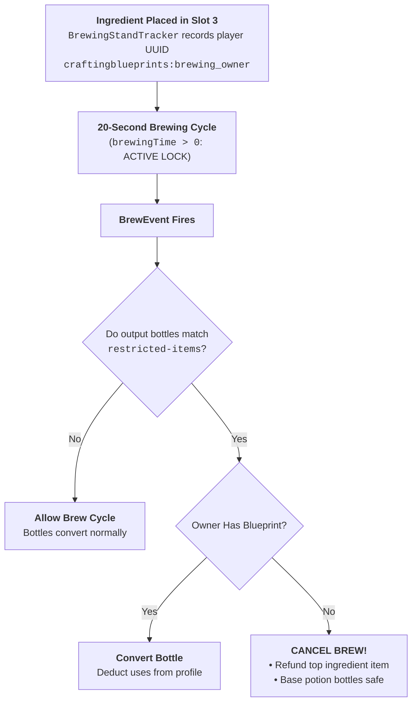

# Brewing Stands & Potion Alchemy

Potion brewing in Minecraft involves multi-step alchemy: refining water bottles into awkward potions, adding primary ingredients (such as blaze powder, ghast tears, or nether wart), and enhancing them with glowstone or redstone to produce Tier II and extended-duration potions.

CraftingBlueprints intercepts brewing stands via the `BrewingRulePipeline` and the persistent `BrewingStandTracker`, ensuring that restricted potions cannot be brewed without valid blueprints, while safeguarding ingredients against theft and voiding.

---

## Interception Architecture

In vanilla Minecraft, the `BrewEvent` fires when a 20-second brewing cycle finishes and transforms the bottom three potion bottles into the new potion type.

Unlike player inventory clicks, `BrewEvent` is an automated block cycle that does not provide a player reference. To evaluate player blueprints accurately, CraftingBlueprints employs a persistent metadata tracking engine:



1. **Station Type**: Classified internally as `POTION_TYPE` (Type ID `2`).
2. **Persistent Tracking**: The player who placed the brewing stand or loaded the ingredient is tracked directly in the block's tile entity.
3. **Multi-Bottle Accounting**: Up to three bottles can be brewed simultaneously. Blueprint uses are deducted according to the number of restricted bottles produced.

---

## Persistent Brewing Stand Tracker (`BrewingStandTracker`)

To guarantee that brewing stand ownership survives chunk unloads, player logouts, and server reboots, the engine writes the player's identity directly into the block's `PersistentDataContainer`:

* **Target Tile**: `org.bukkit.block.BrewingStand` (TileState)
* **PDC Key**: `craftingblueprints:brewing_owner`
* **Data Type**: `PersistentDataType.STRING` (Player UUID)
* **Persistence Guarantee**: Written via `state.update(true, false)` directly into world chunk storage.

### Ownership Lifecycle

1. **Block Placement (`BlockPlaceEvent`)**: When a player places a `BREWING_STAND`, their UUID is recorded as the initial owner.
2. **Ingredient Insertion**: When a player modifies the top ingredient slot (slot 3) or shift-clicks an ingredient into the stand while the machine is idle (`brewingTime == 0`), ownership automatically transfers to the initiating player.
3. **Completion Verification (`BrewEvent`)**: When brewing completes, `BrewingRulePipeline` queries `BrewingStandTracker.getOwner(block)`. If the owner possesses the blueprint, the brew succeeds; if the owner is offline, unranked, or missing the blueprint, the brew is cancelled.

---

## Anti-Theft Active Brew Lock

A common exploit in shared brewing setups is "brew hijacking": Player A loads ingredients to brew an authorized potion. At second 19 of the 20-second brew cycle, Player B (who does not own the blueprint) clicks or swaps an item in the brewing stand, attempting to trigger a desync or steal the brew.

To eliminate this vulnerability, CraftingBlueprints enforces an **Active Brew Lock**:

```text
While brewingTime > 0:
Third-party inventory modifications are strictly rejected.
Ownership transfers are locked until the active cycle completes.
```

If any unauthorized player attempts to click or modify slots while `brewingTime > 0`, the interaction is cancelled, ensuring that only the player who initiated the brew controls its outcome.

---

## Clean Ingredient Refund

When a brewing cycle is cancelled because the owner lacks the required blueprint:

* **Zero Ingredient Voiding**: The top ingredient (e.g. Blaze Powder, Ghast Tear, Golden Carrot) is **never deleted**. The engine cleanly refunds the item, returning it safely to the top slot or dropping it at the block if the slot is blocked.
* **Bottles Preserved**: The three bottom potion bottles remain in their original state (e.g. Awkward Potions or Water Bottles).
* **Blaze Powder Fuel**: Fuel progress is preserved without phantom consumption.

!!! important "Exploit-Proof Alchemy"
    Because cancelled brews preserve both ingredients and base bottles, players cannot duplicate items or consume server resources by triggering infinite blocked brew cycles.

---

## Restriction Syntax for Potions (`config.yml`)

Potions are restricted using the `potion:` or `brew:` prefix in `config.yml`:

```yaml
restrictions:
  restricted-items:
    # 1. Broad Potion Families (Regex)
    - "potion:strength.*"       # Restricts Strength I, Strength II, Splash & Lingering
    - "potion:speed.*"          # Restricts Speed I and Speed II
    - "potion:invisibility.*"   # Restricts Invisibility variants

    # 2. Specific Tiers & Types
    - "potion:strength_2"       # Restricts only Tier II Strength
    - "potion:turtle_master"    # Restricts Turtle Master potions
    - "potion:regeneration_2"   # Restricts high-tier Regeneration
```

---

## Blueprint Declaration (`blueprints/`)

Author alchemy blueprints that grant potion brewing knowledge:

```yaml
# yaml-language-server: $schema=./blueprint.schema.json
singles:
  strength_alchemist:
    blueprint: "potion:strength_2"
    station: BREWING_STAND
    name: "<gradient:#FF512F:#DD2476><bold>Alchemist Scroll: Strength II</bold></gradient>"
    permanent: false
    uses: 10                   # Allows brewing 10 bottles of Strength II
    item:
      material: POTION
      glowing: true
    lore:
      - "<gray>Station:</gray> <light_purple>Brewing Stand</light_purple>"
      - "<gray>Unlocks distillation of potent Strength II potions.</gray>"
      - "<gray>Remaining Uses:</gray> <yellow>{uses} bottles</yellow>"
```

---

## Diagnostics & Edge Cases

### 1. In-Game Potion Check (`/cb cani`)

To inspect potion restrictions and verify player access:

```text
/cb cani potion:strength_2
```

* **Unlocked Player**:
  ```text
  Potion: Strength II (Brewing Stand)
  Status: Restricted
  Required Blueprint: strength_alchemist
  Unlocked: YES (Remaining Uses: 10 bottles)
  ```

* **Locked Player**:
  ```text
  Potion: Strength II (Brewing Stand)
  Status: Restricted
  Required Blueprint: strength_alchemist
  Unlocked: NO
  ```

### 2. Common Edge Cases & Troubleshooting

| Symptom | Cause | Resolution |
| :--- | :--- | :--- |
| **Brew cancels at 20 seconds; ingredient drops** | The brewing stand owner does not have the required potion blueprint. | Acquire the blueprint scroll or unlock the corresponding permission group. |
| **Cannot click brewing stand while brewing** | Active Brew Lock is protecting the machine from third-party hijacking while `brewingTime > 0`. | Wait a few seconds for the active 20-second cycle to finish. |
| **Natural brewing stand in witch hut blocked** | Naturally generated brewing stands have no initial owner tag. | Break and re-place the stand, or insert an ingredient once while idle to claim ownership. |
| **Hopper feeding brewing stand** | Hoppers feeding unowned stands without player interaction. | Have an authorized player interact with the brewing stand GUI to establish ownership. |

---

## Next Steps

* [Locked Previews & Recipe Book Sync](previews-and-recipe-book.md) — Visual recipe previews and recipe book integration.
* [In-Game Menus & Catalog](menus-and-catalog.md) — Personal `/cb menu` and administrative catalog.
* [Workstations Interception Matrix](workstations-matrix.md) — Overview of all 7 production stations.
