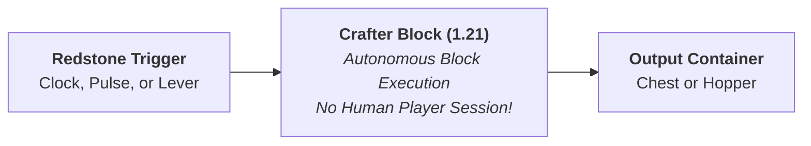
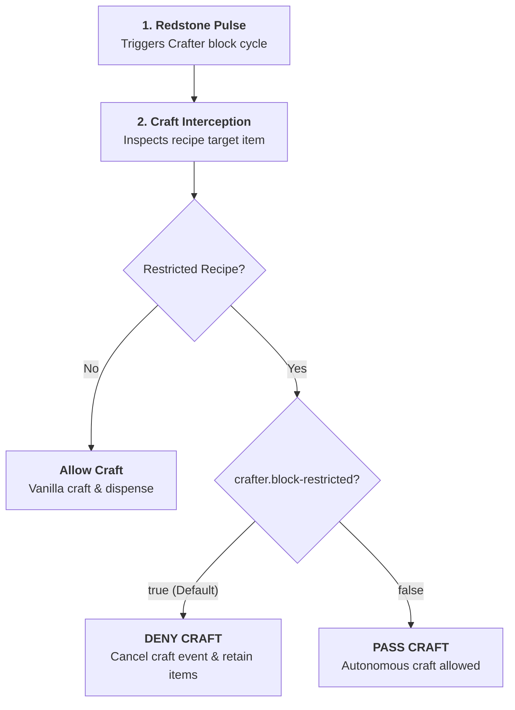

# 1.21 Crafter Block Automation

Minecraft 1.21 introduced the **Crafter** (`Material.CRAFTER`), a redstone-powered automated crafting table. When powered by a redstone pulse, the Crafter evaluates its internal 3×3 grid, crafts the corresponding recipe, and ejects the resulting item into a chest, hopper, or the surrounding world.

Because Crafters operate autonomously without a human player clicking an inventory slot, they present a fundamental challenge to progression systems: without dedicated interception, automated redstone factories can mass-produce late-game equipment (such as Netherite weapons, beacons, and custom gear) without any player ever unlocking the required blueprints.

---

## The Redstone Automation Hazard

In standard Minecraft servers, players interact with crafting tables through client clicks (`CraftItemEvent`). However, Crafter blocks are triggered exclusively by environmental redstone signals:



If an automated Crafter is permitted to craft restricted recipes without blueprint verification:

1. **Progression Collapse**: A single player could unlock a blueprint, build a Crafter contraption, and supply an entire faction or server network with endgame gear.
2. **Exploit Bypasses**: Players who have not earned or purchased blueprints could simply funnel raw materials into a Crafter to bypass the restriction engine entirely.
3. **Finite Uses Invalidation**: Crafters have no concept of player durability limits, rendering use-limited blueprints (`uses: 5`) obsolete.

---

## Interception Architecture

CraftingBlueprints intercepts automated Crafters before any items are produced using the `CrafterRulePipeline`:



### Version Abstraction Layer (VAL)

The `CrafterCraftEvent` exists only in Paper/Bukkit API 1.21 and higher. Referencing this event directly on multi-version servers (such as 1.18.2 or 1.20.4) would trigger fatal `NoClassDefFoundError` crashes on server startup.

CraftingBlueprints resolves this via a decoupled **Version Abstraction Layer (VAL)**:

* **Paper 1.21+ (`supportsCrafterBlock = true`)**: The engine loads native Crafter event adapters (`CrafterAdapterImpl`) that hook directly into the server's redstone event dispatching pipeline.
* **Paper 1.18.2 – 1.20.4 (`supportsCrafterBlock = false`)**: The engine automatically binds a lightweight `NoOpCrafterAdapter`. The plugin boots cleanly across all legacy versions with zero memory footprint and zero missing class warnings.

### Performance on Redstone Clocks

Redstone contraptions often trigger Crafters multiple times per second (e.g. 1-tick or 4-tick redstone clocks). To ensure zero server tick lag:

* **Fast Recipe Matching**: Unrestricted items (such as iron blocks, paper, gold nuggets, or bread) are validated via high-speed hash lookups and permitted instantly.
* **Cached Reflection Handles**: On multi-version fallbacks, all internal method handles (`getResult`, `getRecipe`, `getBlock`, `setCancelled`) are cached once at startup, eliminating per-tick reflection overhead.

---

## Anti-Exploit Enforcement Policy

Because an inanimate Crafter block cannot authenticate as a player or hold blueprint permissions, CraftingBlueprints applies a strict anti-exploit policy:

### Default Operating Modes

1. **Restricted Recipes (Blocked)**:  
   If an item matches `restrictions.restricted-items` (e.g. `craft:netherite_chestplate`, `craft:diamond_sword`, `craft:beacon`), the craft is **strictly cancelled**. The Crafter refuses to cycle, leaving all ingredients safely inside the block's inventory.

2. **Unrestricted Recipes (Allowed)**:  
   Basic materials, utility blocks, and intermediate components that do not match `restricted-items` (e.g., crafting copper ingots into copper blocks, wheat into bread, or iron ingots into iron bars) craft at full vanilla speeds.

3. **Universal Unlocks (Allowed)**:  
   If a recipe is configured in `default-unlocked-blueprints` (recipes unlocked for all players by default), Crafters are permitted to assemble it automatically.

### Audio & Visual Feedback (`fail-effect`)

When a Crafter attempts to assemble a restricted recipe, it provides immediate physical feedback in the game world:

* **Sound Feedback**: A mechanical dispenser click sound (`Sound.BLOCK_DISPENSER_FAIL` at volume 1.0, pitch 1.2) alerts nearby players that the craft was rejected.
* **Visual Particles**: Dark smoke particles (`Particle.SMOKE`) emit from the center of the Crafter block $(x+0.5, y+0.5, z+0.5)$, visually indicating that the machine is blocked by a progression rule.
* **Ingredient Safety**: Ingredients are never voided, dropped, or duplicated. The matrix remains in its exact state.

---

## Configuration Schema (`config.yml`)

Crafter behavior is configured under the `crafter:` section in `config.yml`:

```yaml
# ==============================================================================
# CraftingBlueprints - Automated Crafter Interception (Minecraft 1.21+)
# ==============================================================================

crafter:
  # If true, redstone Crafters are blocked from crafting restricted recipes.
  # If false, Crafters can autonomously craft all recipes without player blueprints.
  # (Default: true - Recommended for progression economies)
  block-restricted: true

  # If true, plays a dispenser click sound and emits smoke particles
  # at the Crafter block when a craft attempt is blocked.
  # (Default: true)
  fail-effect: true
```

!!! tip "Choosing the Right Policy"
    * Keep `block-restricted: true` on RPG, SMP, and Economy networks where high-tier weapons, armors, and tools should require personal player effort and progression.  
    * Set `block-restricted: false` only on pure technical anarchy or creative automation servers where fully automated factory production of all items is explicitly intended.

---

## Diagnostics & Edge Cases

### 1. In-Game Restriction Inspection (`/cb cani`)

To verify whether a recipe will be blocked from automated Crafter production:

```text
/cb cani craft:<item>
```

* **If Restricted**: The command outputs `Status: Restricted`. The recipe will be blocked from automated Crafters when `block-restricted: true`.
* **If Unrestricted**: The command outputs `Status: Unrestricted`. The recipe will craft automatically inside Crafters without obstruction.

### 2. Common Edge Cases & Troubleshooting

| Symptom | Cause | Solution |
| :--- | :--- | :--- |
| **Crafter clicks and smokes continuously** | A redstone clock is pulsing a Crafter loaded with ingredients for a restricted recipe. | The recipe requires a player blueprint. Remove the ingredients or adjust `restrictions.restricted-items`. |
| **Crafter crafts restricted items** | `crafter.block-restricted` is set to `false`. | Open `config.yml`, set `crafter.block-restricted: true`, and run `/cb reload`. |
| **Crafter not working on 1.20 or older** | The Crafter block only exists in Minecraft 1.21+. | On Minecraft 1.18.2–1.20.4, the Version Abstraction Layer safely operates in `NoOp` mode. Crafter features require Paper 1.21+. |
| **High Redstone Clock Noise** | A fast 1-tick redstone clock is triggering loud fail clicks repeatedly. | Set `crafter.fail-effect: false` in `config.yml` to mute the sound and particle feedback on high-frequency machines. |

---

## Next Steps

* [Smelting Stations & Hopper Tracking](smelting-and-furnaces.md) — How furnaces and hoppers prevent automated smelting exploits.
* [Workstations Interception Matrix](workstations-matrix.md) — Comprehensive overview across all 7 workstation domains.
* [Recipe Restriction Engine](../progression/recipe-restrictions.md) — Syntax rules for selective vs universal recipe gating.
