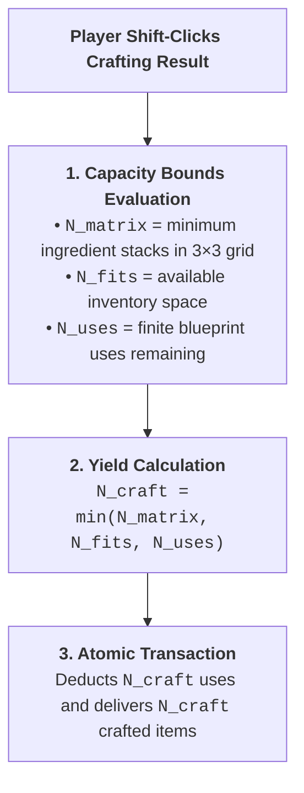
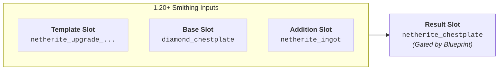

# Crafting Table & Shift-Craft Mathematics

The **Crafting Table** and the **2×2 Player Inventory Grid** represent the foundational crafting matrices in Minecraft. CraftingBlueprints intercepts both stations using the `CraftingRulePipeline`, ensuring that restricted items cannot be crafted without the corresponding blueprint unlock, whether crafted one at a time or in bulk via shift-click.

---

## Standard Crafting Interception

When a player places ingredients into a 3×3 Crafting Table or a 2×2 inventory crafting grid:

1. **Recipe Detection**: As ingredients are placed, the engine identifies the resulting item output.
2. **Restriction Check**: If the item does not match any entry in `restrictions.restricted-items`, the craft executes normally with zero overhead.
3. **Blueprint Validation**: If the recipe is restricted (e.g., `diamond_pickaxe`, `netherite_chestplate`, `beacon`), the engine checks the player's active unlocks:
    * **Permanent Blueprint**: Crafting is allowed indefinitely.
    * **Timed Blueprint**: Crafting is allowed as long as the expiration timestamp has not elapsed.
    * **Finite Uses Blueprint**: Crafting is allowed if the player has at least 1 remaining use.
    * **Locked / 0 Uses**: The craft is cancelled immediately, and the player receives an informative notification.

---

## Shift-Crafting Capacity Mathematics

In vanilla Minecraft, shift-clicking the crafting result slot processes as many craft iterations as possible until either the grid ingredients are exhausted or the player's inventory is full.

On servers with finite-use blueprints (e.g. an RPG scroll granting 3 crafts of a `diamond_sword`), naive shift-crafting presents a severe balance hazard: a player could shift-click a full grid of 64 diamonds and 64 sticks to produce 64 swords while consuming only 1 blueprint use, or craft 64 items when they only had permission to craft 3.

To solve this, CraftingBlueprints implements an exact mathematical capacity model (`ShiftCraftCalculator`) that evaluates **three independent bounds** before executing a shift-craft transaction:



### 1. Grid Matrix Bound ($N_{\text{matrix}}$)

The maximum number of crafts supported by the physical ingredient stacks present in the crafting grid matrix $M$:

$$N_{\text{matrix}} = \min \{ \text{item.amount} \mid \text{item} \in M, \text{item.type} \neq \text{AIR} \}$$

*Example*: If a recipe requires 1 iron ingot and 1 stick, and the grid contains 10 iron ingots and 4 sticks, $N_{\text{matrix}} = \min(10, 4) = 4$.

### 2. Bottom Inventory Space Bound ($N_{\text{fits}}$)

The maximum number of recipe output batches that can physically fit into the player's main inventory (slots 0 through 35), accounting for empty slots and partial stacks of similar items:

$$\text{Capacity} = \sum_{s \in \text{Slots}} \begin{cases} R.\text{maxStackSize} & \text{if } s = \text{AIR} \\ \max(0, R.\text{maxStackSize} - s.\text{amount}) & \text{if } s \text{ isSimilar } R \\ 0 & \text{otherwise} \end{cases}$$

$$N_{\text{fits}} = \left\lfloor \frac{\text{Capacity}}{R.\text{amount}} \right\rfloor$$

Where $R$ is the recipe output item stack, $R.\text{amount}$ is the quantity produced per craft cycle, and $R.\text{maxStackSize}$ is its maximum stack size (e.g. 64 for arrows, 16 for ender pearls, 1 for swords).

### 3. Blueprint Usage Bound ($N_{\text{uses}}$)

The player's remaining finite blueprint uses $U$:

$$N_{\text{uses}} = \begin{cases} \infty & \text{if } U = -1 \text{ (Permanent / Unlimited)} \\ U & \text{if } U \ge 0 \end{cases}$$

### Final Iteration Resolution ($N_{\text{craft}}$)

The engine resolves the exact number of allowed crafts by taking the minimum across all bounds:

$$N_{\text{craft}} = \min(N_{\text{matrix}}, N_{\text{fits}}, N_{\text{uses}})$$

---

## Anti-Loss & Anti-Exploit Enforcement

The capacity model guarantees two non-negotiable player experience invariants:

1. **No Blueprint Use Bypasses**:  
   If a player has 2 uses remaining on their `netherite_ingot` blueprint and shift-clicks a grid with 16 ancient debris and 16 gold ingots, the engine crafts **exactly 2 netherite ingots**, deducts 2 uses, and decrements 2 items from each grid slot. The remaining 14 ingredients remain safely untouched in the crafting grid.

2. **Zero Inventory Overflow or Voiding**:  
   If a player's inventory can only accommodate 12 arrows before reaching full capacity, shift-clicking a recipe that produces 4 arrows per craft will execute exactly $N_{\text{fits}} = \lfloor 12 / 4 \rfloor = 3$ crafts (12 arrows total). Surplus ingredients remain in the grid, preventing items from spilling onto the floor or being voided.

!!! warning "Exploit Prevention in High-Speed Networks"
    In vanilla Bukkit, modified or fast-clicking clients can attempt to fire multiple shift-clicks within a single server tick. CraftingBlueprints locks the player transaction synchronously, guaranteeing that uses are decremented before the inventory state is updated.

---

## Smithing Table Interception

The **Smithing Table** (`SmithItemEvent` and `PrepareSmithingEvent`) is unified under the `SmithingRulePipeline`, which shares identical bypass permissions and capacity calculations.



### Slot Evaluation (Minecraft 1.20+)

In modern Minecraft (1.20+), the Smithing Table utilizes three input slots:

* **Slot 0**: Smithing Template (`netherite_upgrade_smithing_template`, armor trims)
* **Slot 1**: Base Item (e.g. `diamond_chestplate`, `diamond_pickaxe`)
* **Slot 2**: Addition Material (e.g. `netherite_ingot`, amethyst shard)

*(On legacy Minecraft 1.18.2–1.19.4 servers, the 2-slot base + addition layout is evaluated automatically).*

### Shift-Smithing Capacity Model

Smithing tables support shift-click operations:

1. **Input Slot Bound**:
   $$N_{\text{smith\_inputs}} = \min \{ \text{stack.amount} \mid \text{stack} \in \text{InputSlots}, \text{stack.type} \neq \text{AIR} \}$$

2. **Net Smith Iterations**:
    * **Regular Click**: $N_{\text{smith}} = 1$.
    * **Shift-Click**: $N_{\text{smith}} = \max(1, \min(N_{\text{smith\_inputs}}, N_{\text{fits}}, N_{\text{uses}}))$.
3. **Transaction Deduction**: Deducts $N_{\text{smith}}$ uses from the corresponding smithing blueprint. If remaining uses are insufficient, the transaction is cancelled and ingredients remain intact.

---

## Configuration Reference (`config.yml`)

The crafting and preview engine settings are configured in `config.yml`:

```yaml
# ==============================================================================
# Crafting & Preview Options
# ==============================================================================

restrictions:
  restricted-items:
    # Gating standard crafting recipes
    - "craft:diamond_sword"
    - "craft:diamond_pickaxe"
    - "craft:netherite_.*"
    - "craft:beacon"

ux:
  prepare-preview:
    enabled: true
    mode: "LOCKED_OVERLAY" # LOCKED_OVERLAY | CUSTOM_ITEM | HIDE_RESULT
    locked-item:
      material: BARRIER
      custom-model-data: 4001
      name: "<red><bold>Recipe Locked</bold></red>"
      lore:
        - "<gray>Requires blueprint:</gray> <yellow>{blueprint_name}</yellow>"
        - "<gray>Use</gray> <aqua>/cb info {blueprint_id}</aqua> <gray>for details.</gray>"
```

---

## Diagnostics & Edge Cases

### 1. In-Game Permission Check (`/cb cani`)

Administrators and players can verify whether an item can be crafted:

```text
/cb cani craft:diamond_chestplate
```

* **Unlocked Output**:
  ```text
  Item: Diamond Chestplate
  Status: Restricted
  Required Blueprint: diamond_armor_pack
  Unlocked: YES (Remaining Uses: 4)
  ```

* **Locked Output**:
  ```text
  Item: Diamond Chestplate
  Status: Restricted
  Required Blueprint: diamond_armor_pack
  Unlocked: NO
  ```

### 2. Common Edge Cases & Resolution

| Scenario | Behavior / Message | Cause | Resolution |
| :--- | :--- | :--- | :--- |
| **Partial Shift-Craft** | Only 2 items crafted instead of full stack. | Player only had 2 blueprint uses remaining. | Expected behavior. Protects against blueprint use bypasses. |
| **Inventory Full** | Result slot clicks fail with no items crafted. | Player inventory has 0 available space ($N_{\text{fits}} = 0$). | Clear inventory slots to allow output items to fit. |
| **0 Uses Remaining** | `warning.blueprint.not_enough_uses` | Blueprint craft uses have been completely depleted. | Player must acquire a new blueprint scroll or purchase uses via `/cb buy`. |
| **Stray Preview Click** | Result slot click cancelled; item vanishes from cursor. | Anti-extraction guard caught player attempting to take a preview icon. | Normal security guard. Prevents locked preview items from being extracted into inventories. |

---

## Next Steps

* [1.21 Crafter Block Automation](crafter-automation.md) — How automated redstone Crafters interact with the blueprint economy.
* [Locked Previews & Recipe Book Sync](previews-and-recipe-book.md) — Configuring real-time preview overlays in crafting tables.
* [Durability, Limits & Expiration](../authoring/durability-and-limits.md) — Setting up permanent, timed, and use-limited blueprints.
