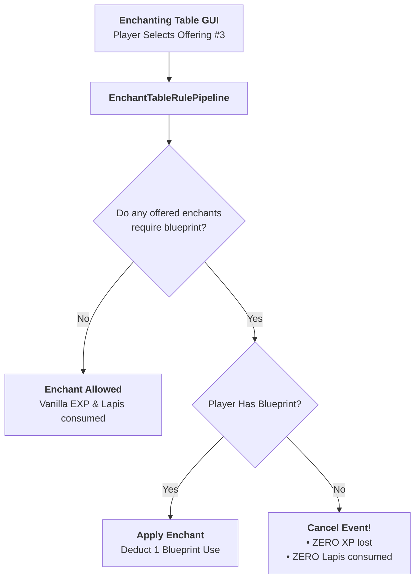

# Enchanting Tables & Anvil Rules

High-tier enchantments (`SHARPNESS V`, `PROTECTION IV`, `MENDING`, `SILK_TOUCH`) represent the peak of player gear progression. In Minecraft, enchantments are acquired through two distinct stations:

1. **Enchanting Tables** (direct arcane enchanting using bookshelves and lapis lazuli).
2. **Anvils** (combining equipment, applying enchanted books, repairing durability, and renaming items).

CraftingBlueprints intercepts both stations using dedicated rule pipelines, introducing **Differential Level Gating** and **Pre-Deduction Transaction Guards** to ensure that players only consume blueprint uses when genuinely upgrading equipment.

---

## Direct Enchanting Tables (`EnchantTableRulePipeline`)

When a player places a tool or armor piece into an Enchanting Table with lapis lazuli, the table presents three randomized enchantment offerings.



### Safe Cancellation Guarantee

In vanilla Bukkit, cancelling an enchantment event incorrectly can result in players losing their lapis lazuli or experience levels without receiving the enchantment.

CraftingBlueprints guarantees **absolute zero resource loss**:

* If a player lacks the blueprint for any enchantment that would be applied by the selected offering, the event is cleanly cancelled.
* **0 Experience Levels are consumed.**
* **0 Lapis Lazuli is consumed.**
* The item remains in the input slot, completely unaltered.
* A notification (`warning.blueprint.enchant_table.locked`) informs the player which blueprint is required.

### Restriction Syntax for Enchanting Tables

Use the `enchant_table:` prefix to restrict direct table enchanting:

```yaml
restrictions:
  restricted-items:
    # Restrict specific enchantments from Enchanting Tables
    - "enchant_table:silk_touch"
    - "enchant_table:mending"
    - "enchant_table:fortune_[23]"
    - "enchant_table:sharpness_[45]"
```

---

## Anvil Combinations (`EnchantingRulePipeline`)

The **Anvil** (`InventoryType.ANVIL`) allows players to combine two items (e.g. merging two damaged pickaxes or applying an enchanted book to a sword), repair items using raw materials, and rename equipment.

### Differential Level Gating ($L_{\text{result}} > L_{\text{first}}$)

In an anvil, the first slot contains the **base item**, and the second slot contains the **sacrifice item** (or enchanted book).

CraftingBlueprints evaluates enchantments **differentially**:

* Let $L_{\text{first}}$ be the level of an enchantment already present on the base item.
* Let $L_{\text{result}}$ be the level of that enchantment on the resulting item.
* **Blueprint Verification Rule**: A blueprint check and use deduction is triggered **if and only if**:

$$L_{\text{result}} > L_{\text{first}}$$

| Scenario | Base Item ($L_{\text{first}}$) | Sacrifice Item | Result Item ($L_{\text{result}}$) | Evaluation ($L_{\text{result}} > L_{\text{first}}$) | Blueprint Gating & Uses |
| :--- | :--- | :--- | :--- | :--- | :--- |
| **A: Upgrading** | Diamond Sword (Sharpness IV) [$L=4$] | Enchanted Book (Sharpness IV) | Diamond Sword (Sharpness V) [$L=5$] | $5 > 4$ (TRUE) | Requires `sharpness_5` blueprint. Consumes 1 use. |
| **B: Maintaining** | Diamond Sword (Sharpness IV) [$L=4$] | Enchanted Book (Sharpness III) | Diamond Sword (Sharpness IV) [$L=4$] | $4 > 4$ (FALSE) | NO blueprint required. 0 uses consumed. |
| **C: Combining** | Diamond Sword (Unbreaking II) [$L=2$] | Enchanted Book (Unbreaking III) | Diamond Sword (Unbreaking III) [$L=3$] | $3 > 2$ (TRUE) | Requires `unbreaking_3` blueprint. Consumes 1 use. |

### Pure Repairs and Renames Are Never Blocked

* **Repairing**: Combining a damaged Netherite Chestplate with a Netherite Ingot to restore durability does not alter enchantment levels ($L_{\text{result}} = L_{\text{first}}$). Repairs are **never blocked** by the enchantment engine.
* **Renaming**: Renaming an item in the anvil text field does not alter enchantments and is **freely permitted for all players**.

---

## Pre-Deduction Transaction Guards

A frequent exploit in custom anvil plugins is "use phantom deduction": if a plugin deducts blueprint uses as soon as an anvil slot is clicked, a player who lacks the required vanilla experience levels could have their blueprint uses stolen without ever receiving the item.

CraftingBlueprints implements **three pre-deduction transaction guards** before any blueprint uses are deducted:

1. **Experience Affordability Guard**:
    * Evaluates `player.level >= anvilInventory.repairCost`.
    * Evaluates `anvilInventory.repairCost < 40` (the vanilla "Too Expensive!" limit), unless the player is in Creative Mode.
    * If the player cannot afford the anvil repair cost, **no blueprint uses are deducted**, and the click is safely cancelled.
2. **Creative Mode Awareness**:
    * Players in Creative Mode bypass experience costs natively; the engine validates blueprint access without checking XP levels.
3. **Bottom Inventory Space Guard**:
    * During shift-clicks, the engine verifies that the player's inventory has sufficient space to receive the combined item before executing use deductions.

---

## Blueprint Declaration (`blueprints/`)

Enchantment blueprints can target anvils (`ENCHANT_TYPE = 1`) or enchanting tables (`ENCHANT_TABLE_TYPE = 5`):

```yaml
# yaml-language-server: $schema=./blueprint.schema.json
singles:
  sharpness_v_scroll:
    blueprint: "enchantment:sharpness_5"
    name: "<gradient:#FF416C:#FF4B2B><bold>Tome of Sharpness V</bold></gradient>"
    permanent: false
    uses: 1                   # Consumed once upon forging
    item:
      material: ENCHANTED_BOOK
      glowing: true
    lore:
      - "<gray>Enchantment:</gray> <red>Sharpness V</red>"
      - "<gray>Applies via Anvil combination.</gray>"
      - "<gray>Remaining Uses:</gray> <yellow>{uses}</yellow>"
```

---

## Configuration Reference (`config.yml`)

Configure enchanting table and anvil rules under `stations:` in `config.yml`:

```yaml
# ==============================================================================
# CraftingBlueprints - Enchanting & Anvil Configuration
# ==============================================================================

stations:
  enchanting-table:
    # Enable Enchanting Table direct verification
    enabled: true

    # Cancel the enchantment if the player lacks the required blueprint
    cancel-if-locked: true

    # Dispatch an informative notification to the player naming the missing blueprint
    send-fail-message: true

restrictions:
  restricted-items:
    # Anvil enchantment gating
    - "enchantment:sharpness_5"
    - "enchantment:protection_4"
    - "enchantment:mending"
    - "enchantment:unbreaking_3"

    # Direct Enchanting Table gating
    - "enchant_table:silk_touch"
    - "enchant_table:sharpness_.*"
```

---

## Diagnostics & Edge Cases

### 1. In-Game Permission Inspection (`/cb cani`)

To inspect enchantment restrictions and player access:

```text
/cb cani enchant:sharpness_5
/cb cani enchant_table:silk_touch
```

* **Unlocked Player**:
  ```text
  Enchantment: Sharpness V (Anvil)
  Status: Restricted
  Required Blueprint: sharpness_v_scroll
  Unlocked: YES (Remaining Uses: 3)
  ```

* **Locked Player**:
  ```text
  Enchantment: Sharpness V (Anvil)
  Status: Restricted
  Required Blueprint: sharpness_v_scroll
  Unlocked: NO
  ```

### 2. Common Edge Cases & Troubleshooting

| Symptom | Cause | Resolution |
| :--- | :--- | :--- |
| **Enchant cancelled at table; 0 XP lost** | Offering contained a restricted enchantment that the player has not unlocked. | Expected behavior. Protects player resources while enforcing progression. |
| **"Too Expensive!" in Anvil** | Vanilla anvil cumulative repair cost exceeded 39 levels. | Vanilla mechanic. Reset repair penalty using grindstones or repair with fresh equipment. |
| **Uses not deducted on anvil click** | Player did not have enough XP levels to take the item. | Pre-deduction transaction guard prevented blueprint use loss until the player can afford the XP cost. |
| **Repairing tool didn't consume uses** | Tool repair does not increase enchantment levels ($L_{\text{result}} = L_{\text{first}}$). | Differential gating correctly identifies that no new restricted enchantments were added. |

---

## Next Steps

* [Brewing Stands & Potion Alchemy](brewing-stand.md) — Potion gating, active brew lock, and ingredient refunds.
* [Locked Previews & Recipe Book Sync](previews-and-recipe-book.md) — Real-time anvil preview overlays.
* [Workstations Interception Matrix](workstations-matrix.md) — Summary across all 7 production stations.
