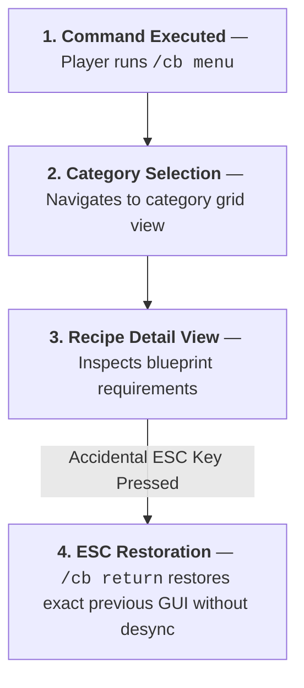
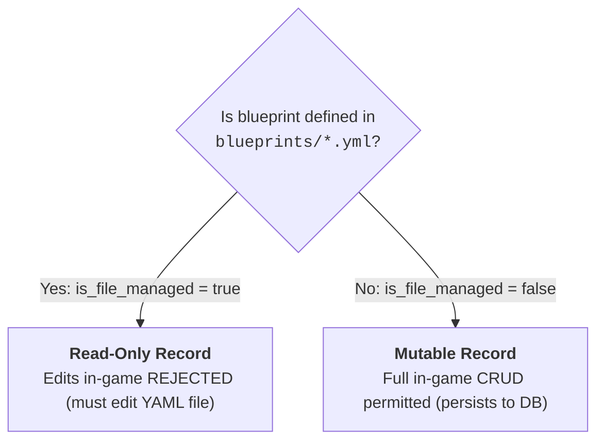

# In-Game Menus & Catalog

CraftingBlueprints features an intuitive, declarative inventory GUI engine that powers player progression tracking, blueprint inspection, administrative catalog management, and seamless menu navigation.

The GUI engine eliminates menu-stealing vulnerabilities, preserves player navigation stacks across accidental keypresses, and enforces strict immutability rules to protect version-controlled YAML files from in-game tampering.

---

## Player Progression Menu (`/cb menu`)

Players open their personal progression dashboard by running:

```text
/cb menu
```

*(Permission: `craftingblueprints.menu` — Enabled by default for all players).*

| Navigation / Action | GUI Control / Slot | Functionality |
| :--- | :--- | :--- |
| **Header Bar** | Page Title | Displays active catalog page, total pages, and unlock count |
| **Item Grid (Rows 1–4)** | Blueprint Icons | Unlocked recipes: checkmark icon; Locked recipes: barrier or preview icon |
| **Bottom Controls** | `[< Prev]` / `[Next >]` | Fast asynchronous pagination |
| **Bottom Center** | `[Search]` | Opens MiniMessage query prompt for real-time name filtering |

### Dashboard Features

1. **Categorized Blueprint Display**: Displays all blueprints unlocked by the player, including personal unlocks and hierarchical group permissions (`craftingblueprints.group.<id>`).
2. **Real-Time Status Badges**:
    * **Permanent Unlocks**: Displayed with a green checkmark or permanent infinity ($\infty$) badge.
    * **Timed Unlocks**: Shows a live countdown timer until expiration (e.g., `Expires in: 2d 14h`).
    * **Finite Uses**: Displays remaining craft iterations (e.g., `Remaining Uses: 4`).
3. **Interactive Inspection**: Left-clicking any blueprint item opens the detailed recipe view, showing the crafting matrix ingredients and the target station required.

---

## Stack-Based Navigation & ESC Restoration (`/cb return`)

In standard Minecraft GUI plugins, pressing the `ESC` key or accidentally closing an inventory closes the entire interface, forcing the player or administrator to re-navigate from page 1.

CraftingBlueprints introduces **Stack-Based Navigation** and **ESC Restoration** via `MenuSessionManager`:



## Admin Blueprint Catalog (`/cb item list`)

Administrators and developers can browse, inspect, and modify all registered server blueprints using the paginated catalog:

```
/cb item list
```

| Navigation / Action | GUI Control / Slot | Functionality |
| :--- | :--- | :--- |
| **Header Bar** | Page Title | Displays active catalog page, total pages, and unlock count |
| **Item Grid (Rows 1–4)** | Blueprint Icons | Unlocked recipes: checkmark icon; Locked recipes: barrier or preview icon |
| **Bottom Controls** | `[< Prev]` / `[Next >]` | Fast asynchronous pagination |
| **Bottom Center** | `[Close]` | Closes catalog GUI safely |

### Catalog Interactions

* **Left-Click (Edit / Inspect)**: Opens the blueprint modifier menu (`SingleModifyMenu`) to inspect target recipes, prices, and durability settings.
* **Right-Click (Metadata Info)**: Opens `SingleInfoMenu`, displaying the unique identifier, file source, creation date, and economy values.

---

## File-Managed Badges & Immutability Rules

To maintain production stability on version-controlled networks, CraftingBlueprints enforces strict **Source Immutability Rules**:



1. **File-Managed Blueprints (`is_file_managed: true`)**:
    * Any blueprint loaded from YAML files in `blueprints/` or modular packs in `configs/` is marked as **File-Managed**.
    * Attempting to modify properties (such as price, durability, or ingredients) inside in-game modifier menus is strictly blocked with:
     ```text
     warning.item.file_managed_immutable: "This blueprint is managed by a configuration file and cannot be modified in-game."
     ```

    * This guarantees that in-game operator clicks cannot corrupt or overwrite configuration files tracked in Git or cluster file synchronization.
2. **Manual Blueprints (`is_file_managed: false`)**:
    * Blueprints created dynamically in-game via `/cb item` can be edited freely through the GUI and are stored in `exports/manual_blueprints.yml`.

---

## Blueprint Duplication (`/cb item duplicate`)

Administrators can duplicate an existing blueprint to create tiered variants (e.g. creating a 5-use "Apprentice" scroll from a master blueprint) directly from the command line:

```text
/cb item duplicate <source_id> <target_id>
```

* **Example**:
  ```text
  /cb item duplicate netherite_sword_master netherite_sword_apprentice
  ```

* The engine creates a clean clone of the source configuration under the new identifier, allowing administrators to modify durability, prices, or templates independently without manual copy-pasting.

---

## Anti-Steal & Menu Item Purging (`MENU_TYPE`)

To prevent players from extracting decorative icons, navigation arrows, or preview items from custom menus using packet injectors or client glitches:

1. **Universal Menu Item Tagging**: Every icon rendered inside a `BaseMenu` or `PaginatedMenu` is stamped with an immutable PDC tag:
   ```text
   ItemPDT(ItemManager.MENU_TYPE)
   ```

2. **Click & Drag Cancellation**: `InventoryListener` intercepts clicks on non-input slots and cancels the event immediately.
3. **Autonomous Purge Listener**: If an item bearing `MENU_TYPE` is detected outside an active menu GUI (on a player cursor, in their inventory, dropped on the ground, or stored in a chest/shulker), the engine immediately zeroes the item amount (`amount = 0`) and purges it from the world.

---

## Diagnostics & Edge Cases

### 1. Permission Verification

Ensure players and administrators have the proper permission nodes assigned:

| Command | Node | Default Group | Purpose |
| :--- | :--- | :--- | :--- |
| `/cb menu` | `craftingblueprints.menu` | Default / Everyone | Opens player progression dashboard |
| `/cb return` | `craftingblueprints.return` | Default / Everyone | Restores previous or closed menu session |
| `/cb item list` | `craftingblueprints.item.list` | Admins / Operators | Opens administrative blueprint catalog |
| `/cb item edit` | `craftingblueprints.item.edit` | Admins / Operators | Opens in-game blueprint editor |

### 2. Common Edge Cases & Troubleshooting

| Symptom | Cause | Resolution |
| :--- | :--- | :--- |
| **`/cb return` says "No previous menu"** | The player has not opened a menu in this session, or the stack has been cleared. | Open `/cb menu` first to initialize the navigation session. |
| **Cannot edit blueprint in `/cb item list`** | The blueprint is file-managed (`is_file_managed: true`). | Edit the corresponding YAML file in `plugins/CraftingBlueprints/blueprints/` and run `/cb reload blueprints`. |
| **Menu icons vanish when clicked** | Menu item anti-steal engine detected an unauthorized inventory transfer attempt. | Expected security behavior. Protects server menus against item duplication hacks. |
| **Large catalog pagination lag** | Server has thousands of registered blueprints. | CraftingBlueprints uses windowed database pagination to fetch only active page items, maintaining 20 TPS. |

---

## Next Steps

* [Workstations Interception Matrix](workstations-matrix.md) — Comprehensive overview of all 7 production stations.
* [Locked Previews & Recipe Book Sync](previews-and-recipe-book.md) — Configuring real-time result slot previews.
* [Hierarchical Permission Groups](../progression/permission-groups.md) — Assigning blueprint groups and permission nodes.
