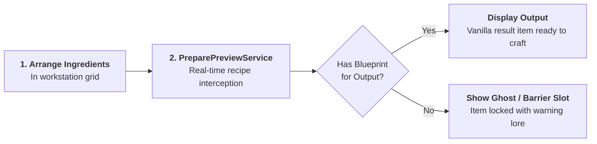
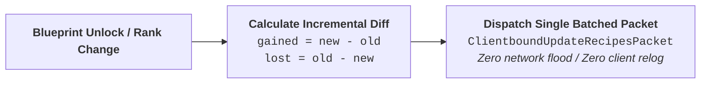

# Locked Previews & Recipe Book Sync

In traditional progression plugins, players often experience a frustrating anti-pattern: they gather ingredients, arrange them inside a crafting table or anvil, and only discover they cannot craft the item when the final click fails.

CraftingBlueprints elevates the player experience through **Locked Output Previews** and **Vanilla Recipe Book Synchronization**. Players see clear, contextual progression feedback directly inside workstation result slots, while the green vanilla recipe book stays in perfect harmony with their unlocked blueprints.

---

## Locked Output Previews (`PreparePreviewService`)

When a player places ingredients into a Crafting Table (`PrepareItemCraftEvent`), Smithing Table (`PrepareSmithingEvent`), or Anvil (`PrepareAnvilEvent`), the `PreparePreviewService` evaluates their blueprint access in real time before any click occurs.

If the player has not unlocked the recipe or has exhausted their craft uses, the result slot dynamically updates to reflect the locked state:



### Preview Modes

Administrators can choose between three distinct visual feedback modes in `config.yml`:

```yaml
ux:
  prepare-preview:
    enabled: true
    mode: "LOCKED_OVERLAY" # LOCKED_OVERLAY | CUSTOM_ITEM | HIDE_RESULT
```

| Preview Mode | Mode Alias | Visual Result in Output Slot | Recommended Use Case |
| :--- | :--- | :--- | :--- |
| **`LOCKED_OVERLAY`** *(Default)* | `LOCKED_LORE` | Clones the original output item (retaining its icon, enchantments, and custom model data), adds a red locked prefix to its name, and appends informative lore naming the required blueprint. | Best for RPG and survival servers where players should recognize what item they are trying to craft. |
| **`CUSTOM_ITEM`** | `BARRIER_ICON` | Replaces the output slot with a custom barrier or lock icon configured under `locked-item` (with custom model data and MiniMessage formatting). | Ideal for servers with custom resource packs featuring dedicated "Locked" padlocks or runes. |
| **`HIDE_RESULT`** | N/A | Completely clears the output slot (`AIR`), mimicking standard vanilla behavior when an invalid recipe is placed. | Best for hardcore immersion servers where recipes must remain completely undiscovered until unlocked. |

### Placeholder Support

The `locked-item` display name and lore support dynamic placeholders:

* `{blueprint_name}` (or `<blueprint_name>`): Resolves to the human-readable display name of the required blueprint.
* `{blueprint_id}` (or `<blueprint_id>`): Resolves to the canonical blueprint identifier, allowing players to type `/cb info {blueprint_id}` to inspect how to obtain it.

---

## Anti-Extraction Security (`LOCKED_PREVIEW_TYPE = 8`)

Displaying preview items in workstation result slots introduces a potential exploit: what if a player attempts to steal the preview barrier or cloned netherite sword using modified inventory packets, hotbar number keys, or shift-clicks?

CraftingBlueprints implements an absolute **Anti-Extraction Security Guard**:

1. **PDC Security Stamping**: Every generated preview item is stamped with an immutable internal tag:
   ```text
   ItemPDT(ItemManager.LOCKED_PREVIEW_TYPE, blueprintId)
   ```

2. **Absolute Cancellation at `EventPriority.LOWEST`**:
    * Any click, drag, or shift-click targeting a `LOCKED_PREVIEW_TYPE` item in a crafting table, smithing table, or anvil is instantly cancelled at the lowest listener priority before any item transfer can occur.
    * The player receives an immediate notification: `warning.blueprint.not_enough_uses`.
3. **Stray Item Purge Engine**:
    * If a modified client somehow glitched a preview item onto their cursor or into their inventory, the engine's purge listener detects the `LOCKED_PREVIEW_TYPE` tag across all Bukkit lifecycle events:
        * Cursor pickups and hotbar key swaps
        * Offhand swaps (`F` key)
        * Inventory drags and drops (`PlayerDropItemEvent`)
        * Container placements (chests, shulker boxes, item frames)
        * Player death drops and entity pickups
    * Detected items are immediately cancelled, zeroed out (`amount = 0`), and purged from existence.

---

## Vanilla Recipe Book Synchronization (`RecipeBookSyncService`)

Minecraft's client-side recipe book (the green knowledge book icon in crafting tables) displays recipes the client is permitted to craft. If a recipe book is left unmanaged, players will see recipes they cannot craft, leading to confusion.

CraftingBlueprints provides **Incremental Diff-Based Recipe Book Synchronization**:



### Incremental Diffs (Zero Per-Tick Lag)

Unlike naive synchronization plugins that re-index hundreds of recipes every second, `RecipeBookSyncService` operates strictly on **minimal diffs**:

* **On Server Startup**: The engine builds an $O(1)$ bidirectional index of all server crafting recipes (`Bukkit.recipeIterator()`).
* **On Player Login**: As soon as the player's profile finishes loading, the engine compares their unlocked blueprints against their active recipe book and dispatches a single batched synchronization packet.
* **On Blueprint Lifecycle Events**:
    * Unlocking a blueprint (`BlueprintUnlockEvent`) immediately calls `player.discoverRecipes(...)` for the target recipe keys.
    * Expiring a blueprint (`BlueprintExpireEvent`) calls `player.undiscoverRecipes(...)` if no other group or permission still grants access.
* **On Permission Group Changes**: The background `CyclicTask` monitors rank promotions (e.g. LuckPerms group changes). If groups change, it computes:
  $$\text{gained} = \text{newGroupBlueprints} - \text{oldGroupBlueprints}$$
  $$\text{lost} = \text{oldGroupBlueprints} - \text{newGroupBlueprints}$$
  And synchronizes only the differential delta.

* **Discovery Guard (`PlayerRecipeDiscoverEvent`)**: If `hide-locked-recipes: true` is configured, vanilla natural recipe discoveries (e.g. picking up iron for the first time) are cancelled for recipes that require locked blueprints.

---

## Configuration Reference (`config.yml`)

The preview and recipe book settings are configured under `ux:` in `config.yml`:

```yaml
# ==============================================================================
# CraftingBlueprints - User Experience & Previews
# ==============================================================================

ux:
  # Vanilla Recipe Book Synchronization
  vanilla-recipe-book:
    # Synchronize recipe book when a player joins the server
    sync-on-join: true

    # Synchronize recipe book dynamically on blueprint unlock or expiration
    sync-on-unlock-expire: true

    # If true, locked recipes are completely hidden from the green recipe book.
    # If false, locked recipes remain visible in the book, but show locked previews when placed.
    hide-locked-recipes: true

  # Workstation Result Slot Previews
  prepare-preview:
    # Enable real-time result slot preview overlays
    enabled: true

    # Mode: LOCKED_OVERLAY | CUSTOM_ITEM | HIDE_RESULT
    mode: "LOCKED_OVERLAY"

    # Custom item configuration (Used when mode is CUSTOM_ITEM)
    locked-item:
      material: BARRIER
      custom-model-data: 4001
      name: "<red><bold>Recipe Locked</bold></red>"
      lore:
        - "<gray>Requires blueprint:</gray> <yellow>{blueprint_name}</yellow>"
        - "<gray>Type</gray> <aqua>/cb info {blueprint_id}</aqua> <gray>to inspect.</gray>"
```

---

## Diagnostics & Edge Cases

### 1. In-Game Permission Inspection (`/cb cani`)

To verify whether a recipe should appear in a player's recipe book or display as locked:

```text
/cb cani craft:diamond_pickaxe
```

### 2. Common Edge Cases & Troubleshooting

| Symptom | Cause | Resolution |
| :--- | :--- | :--- |
| **Locked recipes visible in green book** | `ux.vanilla-recipe-book.hide-locked-recipes` is set to `false`. | Set `hide-locked-recipes: true` in `config.yml` and run `/cb reload config`. |
| **Ghost item left on cursor** | Client packet latency after clicking a locked preview item. | Opening and closing inventory or pressing ESC immediately clears the ghost item. |
| **Client mods (JEI/EMI/REI) conflict** | Client-side recipe viewers query server recipes directly. | `LOCKED_OVERLAY` works natively with client mods. In locked states, the server cancels extraction safely. |
| **Preview not updating on fast clicking** | Server thread synchronization guard. | Normal protection behavior. Prevents race conditions during rapid inventory clicking. |

---

## Next Steps

* [In-Game Menus & Catalog](menus-and-catalog.md) — Player progression menu (`/cb menu`) and admin catalog.
* [Crafting Table & Shift-Craft Math](crafting-table.md) — 3×3 grid capacity calculations and shift-craft math.
* [Workstations Interception Matrix](workstations-matrix.md) — Overview of all 7 production stations.
