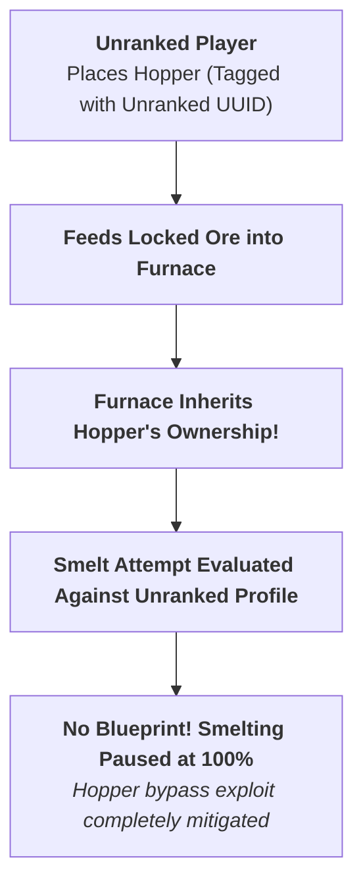

# Smelting Stations & Hopper Tracking

In many RPG and survival economies, high-tier equipment begins not at a crafting table, but in a furnace: refining ancient debris into netherite scrap, smelting raw ores into custom alloys, or smoking specialized food rations.

CraftingBlueprints intercepts all smelting stations in Minecraft—**Furnaces**, **Blast Furnaces**, **Smokers**, and **Campfires**—while maintaining a persistent tile entity tracking engine that prevents automated hopper injection bypasses.

---

## Supported Smelting Stations

CraftingBlueprints evaluates smelting operations through the `SmeltingRulePipeline`, covering four distinct heat-refining stations:

| Station Type | Block Material | Primary Purpose | Restriction Prefix |
| :--- | :--- | :--- | :--- |
| **Standard Furnace** | `FURNACE` | General-purpose smelting of blocks, foods, and ores | `smelt:` / `furnace:` |
| **Blast Furnace** | `BLAST_FURNACE` | High-speed ore and metal smelting (2× vanilla speed) | `blast_furnace:` / `smelt:` |
| **Smoker** | `SMOKER` | High-speed food and meat cooking (2× vanilla speed) | `smoker:` / `smelt:` |
| **Campfire** | `CAMPFIRE`, `SOUL_CAMPFIRE` | Fuel-free outdoor roasting (up to 4 items simultaneously) | `campfire:` / `smelt:` |

---

## Station-Specific Gating

Administrators can enforce blueprint requirements globally across all smelting stations or bind specific recipes to dedicated specialized heat sources:

```yaml
restrictions:
  restricted-items:
    # 1. Global Smelting Gating (Applies to Furnaces & Blast Furnaces)
    - "smelt:ancient_debris"
    - "smelt:iron_raw"

    # 2. Specialized Blast Furnace Gating
    # (Requires a Blast Furnace; fails in standard furnaces)
    - "blast_furnace:netherite_scrap"
    - "blast_furnace:nexo:mythril_ingot"

    # 3. Specialized Smoker Gating
    - "smoker:cooked_beef"
    - "smoker:cooked_porkchop"

    # 4. Specialized Campfire Gating
    - "campfire:cooked_salmon"
```

### Station Binding in YAML Blueprints

When authoring a blueprint in `blueprints/`, specify the `station:` field to mandate that players refine the item at a specific station:

```yaml
# yaml-language-server: $schema=./blueprint.schema.json
singles:
  mythril_refining:
    blueprint: "nexo:mythril_ingot"
    station: BLAST_FURNACE    # Allowed values: FURNACE, BLAST_FURNACE, SMOKER, CAMPFIRE, ANY
    name: "<gradient:#00D2FF:#3A7BD5><bold>Mythril Smelting Knowledge</bold></gradient>"
    permanent: true
    item:
      material: PAPER
      glowing: true
    lore:
      - "<gray>Station:</gray> <aqua>Blast Furnace Only</aqua>"
      - "<gray>Unlocks refining of raw mythril into pure ingots.</gray>"
```mermaid
```

---

## Persistent Tile Ownership Model

Unlike crafting tables which close when a player walks away, smelting workstations (Furnaces, Blast Furnaces, Smokers, and Campfires) are asynchronous tile entities operating independently over time.

CraftingBlueprints tracks container ownership using **Persistent Data Containers (PDC)** attached directly to the tile entity:

```mermaid
flowchart TD
    Interact["<b>Player Places or Interacts With Furnace</b>"]
    Write["<b>Write UUID to Tile PDC</b><br/><code>craftingblueprints:furnace_owner</code>"]
    Eval["<b>Smelt Attempt Evaluated Against Stored Owner</b>"]
    Check{"Blueprint Found &amp; Valid?"}
    Complete["<b>Complete Smelt Iteration</b><br/>Deduct 1 Blueprint Use"]
    Pause["<b>Pause Cooking at 100%</b><br/>Preserve Input Ore &amp; Fuel without loss"]

    Interact --> Write --> Eval --> Check
    Check -->|Yes| Complete
    Check -->|No| Pause
```

### Ownership Synchronization Points

A furnace's ownership tag is established and refreshed at three natural interaction points:

1. **Block Placement (`BlockPlaceEvent`)**: When a player places a furnace, blast furnace, smoker, or campfire, their UUID is recorded as the primary owner.
2. **GUI Interaction (`InventoryClickEvent` & `InventoryDragEvent`)**: Whenever a player opens the furnace GUI and inserts fuel (slot 1), places raw inputs (slot 0), or shift-clicks items into the station, ownership is refreshed to the active player.
3. **Double-Barrier Extraction Guard**: An extra security check executes when extracting from the result slot (slot 2). If a third-party player who lacks the blueprint attempts to retrieve completed items, extraction is blocked.

---

## Hopper Anti-Bypass Protection

On automated survival servers, players often attempt to bypass progression using hoppers: an unranked player places raw ores into a chest that feeds via a hopper into a furnace placed by a high-ranked player who owns the blueprint.

To eliminate this vulnerability, CraftingBlueprints implements **Hopper Ownership Tracking** (`stations.smelting.track-hoppers: true`):



### Hopper Protection Rules

1. **Hopper Placement Tagging**: When a player places a hopper, it is stamped with a `craftingblueprints:hopper_owner` PDC tag.
2. **Ownership Inheritance**: When a hopper transfers items into a furnace, the furnace updates its ownership to match the hopper's owner.
3. **Unowned Hoppers**: If an unowned hopper (such as a naturally generated hopper in a dungeon or minecart with hopper) attempts to insert materials, the furnace's owner tag is cleared. Unowned furnaces cannot process restricted recipes.
4. **Smelt Freeze Guarantee**: When a smelt is cancelled due to missing blueprints:
    * The cooking progress pauses at 100% without consuming fuel or raw input.
    * No output item is created or dropped.
    * If `fail-effect: true`, the furnace emits smoke particles and a fail sound to alert the operator.

---

## Configuration Schema (`config.yml`)

Smelting interception is configured under `stations.smelting:` in `config.yml`:

```yaml
# ==============================================================================
# CraftingBlueprints - Smelting Stations Configuration
# ==============================================================================

stations:
  smelting:
    # Enable smelting interception and blueprint verification
    enabled: true

    # Individual station enforcement
    restrict-furnace: true
    restrict-blast-furnace: true
    restrict-smoker: true
    restrict-campfire: true

    # Track player ownership of hoppers feeding into furnaces.
    # If true, hoppers inherit the placer's blueprint unlocks.
    # Unowned hoppers cannot smelt restricted recipes.
    track-hoppers: true

    # Play failure sound and smoke particles when smelting is blocked
    fail-effect: true
```

---

## Diagnostics & Edge Cases

### 1. In-Game Smelting Inspection (`/cb cani`)

To verify whether an item requires a blueprint for smelting:

```text
/cb cani smelt:ancient_debris
/cb cani blast_furnace:iron_raw
```

* **Output for Unlocked Players**:
  ```text
  Item: Netherite Scrap (Smelting)
  Status: Restricted
  Required Blueprint: netherite_smelting
  Unlocked: YES (Remaining Uses: 12)
  ```

* **Output for Locked Players**:
  ```text
  Item: Netherite Scrap (Smelting)
  Status: Restricted
  Required Blueprint: netherite_smelting
  Unlocked: NO
  ```

### 2. Common Edge Cases & Troubleshooting

| Symptom | Cause | Resolution |
| :--- | :--- | :--- |
| **Furnace stuck at 100% cooking** | The furnace owner does not possess the blueprint required for the smelt output. | Acquire the blueprint, or have an authorized player open the furnace GUI once to update ownership. |
| **Furnace not smelting via hopper** | The hopper feeding the furnace was placed by a player without the required blueprint. | Have the player with the blueprint break and re-place the hopper, or insert the ore manually. |
| **Shared Base Desync** | Player A places furnace; Player B with blueprint tries to use it. | When Player B interacts with the furnace GUI, ownership automatically refreshes to Player B. |
| **Campfire Cooking Blocked** | Food placed on campfire matches a `campfire:` restriction rule. | Player requires the corresponding campfire cooking blueprint to roast that food. |

---

## Next Steps

* [Stonecutter Recipe Gating](stonecutter.md) — Slicing stone blocks and stairs with blueprint validation.
* [1.21 Crafter Block Automation](crafter-automation.md) — Protecting redstone crafters against automated recipe exploits.
* [Workstations Interception Matrix](workstations-matrix.md) — Architectural overview of all 7 production stations.
