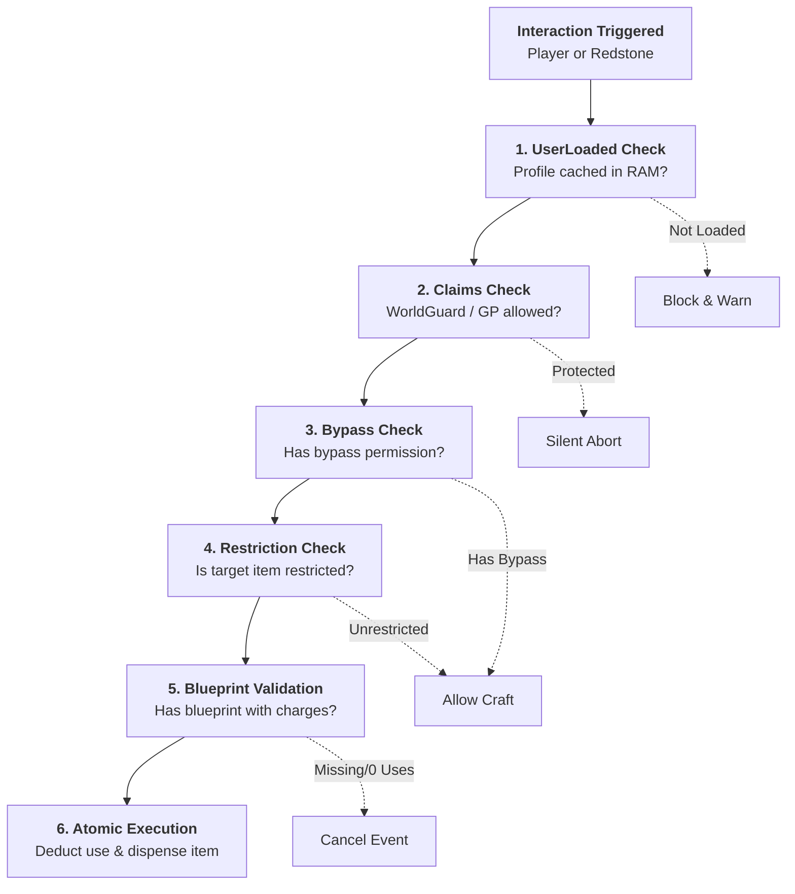

# Workstations Interception Matrix

CraftingBlueprints provides a unified, event-driven progression engine that intercepts crafting, refining, enchanting, and alchemy across all production stations in Minecraft. Rather than restricting only the standard 3×3 crafting grid, the engine enforces blueprint unlocks and durability limits across traditional workbenches, automated redstone blocks, smelting furnaces, stonecutters, enchanting tables, anvils, and brewing stands.

---

## Comprehensive Workstation Matrix

The following matrix summarizes the 7 intercepted workstation domains, their corresponding prefix formats, internal classification types, supported durability modes, and ownership tracking models:

| Workstation | Block Material / Inventory | Prefix Syntax | Type ID | Supported Limits | Tracking & Context Model |
| :--- | :--- | :--- | :--- | :--- | :--- |
| **Crafting Table & 2×2 Grid** | `CRAFTING_TABLE`, Player Inventory | `craft:<item>`<br>`item:<item>` | `0` (`CRAFT_TYPE`) | Permanent, Timed, Uses | Direct Player Inventory Session |
| **1.21 Redstone Crafter** | `CRAFTER` | `craft:<item>`<br>`item:<item>` | `0` (`CRAFT_TYPE`) | Server Policy (Block / Allow) | Inanimate Block (Redstone Pulse) |
| **Smelting Stations** | `FURNACE`, `BLAST_FURNACE`, `SMOKER`, `CAMPFIRE` | `smelt:<item>`<br>`furnace:<item>` | `3` (`SMELT_TYPE`) | Permanent, Timed, Uses | Tile `PersistentDataContainer` (`furnace_owner`) |
| **Stonecutter** | `STONECUTTER` | `stonecut:<item>`<br>`stonecutter:<item>` | `4` (`STONECUT_TYPE`) | Permanent, Timed, Uses | Direct Player Inventory Session |
| **Enchanting Table** | `ENCHANTING_TABLE` | `enchant_table:<enchant>` | `5` (`ENCHANT_TABLE_TYPE`) | Permanent, Timed, Uses | Player Enchant Session (`EnchantItemEvent`) |
| **Anvil Combinations** | `ANVIL`, `CHIPPED_ANVIL`, `DAMAGED_ANVIL` | `enchant:<enchant>`<br>`enchantment:<enchant>` | `1` (`ENCHANT_TYPE`) | Permanent, Timed, Uses | Differential Level Evaluation ($L_{\text{result}} > L_{\text{first}}$) |
| **Brewing Stand** | `BREWING_STAND` | `potion:<type>`<br>`brew:<type>` | `2` (`POTION_TYPE`) | Permanent, Timed, Uses | Tile `PersistentDataContainer` (`brewing_owner`) |

---

## Interception Model & Execution Pipeline

All workstation interactions are processed through modular **Event Rule Pipelines**. Rather than executing arbitrary business logic inside monolithic Bukkit listener classes, every event is evaluated against a deterministic sequence of rules:



### Event Priority & Protection Plugin Interoperability

All terminal execution listeners that deduct blueprint uses (`onCraft`, `onSmithItem`, `onSmelt`, `onBrew`, `onEnchant`) register strictly at:

```text
EventPriority.HIGHEST with ignoreCancelled = true
```

This guarantees seamless, zero-configuration interoperability with land claim and region management plugins, including:

* **WorldGuard** (flags: `interact`, `use`, `build`)
* **GriefPrevention** (claim trust levels)
* **Towny** (plot permissions)
* **Lands** (area restrictions)
* **Residence** (container/table flags)

!!! important "Zero Resource Loss on Claim Denials"
    If a player attempts to craft, smelt, or enchant in an area protected by a region management plugin where they lack build or interaction trust, the claim plugin cancels the Bukkit event. Because CraftingBlueprints listens at `HIGHEST` with `ignoreCancelled = true`, it immediately ignores the cancelled event. **No blueprint uses are consumed, and no error messages are dispatched.**

### Double-Barrier Extraction Guards

For multi-step workstations (such as Furnaces, Stonecutters, and Brewing Stands), CraftingBlueprints implements double-barrier verification:

1. **Pre-Processing Barrier**: Intercepts the initiation of the craft, smelt, or brew cycle (e.g. `FurnaceSmeltEvent`, `BrewEvent`, `PrepareResultEvent`).
2. **Extraction Barrier**: Intercepts `InventoryClickEvent` on the output slot. If an unauthorized player accesses a completed station, item extraction is cancelled, preventing inventory theft.

---

## Asynchronous Join Protection (`CheckUserLoadedRule`)

In high-concurrency environments using remote MySQL databases, player profiles (unlocked blueprints, group memberships, remaining uses) are loaded asynchronously when a player joins the network.

To eliminate race conditions where a player connects and immediately interacts with a workstation before their database profile is loaded into local memory:

1. Every rule pipeline begins with `CheckUserLoadedRule`.
2. If `PlayerDB.isUserLoaded(uuid)` returns `false`, the interaction is immediately blocked.
3. The engine cancels the workstation event and dispatches the warning notification:
   ```text
   warning.wait_for_craft: "Your profile data is still synchronizing. Please wait a moment before crafting."
   ```

4. As soon as the asynchronous database handshake completes (typically within 10–50 milliseconds), full workstation access is automatically restored.

!!! tip "No Crafting Duplication or Bypasses"
    The asynchronous join safeguard guarantees that players can never craft restricted recipes for free during network lag spikes or slow database responses.

---

## Workstation Configuration (`config.yml`)

Station-level interception can be enabled, disabled, or fine-tuned under the `stations:` section of `config.yml`:

```yaml
# ==============================================================================
# CraftingBlueprints - Workstations Configuration
# ==============================================================================

stations:
  # Smelting Stations (Furnaces, Blast Furnaces, Smokers, Campfires)
  smelting:
    enabled: true
    restrict-furnace: true
    restrict-blast-furnace: true
    restrict-smoker: true
    restrict-campfire: true
    # Track player ownership of hoppers feeding into furnaces
    track-hoppers: true
    # Play failure sound and smoke particles when smelting is blocked
    fail-effect: true

  # Stonecutter Station
  stonecutter:
    enabled: true
    # Display locked preview item in the Stonecutter result slot
    prepare-preview: true

  # Enchantment Table Station
  enchanting-table:
    enabled: true
    # Cancel the enchantment if the player lacks the required blueprint
    cancel-if-locked: true
    # Send an informative message in chat naming the missing blueprint
    send-fail-message: true
```

---

## Diagnostics & Edge Cases

### 1. In-Game Permission Inspection (`/cb cani`)

Administrators and players can verify whether an item is restricted and whether the player has access across any workstation:

```text
/cb cani <item>
```

* **Targeting specific stations**: Prepend the station prefix:
  ```text
  /cb cani craft:diamond_pickaxe
  /cb cani smelt:ancient_debris
  /cb cani stonecut:stone_bricks
  /cb cani enchant:sharpness_5
  /cb cani potion:strength_2
  ```

### 2. Common Edge Cases & Resolution

| Scenario | Symptom / Message | Cause | Resolution |
| :--- | :--- | :--- | :--- |
| **Instant Join Craft** | `warning.wait_for_craft` | Player clicked a workbench before MySQL loaded their profile. | Normal behavior. Informs player to wait 1 second. |
| **Claim Denied** | Player cannot craft, no message from CraftingBlueprints. | Region plugin (WorldGuard, Towny) cancelled the interaction. | Verify region trust (`/rg info`, `/plot trust`). CraftingBlueprints properly aborted. |
| **Unowned Station** | Station pauses cooking/brewing; particles emitted. | Furnace or Brewing Stand placed by an untracked entity or hopper. | Have the player break and re-place the workstation, or open its GUI once to claim ownership. |
| **OP Bypass Confusion** | Server operator crafts restricted items without blueprints. | `op-bypass: true` in `config.yml` grants operators automatic bypass. | Set `op-bypass: false` in `config.yml` to test progression accurately. |

---

## Next Steps

Explore the detailed mechanics and configuration for each individual workstation:

* [Crafting Table & Shift-Craft Math](crafting-table.md) — 3×3 grid mathematics, capacity bounds, and smithing tables.
* [1.21 Crafter Block Automation](crafter-automation.md) — Redstone crafter interception and anti-exploit policies.
* [Smelting Stations & Hopper Tracking](smelting-and-furnaces.md) — Furnace ownership, tile PDC tracking, and hoppers.
* [Stonecutter Recipe Gating](stonecutter.md) — Slicing stone variants and shift-click capacity bounds.
* [Enchanting Tables & Anvil Rules](enchanting-and-anvils.md) — Differential level checks and XP transaction guards.
* [Brewing Stands & Potion Alchemy](brewing-stand.md) — Potion gating, active brew lock, and ingredient refunds.
