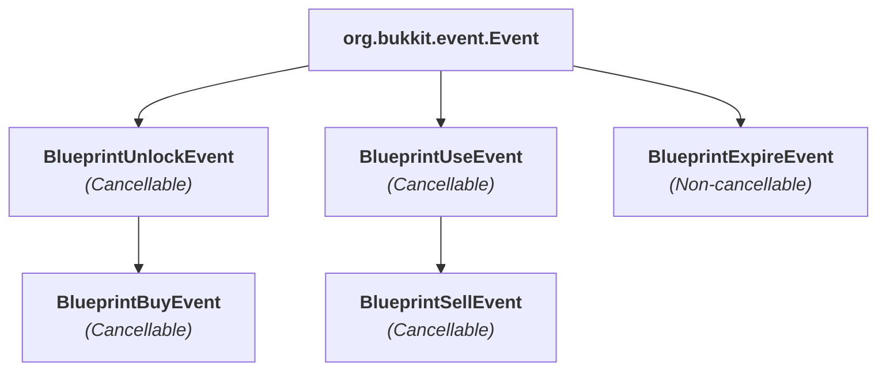

# Developer API & Bukkit Lifecycle Events

CraftingBlueprints provides a decoupled, lightweight public API artifact—**`crafting-blueprints-api`**—that allows third-party plugin developers to monitor player progression, hook into economy transactions, trigger quest milestones, and enforce custom gameplay rules.

---

## Dependency Installation

To compile against the CraftingBlueprints public event suite, add `crafting-blueprints-api` to your build tool.

=== "Maven (`pom.xml`)"

    ```xml
    <repositories>
        <!-- CraftingBlueprints Public Repository -->
        <repository>
            <id>xztotal-repo</id>
            <url>https://repo.xztotal.me/releases</url>
        </repository>
    </repositories>

    <dependencies>
        <!-- CraftingBlueprints Public API -->
        <dependency>
            <groupId>me.xztotal.plugins</groupId>
            <artifactId>crafting-blueprints-api</artifactId>
            <version>2.0.0</version>
            <scope>provided</scope>
        </dependency>
    </dependencies>
    ```

=== "Gradle Kotlin DSL (`build.gradle.kts`)"

    ```kotlin
    repositories {
        mavenCentral()
        maven("https://repo.xztotal.me/releases")
    }

    dependencies {
        compileOnly("me.xztotal.plugins:crafting-blueprints-api:2.0.0")
    }
    ```

=== "Gradle Groovy (`build.gradle`)"

    ```groovy
    repositories {
        mavenCentral()
        maven { url 'https://repo.xztotal.me/releases' }
    }

    dependencies {
        compileOnly 'me.xztotal.plugins:crafting-blueprints-api:2.0.0'
    }
    ```

---

## Event Architecture & Lifecycle

Every blueprint interaction fires synchronous, strongly-typed Bukkit events extending `org.bukkit.event.Event`:



---

### 1. `BlueprintUnlockEvent`

Fired immediately before a player learns a blueprint (permanently or temporally) and stores it in their active profile.

- **Class**: `me.xztotal.plugins.craftingblueprints.api.event.BlueprintUnlockEvent`
- **Interfaces**: `org.bukkit.event.Cancellable`
- **Thread**: Primary Server Thread (`Bukkit.isPrimaryThread()`)

| Method / Field | Return Type | Description |
| :--- | :---: | :--- |
| `getPlayer()` | `Player` | The player acquiring the blueprint knowledge. |
| `getBlueprintId()` | `String` | The unique identifier of the blueprint being unlocked. |
| `getBlueprintType()` | `int` | Blueprint station type (`0` = Craft, `1` = Enchant, `2` = Potion). |
| `isPermanent()` | `boolean` | `true` if unlocked indefinitely; `false` if limited by timer. |
| `getUses()` | `int` | Configured craft usages granted (`0` if unlimited). |
| `getDurationMs()` | `long` | Temporal duration granted in milliseconds (`0` if permanent). |
| `getSource()` | `UnlockSource` | The acquisition channel: `COMMAND`, `PHYSICAL_ITEM`, `VAULT_PURCHASE`, or `SYNC`. |
| `isCancelled()` / `setCancelled(boolean)` | `boolean` | If set to `true`, the blueprint is **not** learned, and any physical voucher item is preserved in the player's inventory. |

---

### 2. `BlueprintUseEvent`

Fired at the exact moment a player uses an unlocked blueprint during workbench crafting, furnace smelting, anvil combination, brewing, or stonecutting, right before a usage count is deducted.

- **Class**: `me.xztotal.plugins.craftingblueprints.api.event.BlueprintUseEvent`
- **Interfaces**: `org.bukkit.event.Cancellable`
- **Thread**: Primary Server Thread (`Bukkit.isPrimaryThread()`)

| Method / Field | Return Type | Description |
| :--- | :---: | :--- |
| `getPlayer()` | `Player` | The player operating the workstation. |
| `getBlueprintId()` | `String` | The blueprint identifier authorizing the craft. |
| `getBlueprintType()` | `int` | Workstation type (`0` = Craft, `1` = Enchant, `2` = Potion, `3` = Smelt, `4` = Stonecut). |
| `getUsesDeducted()` | `int` | Number of uses about to be subtracted (typically `1`, or higher during shift-crafting). |
| `getRemainingUses()` | `int` | Usages remaining in the player's profile after this deduction. |
| `isCancelled()` / `setCancelled(boolean)` | `boolean` | If set to `true`, the crafting action is aborted, items remain in the matrix, and usages are preserved. |

---

### 3. `BlueprintExpireEvent`

Fired when a temporal blueprint's expiration timestamp is reached and the blueprint is evicted from the player's account profile.

- **Class**: `me.xztotal.plugins.craftingblueprints.api.event.BlueprintExpireEvent`
- **Interfaces**: Non-cancellable
- **Thread**: Primary Server Thread or Asynchronous Task (when evicted during offline cleanup)

| Method / Field | Return Type | Description |
| :--- | :---: | :--- |
| `getPlayerUuid()` | `UUID` | The unique UUID of the player whose blueprint expired. |
| `getBlueprintId()` | `String` | The unique identifier of the expired blueprint. |
| `getBlueprintType()` | `int` | Blueprint category (`0` = Craft, `1` = Enchant, `2` = Potion). |

---

### 4. `BlueprintBuyEvent`

Fired inside `EconomyTransactionService` when a player issues `/cb buy <id>`, immediately before Vault funds are withdrawn.

- **Class**: `me.xztotal.plugins.craftingblueprints.api.event.BlueprintBuyEvent`
- **Interfaces**: `org.bukkit.event.Cancellable`
- **Thread**: Primary Server Thread (`Bukkit.isPrimaryThread()`)

| Method / Field | Return Type | Description |
| :--- | :---: | :--- |
| `getPlayer()` | `Player` | The player purchasing the blueprint. |
| `getBlueprintId()` | `String` | The blueprint being purchased. |
| `getPrice()` | `double` | The Vault currency amount about to be deducted. |
| `isPhysicalItem()` | `boolean` | `true` if purchasing via `/cb buy <id> --item`; `false` if direct knowledge. |
| `isCancelled()` / `setCancelled(boolean)` | `boolean` | If set to `true`, the purchase is rejected with zero financial penalty. |

---

### 5. `BlueprintSellEvent`

Fired inside `SellSubCommand` when a player issues `/cb sell`, immediately before the held physical blueprint item is consumed and currency is deposited.

- **Class**: `me.xztotal.plugins.craftingblueprints.api.event.BlueprintSellEvent`
- **Interfaces**: `org.bukkit.event.Cancellable`
- **Thread**: Primary Server Thread (`Bukkit.isPrimaryThread()`)

| Method / Field | Return Type | Description |
| :--- | :---: | :--- |
| `getPlayer()` | `Player` | The player liquidating the blueprint. |
| `getBlueprintId()` | `String` | The blueprint identifier on the physical scroll. |
| `getSellPrice()` | `double` | The Vault currency amount about to be deposited. |
| `getItem()` | `ItemStack` | The exact physical item held in the player's main hand. |
| `isCancelled()` / `setCancelled(boolean)` | `boolean` | If set to `true`, the sale is rejected, and the physical item is kept. |

---

## Copy-Paste Integration Examples

### Example 1: Quest Stage Progression (Java)

This production listener hooks into `BlueprintUnlockEvent`. When a player redeems an ancient blueprint scroll (e.g. `smp_netherite_chestplate`), the quest system advances their quest objective and awards extra XP.

```java
package com.example.serverquests.listeners;

import me.xztotal.plugins.craftingblueprints.api.event.BlueprintUnlockEvent;
import org.bukkit.Sound;
import org.bukkit.entity.Player;
import org.bukkit.event.EventHandler;
import org.bukkit.event.EventPriority;
import org.bukkit.event.Listener;

public class QuestProgressionListener implements Listener {

    @EventHandler(priority = EventPriority.MONITOR, ignoreCancelled = true)
    public void onBlueprintUnlock(BlueprintUnlockEvent event) {
        Player player = event.getPlayer();
        String blueprintId = event.getBlueprintId();

        // Check if the unlocked blueprint matches the master quest goal
        if ("smp_netherite_chestplate".equalsIgnoreCase(blueprintId)) {
            player.sendMessage("§6[Quest] §aMastery Achieved: You have learned the secrets of Netherite forging!");
            player.giveExp(500);
            player.playSound(player.getLocation(), Sound.UI_TOAST_CHALLENGE_COMPLETE, 1.0f, 1.0f);

            // Notify custom quest database or progression system
            // QuestManager.completeStage(player.getUniqueId(), "forge_mastery_stage_1");
        }
    }
}
```

---

### Example 2: High-Tier Purchase Staff Alerts (Kotlin)

This listener monitors `BlueprintBuyEvent`. If a player purchases an expensive end-game blueprint exceeding \$10,000, it notifies online staff members and logs the transaction.

```kotlin
package com.example.audit.listeners

import me.xztotal.plugins.craftingblueprints.api.event.BlueprintBuyEvent
import org.bukkit.Bukkit
import org.bukkit.event.EventHandler
import org.bukkit.event.EventPriority
import org.bukkit.event.Listener

class EconomyAuditListener : Listener {

    @EventHandler(priority = EventPriority.HIGHEST, ignoreCancelled = true)
    fun onBlueprintBuy(event: BlueprintBuyEvent) {
        val player = event.player
        val price = event.price
        val blueprintId = event.blueprintId

        // Flag end-game economy purchases for staff auditing
        if (price >= 10_000.0) {
            val alert = "§e[Audit] §fPlayer §b${player.name} §fpurchased tier blueprint §6$blueprintId §ffor §a\$$price"
            
            // Broadcast to staff with permission
            Bukkit.getOnlinePlayers()
                .filter { it.hasPermission("server.staff.alerts") }
                .forEach { it.sendMessage(alert) }

            Bukkit.getLogger().info("[StaffAudit] $alert")
        }
    }
}
```

---

## Architectural Invariants & Thread Safety

To guarantee that third-party listeners never stall server performance or cause database race conditions, CraftingBlueprints enforces three strict architectural invariants:

1. **Primary Server Thread Dispatch Contract**:
   All cancellable player events (`BlueprintUnlockEvent`, `BlueprintUseEvent`, `BlueprintBuyEvent`, `BlueprintSellEvent`) are dispatched strictly on the primary server thread (`Bukkit.isPrimaryThread()`). Third-party listeners can safely manipulate inventories, play sounds, or interact with Bukkit APIs without scheduling sync tasks.

2. **Alien Method Call & Deadlock Prevention**:
   Neither `BlueprintUnlockEvent` nor `BlueprintUseEvent` is ever fired while holding internal database locks (`user.lock`). Event pre-validation and cancellation checks execute **before** acquiring domain locks, preventing thread stalls and lock-order inversion deadlocks.

3. **Atomic Batch Unlock Operations**:
   When a player opens a blueprint pack (`PackageItem`), the engine evaluates `BlueprintUnlockEvent` for every recipe in the package **before** committing any state changes. If a third-party listener cancels even one recipe in the package, the entire package redemption is aborted cleanly with zero partial knowledge applied or item duplication.
