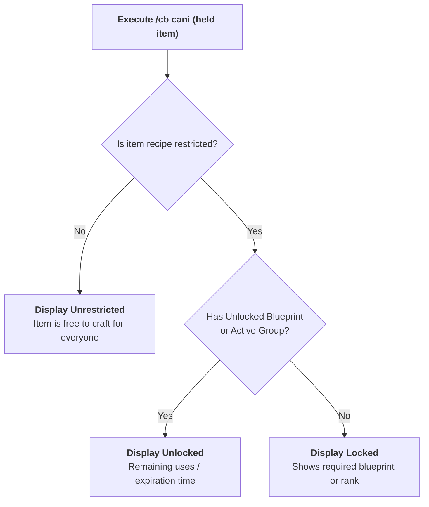

# Player Command Guide

CraftingBlueprints provides an intuitive, player-centric command suite designed to make blueprint progression transparent and frictionless. Players can inspect unlocked recipes, monitor remaining craft usages and expiration clocks, navigate personal progression menus, and trade blueprints via the server economy.

---

## Player Subcommands Reference Table

All player subcommands are executed using the root `/cb` or `/craftingblueprints` command alias.

| Command | Arguments | Permission Node | Default State | Description |
| :--- | :--- | :--- | :---: | :--- |
| **`/cb menu`** | `[player]` | `craftingblueprints.menu` | `true` | Opens the personal progression GUI (`PlayerInfoMenu`) displaying unlocked blueprints and categories. |
| **`/cb return`** | None | `craftingblueprints.return` | `false` | Re-opens the previous GUI menu from the LIFO navigation stack or restores an ESC-closed session. |
| **`/cb cani`** | `[item]` | `craftingblueprints.cani` | `true` | Checks if you possess the blueprint knowledge to craft, smelt, stonecut, brew, or enchant a target item. |
| **`/cb info`** | `[id]` | `craftingblueprints.info` | `true` | Opens the blueprint inspection menu (`SingleInfoMenu`) displaying target recipe preview and usage bounds. |
| **`/cb buy`** | `<id> [--item]` | `craftingblueprints.buy` | `true` | Purchases blueprint access (or a physical voucher item with `--item`) via Vault economy. |
| **`/cb sell`** | None | `craftingblueprints.sell` | `true` | Sells the physical blueprint item held in your main hand for Vault currency. |
| **`/cb owner`** | None | `craftingblueprints.owner` | `true` | Displays the original author, creator, or bound owner of the blueprint item held in hand. |

!!! note
    All player commands adapt to the server's configured localization language (`lang: en` or `lang: es` in `config.yml`) and render via Kyori Adventure MiniMessage typography.

---

## Detailed Command Specifications

### 1. Personal Progression Menu (`/cb menu`)

Opens the primary interactive blueprint catalog (`PlayerInfoMenu`), categorizing all recipes your player account currently knows.

```bash
/cb menu
```

| Category Filter | Category Icon | Typical Gated Blueprints |
| :--- | :---: | :--- |
| **Weapons** | ⚔ | Swords, bows, tridents, custom katanas |
| **Armor** | 🛡 | Netherite armor sets, turtle helmets, elytra |
| **Tools** | ⛏ | Pickaxes, axes, shovels, hoes |
| **Potions** | ⚗ | Strength II, Speed II, Invisibility brews |
| **Enchants** | ✨ | Mending, Sharpness V, Unbreaking III books |
| **Building** | 🧱 | Stonecutter blocks, bricks, copper variants |
| **Redstone** | ⚡ | Crafter block recipes, target blocks |
| **Packages** | 📦 | Bundled masterwork blueprints |

#### Menu Capabilities:

- **Station Categories**: Filter recipes across Crafting Tables, Furnaces/Smokers/Blast Furnaces, Stonecutters, Brewing Stands, and Enchanting Tables.
- **Durability Indicators**: Displays whether each blueprint is **Permanent**, **Timed** (with live duration countdown), or **Usage-Limited** (remaining crafts).
- **Inspect on Click**: Left-clicking any unlocked entry opens its recipe preview displaying crafting matrix ingredients.

#### Inspecting Other Players:
Administrators and staff can view another player's progression menu by appending their username:
```bash
/cb menu Steve
```
*Requires permission: `craftingblueprints.menu.others` (default: `false` / OP).*

---

### 2. Navigation Restoration & ESC Recovery (`/cb return`)

Re-opens the previously viewed menu in your navigation history or restores a menu closed with the keyboard **ESC** key.

```bash
/cb return
# Alias:
/cb re
```

#### LIFO Stack & Session Restoration Contract:
CraftingBlueprints maintains an in-memory Last-In, First-Out (LIFO) navigation stack for every player:

1. **Active Inventory Hierarchy**: If you are navigating deep into a sub-menu (e.g. `MainMenu -> Armor Category -> Diamond Chestplate Info`) and press the menu's back button or execute `/cb return`, the engine pops the top entry and restores `Armor Category`.
2. **ESC Session Preservation**: If you accidentally press the `ESC` key while browsing a menu, Minecraft normally closes the window and loses your place. CraftingBlueprints captures the close event in `MenuSession.lastClosedMenu`. Executing `/cb return` immediately restores the exact menu and page you were viewing!
3. **Safety Purge**: Menu items are protected by internal anti-steal tags (`MENU_TYPE`). You can never accidentally extract GUI icons when reopening menus via `/cb return`.

!!! tip
    Server owners often grant `craftingblueprints.return` to VIP or donor ranks as a quality-of-life navigation perk. See [LuckPerms Guide](luckperms-permissions.md) for configuration snippets.

---

### 3. Crafting Eligibility Verification (`/cb cani`)

The `/cb cani` ("Can I?") command verifies whether you have the necessary blueprint permissions or remaining uses to craft, smelt, brew, or enchant an item before gathering or wasting valuable ingredients.

```bash
/cb cani
```

#### How It Works:
Hold the target item (or blueprint voucher) in your main hand and execute `/cb cani`. The engine checks your player data against the restriction rules and outputs one of five explicit statuses:



#### Status Feedback Examples:

- **Unrestricted Recipe**:
  `<green>✔</green> <white>The recipe for <yellow>Iron Pickaxe</yellow> is unrestricted. You can craft it freely!</white>`

- **Permanent Knowledge**:
  `<green>✔</green> <white>You have permanently unlocked the blueprint for <aqua>Diamond Chestplate</aqua>.</white>`

- **Time-Limited Knowledge**:
  `<green>✔</green> <white>You can craft <aqua>Speed II Potion</aqua> for another <yellow>3 hours, 42 minutes</yellow>.</white>`

- **Craft-Limited Uses**:
  `<green>✔</green> <white>You have <yellow>3 crafts</yellow> remaining for <aqua>Netherite Sword</aqua>.</white>`

- **Timed & Uses Combined**:
  `<green>✔</green> <white>You can craft <aqua>Mace</aqua> for another <yellow>1 day</yellow> (<yellow>5 crafts</yellow> remaining).</white>`

- **Missing Blueprint**:
  `<red>✖</red> <white>You do not possess the required blueprint to craft <red>Netherite Chestplate</red>.</white>`

---

### 4. Blueprint Inspection Menu (`/cb info`)

Inspects the comprehensive recipe preview, economy price, remaining durability, and acquisition lore of a blueprint.

```bash
# Inspect blueprint item held in main hand:
/cb info

# Inspect a registered blueprint by ID:
/cb info netherite_chestplate
```

#### Information Displayed:

- **Interactive Recipe Grid**: Visualizes the exact 3x3 crafting grid, brewing stand slots, or furnace input required.
- **Acquisition Information**: Displays where the blueprint can be acquired (world dungeon loot, mob drops, economy shop).
- **Durability Bounds**: Shows permanent status, finite craft counts, or duration clock.
- **Economy Valuation**: Shows purchase cost (`/cb buy`) and pawn shop redemption value (`/cb sell`).

---

### 5. Economy Purchase Flow (`/cb buy`)

Allows players to purchase blueprint access or physical blueprint items directly using server currency through the **Vault** economy hook.

```bash
# Purchase and immediately unlock blueprint knowledge:
/cb buy diamond_sword

# Purchase as a physical tradeable item voucher:
/cb buy diamond_sword --item
```

#### Purchase Modes:

1. **Direct Unlock (Default)**:
    - Deducts the configured `price:` from your Vault economy balance.
    - Immediately binds the recipe knowledge to your account in the database.
    - You can start crafting at workstations instantly without carrying any physical voucher items.
2. **Physical Item Voucher (`--item`)**:
    - Deducts the configured `price:` from your balance.
    - Generates a physical blueprint item into your inventory.
    - Physical vouchers can be traded with other players, sold on auction houses, placed in display item frames, or stored in storage chests.

!!! warning
    If your inventory is completely full when purchasing with `--item`, the engine safely drops the item at your feet via `world.dropItem(...)` to prevent silent item loss.

---

### 6. Economy Pawn Shop (`/cb sell`)

Players can liquidate physical blueprints found in world dungeons, trial chambers, or mob drops for server currency.

```bash
/cb sell
```

#### How Selling Works:

1. Hold the physical blueprint item in your **main hand**.
2. Run `/cb sell`.
3. The engine verifies that:
    - The item is a valid CraftingBlueprints item (stamped with `ItemPDT`).
    - The blueprint has a configured `sell_price > 0.0`.
4. The blueprint item is consumed from your hand, and the funds are credited to your Vault balance with a transaction sound effect (`ENTITY_EXPERIENCE_ORB_PICKUP`).

```
[Economy] Sold 1x Netherite Chestplate Blueprint for $2,500.00!
```

---

### 7. Blueprint Creator & Owner Inspection (`/cb owner`)

Inspects the original author, crafter, or owner bound to the blueprint item in your main hand.

```bash
/cb owner
```

#### Ownership Semantics:

- **Player-Crafted / Bound Blueprint**:
  `<gray>This blueprint is owned by: <gold>Steve</gold></gray>`

- **Natural World Loot / Unbound Blueprint**:
  `<gray>This blueprint has no bound owner and can be claimed by anyone.</gray>`

---

## Command Feedback & MiniMessage Localization

All command responses render through the plugin's localization engine (`plugins/CraftingBlueprints/messages_en.yml`). Server administrators can customize message text, sound effects, and color themes using Kyori Adventure MiniMessage formatting tags:

```yaml
messages:
  warning:
    command:
      cani:
        permanent: "<prefix><green>✔</green> <white>You have permanently unlocked <aqua><blueprint_name></aqua>!</white>"
        until: "<prefix><green>✔</green> <white>You can craft <aqua><blueprint_name></aqua> for: <yellow><date></yellow>.</white>"
        uses: "<prefix><green>✔</green> <white>You have <yellow><uses> uses</yellow> remaining for <aqua><blueprint_name></aqua>.</white>"
        not_had: "<prefix><red>✖</red> <white>You do not know the blueprint for <red><blueprint_name></red>.</white>"
```

### Supported Dynamic Placeholders

| Placeholder | Context | Example Value |
| :--- | :--- | :--- |
| `<blueprint_name>` | Target recipe or blueprint name | `Diamond Chestplate` |
| `<uses>` | Remaining craft count | `5` |
| `<date>` | Human-formatted remaining duration | `2h 30m` |
| `<player_name>` | Target player username | `Alex` |
| `<price>` | Vault economy transaction cost | `$1,500.00` |

---

## Related References

- [Admin Operations & Scaffolding](admin-commands.md) — Administrative CLI commands, `/cb give`, and recipe scaffolding.
- [LuckPerms Guide & OP Isolation](luckperms-permissions.md) — Permission tiers for default players, VIPs, and staff.
- [World Loot & Chest Injection](world-loot-tables.md) — Populating blueprints in survival dungeons and vaults.
- [In-Game Menus & Catalog](../mechanics/menus-and-catalog.md) — Deep dive into GUI interaction mechanics.
