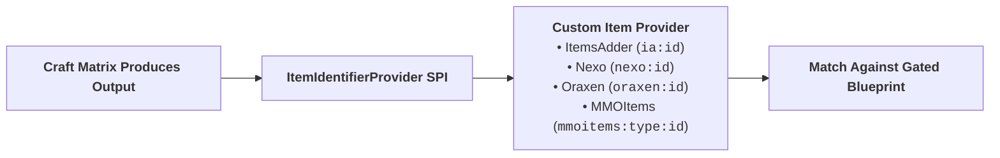

# Tutorial: Custom Items Integration (ItemsAdder, Nexo & Oraxen)

On modern Minecraft servers, custom weapons, armor, and tools rarely use vanilla item types alone. Popular plugins like **ItemsAdder**, **Nexo**, and **Oraxen** create hundreds of distinct RPG items that share identical base vanilla materials (e.g. `DIAMOND_SWORD`, `BOW`, `NETHERITE_CHESTPLATE`) differentiated only by `CustomModelData` and persistent NBT tags.

In naive progression systems, gating a custom ruby sword unintentionally locks **all standard vanilla diamond swords**.

CraftingBlueprints solves this through the **`ItemIdentifierProvider` Service Provider Interface (SPI)**, providing clean, collision-free blueprint gating for custom gear.



---

## Prerequisites

1. Paper 1.18.2 – 1.21.x server with CraftingBlueprints installed.
2. At least one supported custom item engine active:
    - **ItemsAdder** (v3.5.0+)
    - **Nexo** (v0.4.0+)
    - **Oraxen** (v1.160.0+)
3. Custom items and their corresponding crafting recipes already configured in your custom item plugin.

---

## Step 1: Discover Custom Namespaced Item Keys

CraftingBlueprints uses standardized namespaced prefixes to resolve custom items unambiguously:

| Plugin Provider | SPI Prefix | Example Namespaced Identifier | Internal Resolution |
| :--- | :---: | :--- | :--- |
| **ItemsAdder** | `ia:` | `ia:rpgweapons:excalibur` | `CustomStack.byItemStack(item).namespacedID` |
| **Nexo** | `nexo:` | `nexo:mythril_axe` | `NexoItems.idFromItem(item)` |
| **Oraxen** | `oraxen:` | `oraxen:titan_bow` | `OraxenItems.getIdByItem(item)` |
| **MMOItems** | `mmoitems:` | `mmoitems:SWORD:EXCALIBUR` | `NBTItem.get(item).getType()` + ID |
| **EcoItems** | `ecoitems:` | `ecoitems:blood_scythe` | Paper PDC `ecoitems:item` |

!!! note "Priority Hierarchy"
    The SPI evaluates Tier 1 exact plugin hooks first (Priority 100). If an item is recognized as an ItemsAdder or Nexo custom item, the engine binds immediately to the custom ID, bypassing the lower-tier vanilla material fallback (`DIAMOND_SWORD`).

---

## Step 2: Auto-Generate Blueprints via Scaffolder (`/cb generate`)

Rather than writing dozens of YAML blueprints by hand, use the built-in auto-scaffolder to inspect your custom item plugin's registry and generate production-ready YAML definitions.

### Auto-Generating ItemsAdder Weapons:
```bash
/cb generate itemsadder:weapons --price-scale 1.5 --out custom/ia_weapons.yml
```

### Auto-Generating Nexo Items:
```bash
/cb generate nexo:weapons --price-scale 1.5 --out custom/nexo_weapons.yml
```

### Scaffolder Parameters:

- **`itemsadder:weapons`**: Scans the ItemsAdder registry for items categorized under weapons (or recipe outputs matching `itemsadder`).
- **`--price-scale 1.5`**: Scales base estimated crafting costs by 150% to establish calibrated Vault economy values.
- **`--out custom/ia_weapons.yml`**: Writes the generated blueprints to `blueprints/custom/ia_weapons.yml`.
- **`--dry-run`**: (Optional) Previews the blueprints in console without writing to disk.

---

## Step 3: Review and Fine-Tune the Generated Blueprints

Open the newly generated file at `plugins/CraftingBlueprints/blueprints/custom/ia_weapons.yml`.

The auto-scaffolder generates schema-valid YAML with proper namespaced targets:

```yaml
# yaml-language-server: $schema=./blueprint.schema.json
default:
  permanent: true
  extra:
    tier: "LEGENDARY"
    custom_engine: "ItemsAdder"

singles:
  excalibur_blueprint:
    # Explicit custom namespaced target:
    blueprint: "ia:rpgweapons:excalibur"
    name: "<gradient:#FFD700:#FFA500><bold>Blueprint: Excalibur</bold></gradient>"
    price: 25000.0
    sell_price: 6000.0
    item:
      material: PAPER
      custom_model_data: 5010
      glowing: true
    lore:
      - "<gray>Ancient blueprint containing celestial smithing schematics.</gray>"
      - "<gray>Unlocks: <gold>Excalibur (ItemsAdder)</gold></gray>"
      - ""
      - "<yellow>Purchase Cost: <green>${price}</green></yellow>"
      - "<gold>Permanent Knowledge</gold>"

  ruby_dagger_blueprint:
    blueprint: "ia:rpgweapons:ruby_dagger"
    name: "<gradient:#FF0055:#880000><bold>Blueprint: Ruby Dagger</bold></gradient>"
    price: 12000.0
    sell_price: 3000.0
    item:
      material: PAPER
      custom_model_data: 5011
      glowing: true
    lore:
      - "<gray>Schematic for forging blood-infused crimson blades.</gray>"
      - "<gray>Unlocks: <red>Ruby Dagger (ItemsAdder)</red></gray>"
      - ""
      - "<yellow>Purchase Cost: <green>${price}</green></yellow>"
      - "<gold>Permanent Knowledge</gold>"
```

### Gating the Custom Items
Now configure the restriction engine so players cannot craft these custom weapons without the blueprint.

Open `plugins/CraftingBlueprints/config.yml` (or `plugins/CraftingBlueprints/configs/custom_items.yml`):

```yaml
restrictions:
  restricted-items:
    # Gate all ItemsAdder RPG weapons
    - "ia:rpgweapons:.*"
    
    # Or gate specific items individually
    # - "ia:rpgweapons:excalibur"
    # - "nexo:mythril_axe"
```

Reload the plugin to apply changes:
```bash
/cb reload
```

---

## Step 4: Verification & Craft Collision Testing

Verify that custom items are gated without affecting base vanilla items.

### 1. Test Vanilla Diamond Sword Crafting (Unrestricted)

1. Open a standard Crafting Table as a non-OP player who has not unlocked any blueprints.
2. Place 1 Stick and 2 Diamonds in the grid to craft a standard vanilla `minecraft:diamond_sword`.
3. **Result**: The vanilla sword crafts freely without restriction!

### 2. Test Custom Excalibur Crafting (Gated)

1. Arrange the custom crafting recipe for Excalibur in the Crafting Table (as configured in ItemsAdder).
2. **Result**: The output slot is locked! Hovering reveals:
   ```
   Locked Recipe: Requires Blueprint: Excalibur
   ```

3. Attempting to click the output item is rejected, and ingredients remain in the grid.

### 3. Grant & Study Custom Blueprint

1. Grant the blueprint:
   ```bash
   /cb give Steve excalibur_blueprint
   ```

2. Right-click the scroll to unlock `ia:rpgweapons:excalibur`.
3. Return to the Crafting Table: Excalibur is now craftable, while other custom weapons (e.g. `ia:rpgweapons:ruby_dagger`) remain locked until their specific blueprints are acquired.
