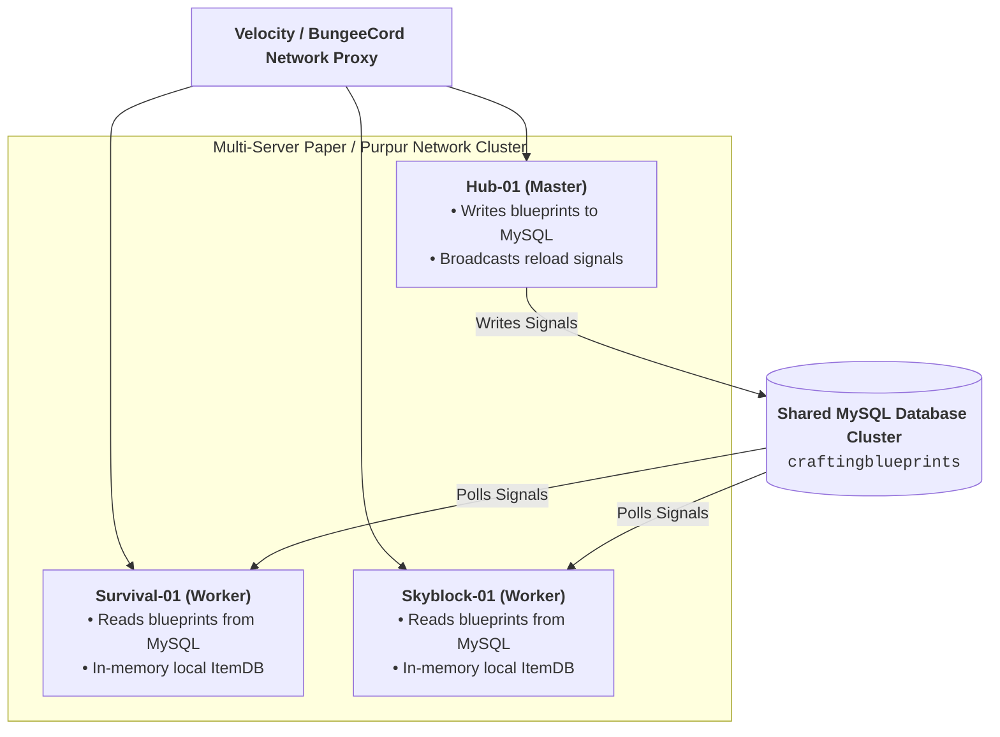

# Tutorial: Multi-Server Cluster Deployment (Velocity / BungeeCord)

In modern Minecraft networks powered by Velocity or BungeeCord proxies, players switch seamlessly between servers (e.g. Hub, Survival, Skyblock, and Minigames). 

Running independent, isolated blueprint files on each sub-server creates severe operational overhead: administrators must manually duplicate YAML files across nodes, players lose learned blueprints when jumping servers, and custom map textures desynchronize.

This tutorial guides you through configuring a **zero-NFS, high-performance Master-Worker network cluster** using shared MySQL and the **Cluster File Distribution Bus** (`cb_cluster_files`).



---

## Prerequisites

1. A centralized MySQL (5.7+) or MariaDB (10.4+) database accessible from all server instances.
2. Three Paper/Purpur instances:
    - `Hub` (designated as the single Master node).
    - `Survival` (designated as Worker node 1).
    - `Skyblock` (designated as Worker node 2).
3. CraftingBlueprints installed in `plugins/` on all three servers.

---

## Step 1: Configure Shared MySQL Connection (`database.yml`)

On **all three servers**, edit `plugins/CraftingBlueprints/database.yml` to point to the shared MySQL database.

```yaml
# ============================================================
#                 DATABASE STORAGE CONFIGURATION
# ============================================================
storage:
  # Supported types: SQLITE, MYSQL
  type: MYSQL

  mysql:
    host: "10.0.0.5"
    port: 3306
    database: "network_blueprints"
    username: "crafting_user"
    password: "SecureProductionPassword123!"

    # Connection pool tuning via HikariCP
    pool:
      pool-name: "CraftingBlueprints-Hikari"
      maximum-pool-size: 10
      minimum-idle: 2
      connection-timeout: 5000       # 5 seconds
      idle-timeout: 600000           # 10 minutes
      max-lifetime: 1800000          # 30 minutes

    # SSL & Character Encoding settings
    properties:
      useSSL: false
      allowPublicKeyRetrieval: true
      serverTimezone: "UTC"
      characterEncoding: "utf8mb4"
```

!!! important
    Ensure all three servers specify identical `database:` names and credentials so they share the `cb_player_data`, `cb_cluster_files`, and `cb_sync_signals` tables.

---

## Step 2: Configure the Master Node (Hub Server)

The Master node is the sole authoritative source of blueprint compilation. Administrative commands (`/cb preset apply`, `/cb generate`, `/cb reload`) are executed exclusively on the Master.

On the **Hub Server**, open `plugins/CraftingBlueprints/config.yml`:

```yaml
# ------------------------------------------------------------
# MULTI-SERVER CLUSTER SETTINGS
# ------------------------------------------------------------
# Master Node: Compiles YAML into database and distributes assets
is-master: true

# Cluster File Distribution Bus
cluster-file-sync:
  # Enable asset synchronization across the network
  enabled: true
  
  # Heartbeat ping rate in seconds to broadcast signals
  heartbeat-interval: 5
```

!!! caution "Strict Single-Master Invariant"
    Never configure `is-master: true` on more than one server connected to the same database. Multiple active Masters can trigger split-brain conflicts, overwriting database files and causing hash divergence.

---

## Step 3: Configure Worker Nodes (Survival & Skyblock)

Worker nodes operate in high-performance read-only mirroring mode. They pull compiled blueprints and physical assets directly from MySQL.

On **Survival** and **Skyblock**, open `plugins/CraftingBlueprints/config.yml`:

```yaml
# ------------------------------------------------------------
# MULTI-SERVER CLUSTER SETTINGS
# ------------------------------------------------------------
# Worker Node: Read-only mirror pulling from shared MySQL
is-master: false

# Cluster File Distribution Bus
cluster-file-sync:
  enabled: true

  # Download missing or updated assets synchronously on server boot
  # before initializing items, ensuring zero missing map graphics.
  sync-on-startup: true

  # Check for updates and mirror deltas when receiving heartbeat signals
  sync-on-heartbeat: true
```

---

## Step 4: Asset Deployment & Cluster Verification

Now deploy an entire progression system on the Master node and verify that it synchronizes to all Workers automatically.

### 1. Boot Servers in Sequence

1. Start the **Hub Server (Master)**. Check console to confirm MySQL tables are created and `is-master: true` is acknowledged.
2. Start **Survival** and **Skyblock** (Workers). Check console to confirm `sync-on-startup: true` executes.

### 2. Deploy a Progression Preset on the Master Node
On the **Hub Server**, deploy the built-in RPG progression pack:

```bash
/cb preset apply rpg_tiers --confirm
```

The Master node executes the following operations in less than 500 ms:

1. Generates 34 declarative blueprints and 5 tiered templates in `blueprints/presets/rpg_tiers/`.
2. Writes restriction files to `configs/presets/rpg_tiers/`.
3. Copies map background textures into `images/presets/rpg_tiers/`.
4. Uploads all generated YAML and PNG assets into `cb_cluster_files`.
5. Emits a `CLUSTER_FILES_SYNC` signal into `cb_sync_signals`.

### 3. Observe Automatic Mirroring on Worker Nodes
Within 5 seconds (the heartbeat interval), observe the console on **Survival** and **Skyblock**:

```text
[CraftingBlueprints] [ClusterSync] Received CLUSTER_FILES_SYNC signal from Hub (Master).
[CraftingBlueprints] [ClusterSync] Manifest check: 8 new files, 0 modified, 0 pruned.
[CraftingBlueprints] [ClusterSync] Synchronized blueprints/presets/rpg_tiers/tier_weapons.yml (SHA-256 verified).
[CraftingBlueprints] [ClusterSync] Synchronized images/presets/rpg_tiers/frame_apprentice.png (Binary verified).
[CraftingBlueprints] [ClusterSync] Disk parity achieved (100%). Evicting runtime caches and reloading recipes...
```

Worker nodes automatically write to temporary files, apply atomic file replacement (`ATOMIC_MOVE`), and clear the image compositor cache with **zero downtime or server restarts**.

---

### 4. Verify Network Cluster Health

Run the diagnostic cluster command on any server:

```bash
/cb cluster status
```

#### Expected Output:
```text
=== CraftingBlueprints Network Cluster Status ===
Node Role: WORKER (Survival-1)
Cluster Mode: ACTIVE | Database: MySQL (HikariCP 5.1.0)
Cluster File Sync: ENABLED | Parity State: 100% IN-SYNC
Total Synced Files: 14 (Blueprints: 8, Images: 4, Configs: 2)
Last Master Sync: 3 seconds ago (from node 'Hub-Master')
Pending Deltas: 0 files
```

### 5. Verify Cross-Server Player Progression

1. On the **Hub Server**, give a test blueprint to Steve:
   ```bash
   /cb give Steve rpg_t1_apprentice_sword
   ```

2. Have Steve right-click to study the blueprint on the Hub.
3. Steve switches servers to **Survival** via `/server survival`.
4. On Survival, Steve opens a Crafting Table: the `rpg_t1_apprentice_sword` recipe is immediately unlocked and craftable!
5. Steve crafts the sword, consuming 1 usage.
6. Steve jumps to **Skyblock** via `/server skyblock`: executing `/cb info rpg_t1_apprentice_sword` confirms the updated remaining usage balance has mirrored across all servers without latency.
