# Tutorial: RPG Magic Forge Scrolls (Limited Uses & Particle Aesthetics)

In RPG, MMORPG, and faction servers, blueprints can serve as **consumable crafting permits** rather than permanent unlocks. By configuring limited craft usages (`uses: 3`), server operators can create high-value "Forge Scrolls" that reward players from dungeons, boss battles, or vote crates while preserving a dynamic crafting economy.

This tutorial demonstrates how to use **Reusable Templates (Mixins)** to create 3-use glowing parchment scrolls for elemental RPG weapons, and how usage depletion enforces progression balance.

```mermaid
flowchart LR
    subgraph Template["blueprints/templates/scroll_template.yml"]
        T1["• <code>uses: 3</code> (Finite durability)"]
        T2["• <code>permanent: false</code>"]
        T3["• <code>station: [CRAFTING_TABLE, ANVIL]</code>"]
    end

    subgraph Blueprint["blueprints/weapons.yml"]
        B1["<code>singles:</code>"]
        B2["  <code>infernal_blade:</code>"]
        B3["    <code>templates: [rpg_scroll]</code>"]
        B4["    <code>blueprint: NETHERITE_SWORD</code>"]
    end

    subgraph Item["In-Game Physical Scroll"]
        I1["Hold scroll in main hand"]
        I2["Right-click to redeem"]
        I3["Grants 3 craft uses of Infernal Blade"]
    end

    Template --> Blueprint --> Item
```



---

## Step 1: Create the Reusable Scroll Template

Templates eliminate boilerplate by defining shared durability rules, item visuals, and lore layouts once in `templates/`.

Create a new file at `plugins/CraftingBlueprints/blueprints/templates/scroll_template.yml`:

```yaml
# yaml-language-server: $schema=./blueprint.schema.json
templates:
  rpg_forge_scroll:
    permanent: false
    uses: 3              # Exactly 3 craft executions allowed
    price: 5000.0        # Vault buy price in shops
    sell_price: 1200.0   # Vault sell value
    item:
      material: PAPER
      custom_model_data: 2001
      glowing: true
    extra:
      tier: "EPIC"
      durability_type: "CHARGED"
    lore:
      - "<dark_purple>══════════════════════════════</dark_purple>"
      - "<gray>A mystical parchment inscribed with</gray>"
      - "<gray>enchanted runic forging diagrams.</gray>"
      - ""
      - "<yellow>Target Recipe:</yellow> <white>{blueprint_target}</white>"
      - "<gold>Forge Charges:</gold> <aqua>{uses} crafts remaining</aqua>"
      - "<yellow>Quality:</yellow> <light_purple>{tier}</light_purple>"
      - ""
      - "<green>Buy: ${price}</green> <gray>|</gray> <yellow>Sell: ${sell_price}</yellow>"
      - "<dark_purple>══════════════════════════════</dark_purple>"
      - "<dark_gray>Right-click to charge your crafting profile.</dark_gray>"
```

### Template Highlights:

- **`uses: 3`**: Limits total crafting output to 3 items before the blueprint is revoked.
- **`permanent: false`**: Declares this recipe as consumable.
- **`item.custom_model_data: 2001`**: Maps to custom 3D scroll textures in your server resource pack.
- **`{uses}`**: Automatically replaced by the engine with the configured initial charges on physical items, and remaining charges in `/cb info`.

---

## Step 2: Author the Elemental Weapons

Now create the blueprints inheriting from our template.

Create a new file at `plugins/CraftingBlueprints/blueprints/weapons.yml`:

```yaml
# yaml-language-server: $schema=./blueprint.schema.json
singles:
  infernal_blade:
    blueprint: "minecraft:diamond_sword"
    name: "<gradient:#FF4500:#FF8C00><bold>Scroll of the Infernal Blade</bold></gradient>"
    templates:
      - rpg_forge_scroll
    extra:
      element: "FIRE"

  frost_bow:
    blueprint: "minecraft:bow"
    name: "<gradient:#00FFFF:#0080FF><bold>Scroll of the Glacial Bow</bold></gradient>"
    templates:
      - rpg_forge_scroll
    extra:
      element: "ICE"

  storm_hammer:
    blueprint: "minecraft:mace"
    name: "<gradient:#FFD700:#FFA500><bold>Scroll of the Thunder Mace</bold></gradient>"
    templates:
      - rpg_forge_scroll
    extra:
      element: "LIGHTNING"
```

Because each entry references `templates: [rpg_forge_scroll]`, they automatically inherit `uses: 3`, `item: PAPER`, glowing glint, and the full formatted lore layout.

---

## Step 3: Gate the Weapon Recipes

To ensure players cannot craft diamond swords, bows, or maces without consuming scroll charges, add them to `restricted-items`.

Open `plugins/CraftingBlueprints/config.yml` (or `plugins/CraftingBlueprints/configs/rpg_weapons.yml`):

```yaml
restrictions:
  restricted-items:
    - "diamond_sword"
    - "bow"
    - "mace"
```

Reload the configuration to activate the restrictions:
```bash
/cb reload
```

---

## Step 4: In-Game Progression & Usage Depletion Testing

Follow this verification procedure to confirm that usage depletion works correctly in-game.

### 1. Grant the Forge Scroll
Give yourself a test scroll:
```bash
/cb give Steve infernal_blade
```
Examine the item in your hand. It renders as a glowing paper scroll with custom model data `2001` and reads:
`Forge Charges: 3 crafts remaining`.

### 2. Learn the Blueprint
Right-click while holding the scroll. The paper is consumed from your hand, a golden chime plays, and your account is credited with 3 uses of the `infernal_blade` blueprint.

### 3. Verify Account Charges
Check your active profile via `/cb info`:
```bash
/cb info infernal_blade
```
The info panel confirms that `infernal_blade` is known with `3` uses remaining.

### 4. Execute the First Craft (3 → 2)

1. Open a Crafting Table.
2. Place 1 Stick and 2 Diamonds to arrange the Diamond Sword recipe.
3. The result slot displays the unlocked Diamond Sword.
4. Take the sword.
5. In chat, CraftingBlueprints notifies you:
   ```
   [CraftingBlueprints] Craft authorized! (2 uses remaining)
   ```

### 5. Execute Second and Third Crafts (2 → 1 → 0)

1. Craft the sword a second time → `1 use remaining`.
2. Craft the sword a third time → `0 uses remaining (Blueprint consumed!)`.
3. The blueprint is now automatically removed from your player profile.

### 6. Attempt the Fourth Craft (Lock Enforcement)

1. Place diamonds and stick in the matrix for a fourth sword.
2. The result slot immediately switches to the locked barrier indicator:
   ```
   Locked Recipe: Requires Scroll of the Infernal Blade!
   ```

3. Clicking the output slot rejects extraction, preserving all diamonds safely in the grid.
4. Execute `/cb cani diamond_sword`: the system confirms you are no longer authorized to craft this item until you obtain another scroll.
