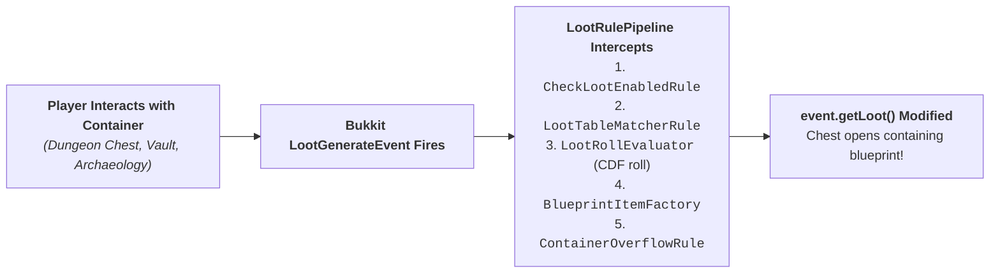
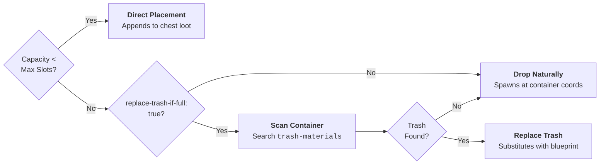

# World Loot & Chest Injection

CraftingBlueprints features an enterprise-grade, event-driven loot injection engine (`loot.yml`) that naturally distributes blueprint items across your Minecraft world. Rather than forcing players to acquire blueprints exclusively through administrative commands, shops, or quests, server administrators can populate blueprints throughout world dungeons, Nether fortresses, Ancient Cities, 1.21 Trial Chamber Vaults, archaeology brush sites, fishing treasures, and mob drops.

---

## Zero-Lag Event-Driven Architecture

Traditional loot injection plugins often scan world chunks on generation or run repeating background tasks that introduce server tick lag and inflate region files. CraftingBlueprints uses a **zero-lag, event-driven architecture**:

- **Native Paper/Bukkit Interception**: The engine hooks into `org.bukkit.event.world.LootGenerateEvent` at the native server level.
- **Lazy Evaluation**: In Minecraft, container loot tables are generated *lazily* only when a player physically opens an unopened chest, interacts with an ominous vault, brushes a block, or catches a fish. CraftingBlueprints calculates rolls solely at the exact instant of interaction.
- **Zero World Scanners**: The engine runs zero chunk-scanning tasks, schedules no heavy world iteration threads, and causes **0 TPS degradation**.



---

## Supported Generation Sources & Table Keys

CraftingBlueprints supports every loot table registered in Vanilla Minecraft, custom datapacks, and modded environments. Table keys use namespaced keys (`namespace:path`) and support both literal strings and wildcard patterns (`*`).

### Generation Sources Matrix

| Source Category | Namespaced Loot Table Pattern | Typical Blueprint Rewards |
| :--- | :--- | :--- |
| **Dungeons & Mineshafts** | `minecraft:chests/simple_dungeon`<br>`minecraft:chests/abandoned_mineshaft` | `iron_sword`, `shield`, `crossbow`, `rpg_dungeon_chest` |
| **Desert & Jungle Temples** | `minecraft:chests/desert_pyramid`<br>`minecraft:chests/jungle_temple` | `tnt`, `golden_apple`, `diamond_pickaxe` |
| **Nether Fortresses & Bastions** | `minecraft:chests/nether_bridge`<br>`minecraft:chests/bastion_*` | `brewing_stand`, `potion:fire_resistance`, `netherite_chestplate` |
| **Ancient Cities & End Cities** | `minecraft:chests/ancient_city`<br>`minecraft:chests/end_city_treasure` | `elytra`, `shulker_box`, `enchantment:mending`, `netherite_sword` |
| **1.21 Trial Chambers** | `minecraft:chests/trial_chambers/*`<br>`minecraft:chests/trial_chambers/reward_ominous` | `mace`, `wind_charge`, `heavy_core` |
| **1.20+ Archaeology** | `minecraft:archaeology/*`<br>`minecraft:archaeology/desert_pyramid` | `sniffer_egg`, `pottery_shard`, ancient utility blueprints |
| **Fishing Treasures** | `minecraft:gameplay/fishing/treasure` | `heart_of_the_sea`, `trident`, `fishing_rod` |
| **Boss & Mob Drops** | `minecraft:entities/wither_skeleton`<br>`minecraft:entities/warden`<br>`minecraft:entities/ender_dragon` | `netherite_sword`, `enchantment:soul_speed`, rare trophies |

!!! note
    Wildcard patterns like `minecraft:chests/bastion_*` automatically match all Bastion Remnant loot tables, including `bastion_treasure`, `bastion_other`, `bastion_bridge`, and `bastion_hoglin_stable`.

---

## Declarative `loot.yml` Configuration Guide

All world loot injection settings are defined declaratively in `plugins/CraftingBlueprints/loot.yml`.

### Complete Production Example

```yaml
# ==============================================================================
# CraftingBlueprints - World Loot Generation Engine (loot.yml)
# ==============================================================================

loot:
  # Master toggle for world loot injection
  enabled: true

  # Engine runtime settings
  settings:
    # Maximum number of blueprint items that can generate in a single container
    max-blueprints-per-container: 2

    # If container is full, replace low-value vanilla items with generated blueprints
    replace-trash-if-full: true

    # Vanilla materials considered low-value trash eligible for replacement
    trash-materials:
      - ROTTEN_FLESH
      - BONE
      - STRING
      - GRAVEL
      - GUNPOWDER
      - SPIDER_EYE

    # Whether player Luck (Luck attribute / Luck effect / Potion of Luck) increases chances
    luck-affects-chance: true

    # Scaling factor applied per Luck point (0.05 = +5% relative chance per Luck point)
    luck-modifier: 0.05

    # Sound played to the player when discovering a blueprint in a container
    rare-find-sound: true
    rare-find-sound-effect: "UI_TOAST_CHALLENGE_COMPLETE"

  # ----------------------------------------------------------------------------
  # Reusable Loot Pools
  # ----------------------------------------------------------------------------
  pools:
    tier1_basic:
      rolls: { min: 1, max: 1 }
      chance: 0.25
      entries:
        - blueprint: "iron_sword"
          weight: 40
        - blueprint: "shield"
          weight: 35
        - blueprint: "crossbow"
          weight: 25

    dungeon_arcane:
      rolls: { min: 1, max: 2 }
      chance: 0.30
      entries:
        - blueprint: "diamond_sword"
          weight: 15
        - blueprint: "diamond_chestplate"
          weight: 10
        - blueprint: "rpg_dungeon_chest"
          weight: 5
        - blueprint: "potion:strength"
          weight: 20

    mythic_vault:
      rolls: { min: 1, max: 1 }
      chance: 0.40
      entries:
        - blueprint: "netherite_chestplate"
          weight: 10
        - blueprint: "elytra"
          weight: 15
        - blueprint: "shulker_box"
          weight: 25
        - blueprint: "enchantment:mending"
          weight: 20

  # ----------------------------------------------------------------------------
  # Table Mappings (Binds Pools or Inline Entries to Namespaced Loot Tables)
  # ----------------------------------------------------------------------------
  tables:
    "minecraft:chests/simple_dungeon":
      pools:
        - pool_ref: "tier1_basic"
        - chance: 0.08
          entries:
            - blueprint: "rpg_dungeon_chest"
              weight: 10

    "minecraft:chests/abandoned_mineshaft":
      pools:
        - pool_ref: "tier1_basic"

    "minecraft:chests/desert_pyramid":
      pools:
        - pool_ref: "tier1_basic"
        - chance: 0.15
          entries:
            - blueprint: "tnt"
              weight: 50
            - blueprint: "golden_apple"
              weight: 20

    "minecraft:chests/nether_bridge":
      pools:
        - chance: 0.35
          entries:
            - blueprint: "brewing_stand"
              weight: 30
            - blueprint: "potion:fire_resistance"
              weight: 40

    "minecraft:chests/bastion_*":
      pools:
        - chance: 0.45
          entries:
            - blueprint: "netherite_chestplate"
              weight: 10
            - blueprint: "diamond_pickaxe"
              weight: 30

    "minecraft:chests/ancient_city":
      pools:
        - pool_ref: "mythic_vault"

    "minecraft:chests/end_city_treasure":
      pools:
        - pool_ref: "mythic_vault"

    "minecraft:chests/trial_chambers/*":
      pools:
        - chance: 0.35
          entries:
            - blueprint: "mace"
              weight: 5
            - blueprint: "wind_charge"
              weight: 40

    "minecraft:archaeology/*":
      pools:
        - chance: 0.20
          entries:
            - blueprint: "sniffer_egg"
              weight: 10

    "minecraft:gameplay/fishing/treasure":
      pools:
        - chance: 0.15
          entries:
            - blueprint: "heart_of_the_sea"
              weight: 20
            - blueprint: "trident"
              weight: 10

    "minecraft:entities/wither_skeleton":
      pools:
        - chance: 0.05
          entries:
            - blueprint: "netherite_sword"
              weight: 10
```

---

## Statistical Cumulative Distribution Function (CDF) Sampling

CraftingBlueprints avoids naive random selection algorithms that produce statistical bias or performance degradation. Instead, the engine precomputes a **Cumulative Distribution Function (CDF)** array for every pool upon configuration loading:

1. Let a pool have entries $E_1, E_2, \dots, E_N$ with relative weights $W_1, W_2, \dots, W_N$.
2. The cumulative weight array $C$ is computed such that:
   $$C_k = \sum_{i=1}^k W_i \quad \text{for } 1 \le k \le N$$

3. When rolling the pool, a uniform pseudo-random integer $r$ is drawn from $[1, C_N]$.
4. The winning entry index $k$ is resolved via **binary search** (`Arrays.binarySearch`), executing in $O(\log N)$ time complexity.

$$\text{Probability of entry } E_k = \frac{W_k}{\sum_{i=1}^N W_i}$$

### Player Luck Influence Calculation

When `luck-affects-chance: true` is enabled, the player's Minecraft Luck attribute alters the base pool roll probability:

$$\text{Effective Chance} = \text{Chance}_{\text{base}} \times \left(1.0 + \text{Luck} \times \text{luckModifier}\right)$$

For example, with a base chance of $0.25$ ($25\%$), a player drinking a Potion of Luck ($\text{Luck} = 2$) with `luck-modifier: 0.05` experiences:

$$\text{Effective Chance} = 0.25 \times \left(1.0 + 2 \times 0.05\right) = 0.25 \times 1.10 = 0.275 \quad (27.5\%)$$

---

## Capacity & Overflow Resolution

Minecraft containers possess finite slot capacities (e.g. single chest: 27 slots, double chest: 54 slots). If vanilla world generation completely fills a container before blueprints are evaluated, CraftingBlueprints resolves capacity conflicts using a three-tier resolution hierarchy:



1. **Direct Placement**: If the container has vacant slots remaining, the blueprint item is directly appended to the container's generated loot list.
2. **Trash Replacement**: If the container is completely full and `replace-trash-if-full: true`, the engine scans existing items in `event.getLoot()`. The first matching material from `trash-materials` (such as `ROTTEN_FLESH` or `BONE`) is replaced by the generated blueprint.
3. **World Drop Fallback**: If the container is completely full and contains no trash materials, the blueprint item is safely spawned in the world at the container's location using `location.world.dropItemNaturally(...)`, guaranteeing zero blueprint deletion.

!!! important "Unbound Ownership Guarantee"
    All blueprints generated in loot containers, vaults, or archaeology sites are instantiated with **unbound ownership** (`uuid: null`). Any player who loots the chest can pick up, trade, inspect, or redeem the blueprint item without permission or ownership restrictions.

---

## Administrative CLI Commands (`/cb loot`)

Administrators can simulate, inspect, calibrate, and reload the loot engine in real time using the `/cb loot` command suite.

### Commands Reference

| Command | Permission | Sender | Description |
| :--- | :--- | :---: | :--- |
| `/cb loot reload` | `craftingblueprints.admin.loot` | Any | Reloads `loot.yml`, validates entries against `ItemDB`, and recompiles CDF arrays and regex matchers. |
| `/cb loot test <table_key> [iterations] [luck]` | `craftingblueprints.admin.loot` | Any | Runs an asynchronous Monte Carlo simulation of loot rolls without modifying world blocks. |
| `/cb loot roll <pool_id> [player]` | `craftingblueprints.admin.loot` | Any | Samples a pool and awards the rolled blueprint item directly to a player. |

### In-Game Monte Carlo Simulation (`/cb loot test`)

Before deploying changes to a live production server, you can simulate thousands of chest generations to verify exact hit rates and item distributions:

```bash
/cb loot test minecraft:chests/trial_chambers/reward_ominous 50000 0.0
```

#### Example Output:
```text
--- Reporte de Simulación de Loot ---
Tabla: minecraft:chests/trial_chambers/reward_ominous
Tiradas: 50000 (14 ms)
Cofres con loot: 17482 (34.96%)
Total de planos generados: 17482 (promedio: 0.35/cofre)
Distribución de planos obtenidos:
  • wind_charge: 15542 veces (31.08% de los cofres)
  • mace: 1940 veces (3.88% de los cofres)
```

!!! tip
    Use `/cb loot test` with different luck values (e.g. `/cb loot test <table_key> 10000 3.0`) to verify how donor perks, Luck potions, or beacon effects influence blueprint drops.

### Manual Pool Sampling (`/cb loot roll`)

To test specific pools or award custom drops during events or quests:

```bash
/cb loot roll mythic_vault PlayerName
```

The engine samples the specified pool using CDF random selection and places the resulting physical blueprint item directly into the player's inventory (or drops it at their feet if full).

---

## Operational Runbook & Diagnostics

### Troubleshooting Checklist

1. **Blueprints Never Appear in Containers**:
    - Check `/cb loot test <table_key>`: If the simulation reports $0$ blueprints generated, ensure the table key pattern matches the target container.
    - Verify that `loot.enabled: true` is set in `plugins/CraftingBlueprints/loot.yml`.
    - Run `/cb loot reload` and verify that the console outputs `Configuración de loot recargada con éxito`.
2. **"Unknown Blueprint ID" Warnings in Console**:
    - Verify that the `blueprint:` ID in `loot.yml` exactly matches a registered blueprint ID in `blueprints/` or `ItemDB`.
    - Check casing: blueprint IDs in CraftingBlueprints are lowercase.
3. **Containers Losing Items**:
    - Ensure `replace-trash-if-full: true` only contains disposable items (`ROTTEN_FLESH`, `BONE`, `GRAVEL`) in `trash-materials`. Never add diamonds, enchanted books, or armor templates to `trash-materials`.

---

## Related References

- [Admin Operations & Scaffolding](admin-commands.md) — Administrative CLI commands and recipe generation.
- [Player Command Guide](player-commands.md) — In-game player commands for blueprint inspection.
- [LuckPerms Guide & OP Isolation](luckperms-permissions.md) — Permission nodes and operator isolation rules.
- [Declarative YAML Anatomy](../authoring/blueprint-yaml-anatomy.md) — Defining blueprint items and properties.
