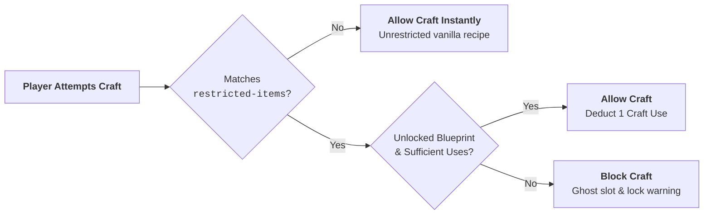

# Recipe Restriction Engine

The **Recipe Restriction Engine** is the core progression gateway of CraftingBlueprints. It governs which items, recipes, potions, and enchantments require blueprints and which remain freely craftable by all players on your server.

---

## Core Concept: Permissive by Default

Unlike restrictive whitelist-only plugins that lock down every single recipe on startup, CraftingBlueprints is **permissive by default**:



1. **Unrestricted Recipes**: If an item does *not* match any pattern defined in `restrictions.restricted-items`, players can craft, smelt, brew, or stonecut it freely without needing a blueprint or permission node. Basic materials (sticks, torches, wooden planks, stone tools, furnaces) remain naturally accessible.
2. **Restricted Recipes**: If an item matches any rule in `restrictions.restricted-items`, CraftingBlueprints intercepts the workstation and checks whether the player has learned the corresponding blueprint or belongs to an authorized permission group (`craftingblueprints.group.<id>`).
3. **Universal Progression Mode**: If your server design requires gating *every* recipe behind research or unlocks, you can enable universal gating simply by adding `".*"` or `"*"` to the restrictions list.

---

## Configuration Syntax (`config.yml`)

The restriction rules are configured under the `restrictions:` section in `config.yml` (and supplemented via modular files in `configs/`):

```yaml
# ==============================================================================
# CraftingBlueprints - Recipe Restrictions
# ==============================================================================

restrictions:
  # List of items, materials, potions, or enchantments that require blueprints.
  # Supports exact names, glob wildcards (*), regular expressions (.*),
  # and workstation/category prefixes (craft:, smelt:, potion:, enchant:, stonecut:).
  restricted-items:
    # 1. Exact Material Matching
    - "beacon"
    - "enchanted_golden_apple"
    - "shulker_box"

    # 2. Glob Wildcard & Regular Expressions
    - "diamond_.*"
    - "netherite_.*"
    - "*_sword"

    # 3. Workstation & Category Prefixes
    - "craft:elytra"
    - "smelt:ancient_debris"
    - "smelt:iron_raw"
    - "potion:strength.*"
    - "potion:speed_2"
    - "enchantment:mending"
    - "enchantment:sharpness_[45]"
    - "stonecut:stone_bricks"
    - "enchant_table:silk_touch"
```

---

## Pattern Matching Rules

The restriction parser evaluates recipe outputs and ingredients against three pattern matching modes:

### 1. Exact Name Matching
Matches the canonical lowercased Bukkit material name:
```yaml
- "beacon"
- "trident"
- "conduit"
```

* Matches only `minecraft:beacon`, `minecraft:trident`, etc.
* Does not match partial occurrences (e.g. `beacon` does not match `beacon_block`).

### 2. Glob Wildcards (`*`)
Standard shell-style wildcards for intuitive administrative configuration:
```yaml
- "diamond_*"    # Matches diamond_sword, diamond_pickaxe, diamond_helmet, etc.
- "*_sword"      # Matches wooden_sword, iron_sword, diamond_sword, netherite_sword
- "*chestplate"  # Matches iron_chestplate, netherite_chestplate, etc.
```

* The engine automatically translates `*` wildcards into equivalent regular expressions without performance penalties.

### 3. Regular Expressions (`.*`)
For advanced, highly granular progression rules:
```yaml
- "netherite_.*"               # Matches any Netherite item
- "potion:healing_[12]"        # Matches healing level 1 and 2 potions
- "enchantment:protection_[34]" # Restricts high-tier Protection III & IV
```

### 4. Universal Progression Mode
To mandate blueprints for all recipes on the server:
```yaml
restrictions:
  restricted-items:
    - ".*"    # Universal progression: every recipe requires a blueprint
```

---

## Workstation & Category Prefixes

By default, an unqualified pattern like `iron_sword` applies to crafting. To target specific crafting stations or disciplines, prepend the corresponding category prefix:

| Prefix Format | Intercepted Workstations | Evaluation Behavior |
| :--- | :--- | :--- |
| `craft:<pattern>`<br>`item:<pattern>` | **Crafting Tables**, 2x2 Player Grids, 1.21 **Crafter** Blocks | Intercepts standard crafting matrices and automated redstone crafters. |
| `smelt:<pattern>`<br>`furnace:<pattern>` | **Furnaces**, **Blast Furnaces**, **Smokers**, **Campfires** | Intercepts smelting outputs and enforces tile ownership to prevent hopper injection bypasses. |
| `potion:<pattern>`<br>`brew:<pattern>` | **Brewing Stands** | Intercepts potion brewing outputs. Unrestricted potions brew freely; restricted potions require blueprints. |
| `enchant:<pattern>`<br>`enchantment:<pattern>` | **Anvils** | Intercepts anvil combination and book applications. Only newly added or upgraded restricted enchantments require blueprints. |
| `stonecut:<pattern>`<br>`stonecutter:<pattern>` | **Stonecutters** | Restricts specific stone slicing recipes from the Stonecutter grid. |
| `enchant_table:<pattern>` | **Enchanting Tables** | Restricts enchanting options offered at the Enchanting Table. |

!!! tip "Namespace Preservation"
    Vanilla `minecraft:` prefixes are stripped automatically (`minecraft:diamond_sword` normalizes to `diamond_sword`). However, custom item namespaces (`ia:`, `nexo:`, `oraxen:`, `mmoitems:`) are strictly preserved, allowing you to restrict custom items like `ia:mithril_sword`.

---

## Pipeline Interception Architecture

Every crafting attempt passes through the `RestrictionEngine` before any player permissions, blueprint items, or craft uses are queried:

1. **Crafting Tables & Inventories**:
   If `!RestrictionEngine.isBlueprintRequired(item, CRAFT_TYPE)`, the recipe passes immediately with **zero performance overhead**. No database queries, group lookups, or use deduction cycles occur.

2. **Automated 1.21 Crafter Blocks**:
   Redstone crafters producing unrestricted items (such as iron blocks, paper, or bread) operate at vanilla speeds without permission checks. Only restricted recipes trigger redstone lockouts.

3. **Brewing Stands**:
   When a brewing cycle finishes, only output bottles matching restricted potion types consume player blueprint uses. Unrestricted water bottles and basic potions brew freely.

4. **Anvils**:
   When combining items or applying books in an anvil, the engine checks whether any resulting enchantment is restricted. If the player already possesses that enchantment level on the base item, no blueprint check is triggered.

---

## In-Game Inspection (`/cb cani`)

Players and administrators can check whether an item requires a blueprint at any time:

```text
/cb cani <item>
```

### Unrestricted Recipe Feedback:
If the queried item does not match any pattern in `restricted-items`, the command reports:

```text
Item: Iron Sword
Status: Unrestricted (Freely craftable by all players)
```

### Restricted Recipe Feedback:
If the item matches a restriction rule, the command reports the required blueprint, the player's unlock status, and remaining craft uses:

```text
Item: Netherite Chestplate
Status: Restricted
Required Blueprint: netherite_armor_pack (or group 'elite')
Unlocked: NO
```

---

## Next Steps

* **Organize Progression Groups**: Learn how to grant sets of restricted recipes via LuckPerms with [Hierarchical Permission Groups](permission-groups.md).
* **Modular Configuration Files**: Separate your restriction rules into multiple files using [Modular Configurations](modular-configs.md).
* **Hands-On Quickstart**: Follow the step-by-step tutorial to create and test a restricted item in [Your First Blueprint](../getting-started/first-blueprint.md).
