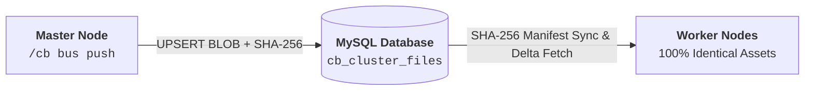
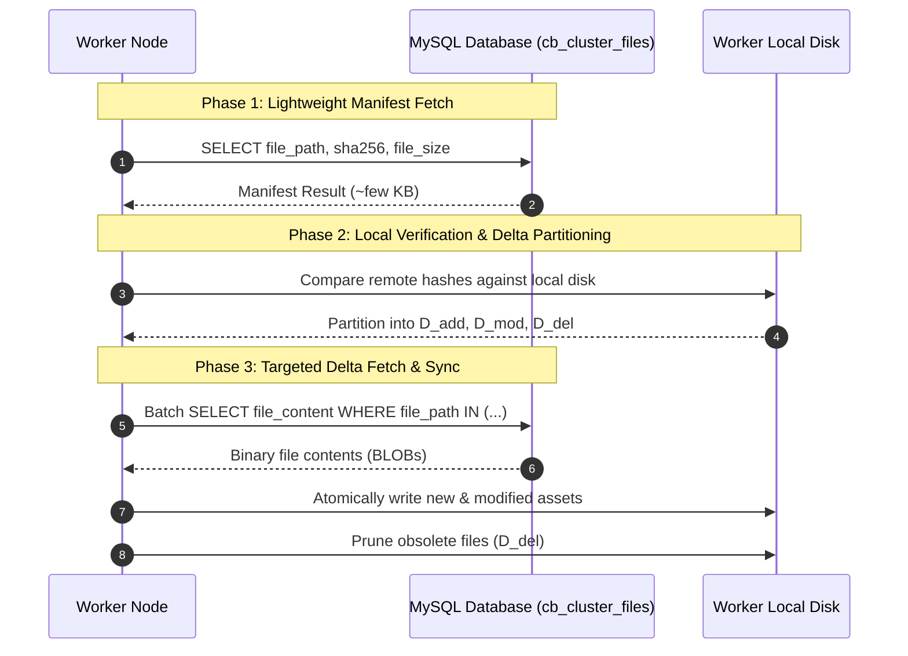

# Cluster File Distribution Bus (`cb_cluster_files`)

In multi-server Minecraft networks operating with a shared MySQL database, database rows synchronize immediately. However, physical disk files—such as custom 128×128 map PNG textures (`images/`), modular blueprint definitions (`blueprints/`), modular configuration fragments (`configs/`), and custom loot tables (`loot/`)—reside strictly on the Master node's local filesystem.

Without a synchronization mechanism, Worker nodes suffer from **missing map textures** (pink/black checkered glitches), outdated recipe previews, and broken loot injections.

CraftingBlueprints solves this with a **Zero-NFS Database Distribution Bus**: the central relational database acts as an automated binary asset distribution engine via the `cb_cluster_files` table, mirroring assets across all Worker nodes with byte-level fidelity.

---

## The Distributed Asset Dilemma

Traditional multi-server setups rely on external file distribution workarounds, each carrying severe operational pitfalls:

* **Network File System (NFS) Mounts**: Introduce network file-lock contentions, high read latencies during map rendering bursts, and single-point-of-failure network dependencies.
* **Shared Docker Volumes**: Only function when all servers run on the exact same physical host machine, preventing horizontal scaling across cloud providers or dedicated servers.
* **rsync Cron Scripts**: Require external SSH key management, cron maintenance, and lack reactive event-driven synchronization, leading to race conditions where players join before files transfer.

### Traditional Fragile Architecture


### CraftingBlueprints Zero-NFS Architecture


---

## Canonical Tracked Directories vs. Protected Paths

To ensure rock-solid stability and prevent tutorials from breaking, CraftingBlueprints uses **fixed, zero-configuration canonical directory rules**.

### Tracked Asset Categories (`CANONICAL_TRACKED_PATHS`)

The Master node automatically mirrors only these four asset directories into `cb_cluster_files`:

| Canonical Directory / File | Category ID | Asset Description |
| :--- | :---: | :--- |
| `blueprints/` | `BLUEPRINT` / `TEMPLATE` | All YAML blueprint definitions, crafting recipes, mixin templates (`blueprints/templates/`), and deployed presets (`blueprints/presets/<id>/`). |
| `images/` | `IMAGE` | Custom 128×128 map backgrounds (`images/backgrounds/`), frames, rosettes, wax stamps, and preset textures. |
| `configs/` | `CONFIG` | Modular preset configuration overrides (`configs/presets/<id>/`), including `groups.yml` and `restrictions.yml`. |
| `loot/` & `loot.yml` | `LOOT` | Modular chest injection tables (`loot/**/*.yml`) and global world loot mappings (`loot.yml`). |

### Protected Local Paths (`CANONICAL_PROTECTED_PATTERNS`)

The following files and folders are **strictly node-local**. They are **never uploaded** by the Master node and **never deleted (pruned)** by Worker nodes:

1. **Server Configuration Files**: `config.yml`, `database.yml`, `paper-global.yml`, `spigot.yml`, `bukkit.yml`.
2. **Dynamic Backups & Exports**: `exports/` (audit text files, `manual_blueprints.yml`) and `backups/`.
3. **Inactive Preset Staging Archives**: `presets/` (inactive `.zip` bundles, raw downloads). Deployed active assets live strictly in `blueprints/presets/`, `images/presets/`, and `configs/presets/`.
4. **Temporary & Lock Files**: `*.tmp`, `*.tmp.*`, `*.bak`, `.*` (hidden dotfiles such as `.git` or `.DS_Store`).

---

## Two-Phase Lightweight Synchronization Protocol

Transferring megabytes of binary data across MySQL connections on every reload would cause network congestion. Worker nodes execute a **Two-Phase Selective Synchronization Protocol** that transfers data only when a file has actually changed.



### Atomic Disk Replacement (`writeAtomic`)

Directly overwriting an image or blueprint file while a map rendering worker thread or recipe parser is reading it causes corrupted reads, partial image frames, or `FileNotFoundException`.

Worker nodes implement atomic swap semantics:

1. Write the payload to a temporary file in the same directory: `filename.tmp.<uuid>`.
2. Flush and synchronize to disk.
3. Perform an atomic filesystem replacement using `StandardCopyOption.ATOMIC_MOVE`.
4. If a server crash occurs mid-write, the existing file remains uncorrupted and the temporary file is purged automatically on next boot.

### Targeted Cache Invalidation Matrix

Once files are mirrored to disk, Worker nodes do not execute a crude full-plugin reload. Instead, they execute targeted cache invalidation based on which file types were modified:

| Modified Asset Type | Automated Invalidation Routine | Impact |
| :--- | :--- | :--- |
| **`images/**/*.png`** | `LazyImageLoader.clear()`, `AsyncCompositorPipeline.invalidateAll()`, `BlueprintMapRegistry.refreshAllRenderers()` | Flushes texture cache; active map items render new graphics on the next player frame. |
| **`blueprints/**/*.yml`** | `ItemDB.initializeItems()`, refresh recipe book bindings | Reloads recipe matching and crafting permissions in RAM without kicking players. |
| **`loot.yml`, `loot/**/*.yml`** | `LootRulePipeline.reload()` | Refreshes world chest injection and drop rules. |
| **`configs/**/*.yml`** | `GroupInheritanceResolver.reload()`, `RestrictionEngine.reload()` | Updates permission DAG and crafting restrictions. |

---

## Security & Data Integrity Invariants

### 1. Strict Path Traversal Defense (`validateRelativePath`)
To prevent malicious or malformed database records from executing Arbitrary File Overwrites (Zip-Slip traversal attacks outside `plugins/CraftingBlueprints/`), all incoming paths undergo five strict security validations:

* Forbid leading slashes (`/` or `\`).
* Forbid absolute paths, drive letters (`C:`, `D:`), and UNC network shares.
* Forbid relative directory navigation tokens (`..` or `.` path segments).
* Forbid null bytes (`\0`) and control characters.
* **Canonical Real-Path Check**:
  $$\text{targetPath.toRealPath().startsWith(dataFolder.toRealPath())} == \text{true}$$

Any path failing these checks is immediately blocked with a security console alert, and the download is discarded.

### 2. MySQL Packet Overflow Defense
MySQL servers enforce a `max_allowed_packet` size (commonly 16MB or 64MB).

* Files exceeding `cluster-file-sync.max-file-size-mb` are rejected before upload.
* Text-based files (YAML, JSON, TXT) larger than 2 KB are transparently compressed using **GZIP**, reducing packet size by up to 85%.

### 3. SHA-256 Cryptographic Verification
Before moving any downloaded file from `.tmp` to its permanent destination, Worker nodes compute:
$$\text{CalculatedHash} = \text{Hex}(\text{SHA-256}(\text{UncompressedBytes}))$$
If $\text{CalculatedHash} \neq \text{RemoteManifest.sha256}$, the download is recognized as truncated or corrupted (e.g., due to an interrupted connection). The temporary file is deleted, the existing file remains untouched, and an error is logged.

---

## Configuration Reference (`config.yml`)

The cluster distribution engine is configured under `cluster-file-sync`:

```yaml
# ------------------------------------------------------------------------------
# CLUSTER FILE DISTRIBUTION & ASSET MIRRORING
# ------------------------------------------------------------------------------
# Allows Worker nodes to automatically mirror local assets from the Master
# (blueprints, images, templates, deployed presets, loot tables) via MySQL.
# Tracked directories (blueprints/, images/, configs/, loot/) are fixed & canonical.
cluster-file-sync:
  # Master toggle for database file distribution across the cluster
  enabled: true

  # If true, Worker nodes download missing/updated files synchronously on server boot
  # before initializing items, recipes, and graphics, guaranteeing zero missing textures.
  sync-on-startup: true

  # If true, Worker nodes check for updates when receiving heartbeat signals
  sync-on-heartbeat: true

  # If true, Worker nodes automatically delete (prune) local files within tracked directories
  # that were deleted on the Master node.
  # Safe fail-safe: Never prunes files matching protected patterns or outside tracked roots.
  prune-deleted: true

  # Maximum allowed single file size in megabytes (MB) to prevent database packet overflow.
  max-file-size-mb: 16

  # Transparently GZIP-compress text-based files (YAML, JSON, TXT) before database persistence.
  # Images (PNG, JPG) are already compressed and will skip GZIP automatically.
  gzip-text-files: true
```

---

## Administrative Command Suite (`/cb cluster`)

CraftingBlueprints provides dedicated administrative subcommands under `/cb cluster`:

### 1. `/cb cluster status`
Displays node role, database connection health, tracked file counts, storage metrics, and synchronization status.

```text
/cb cluster status
```

**Output on a Worker Node:**
```text
--------------------------------------------------
 CraftingBlueprints - Cluster File Distribution
--------------------------------------------------
 Node Role: Worker (Read-Only Mirror)
 Distribution Engine: ENABLED
 Database Engine: MYSQL (Ping: 3ms)
 Last Cluster Ping: 2s ago (from Master: Hub-01)
 Tracked Files in DB: 142 files (4.82 MB)
 Local Mirror State: IN SYNC (142/142 matching)
   - Images: 86 textures (3.91 MB)
   - Blueprints: 48 YAML files (0.81 MB)
   - Configs & Loot: 8 files (0.10 MB)
 Automatic Pruning: ENABLED
--------------------------------------------------
```

### 2. `/cb cluster files push [--force] [--prune]` *(Master Node Only)*
Forces the Master node to scan all local tracked directories (`blueprints/`, `images/`, `configs/`, `loot/`), calculate cryptographic hashes, and upload new or modified files to `cb_cluster_files`.

* `--force`: Overwrites database records even if checksums match.
* `--prune`: Purges database records for files that were deleted from the Master's local disk.

```text
/cb cluster files push --prune
```

### 3. `/cb cluster files pull [--force]` *(Worker Nodes Only)*
Forces a Worker node to query the database manifest and download all missing or out-of-sync files to local disk immediately.

* `--force`: Re-downloads and overwrites all tracked local files regardless of local hash matching.

```text
/cb cluster files pull --force
```

### 4. `/cb cluster files diff` *(Master & Worker)*
Performs a pre-flight comparison between the local filesystem and the remote `cb_cluster_files` database records without transferring any files.

```text
/cb cluster files diff
```

**Example Diff Output:**
```text
Cluster File Difference Report:

- MISSING: images/backgrounds/forge.png (48.2 KB)
- MODIFIED: blueprints/weapons/excalibur.yml (1.2 KB)
- UNTRACKED: blueprints/test_scrap.yml (0.4 KB)
Total divergent files: 2 to pull, 1 local untracked.
```
