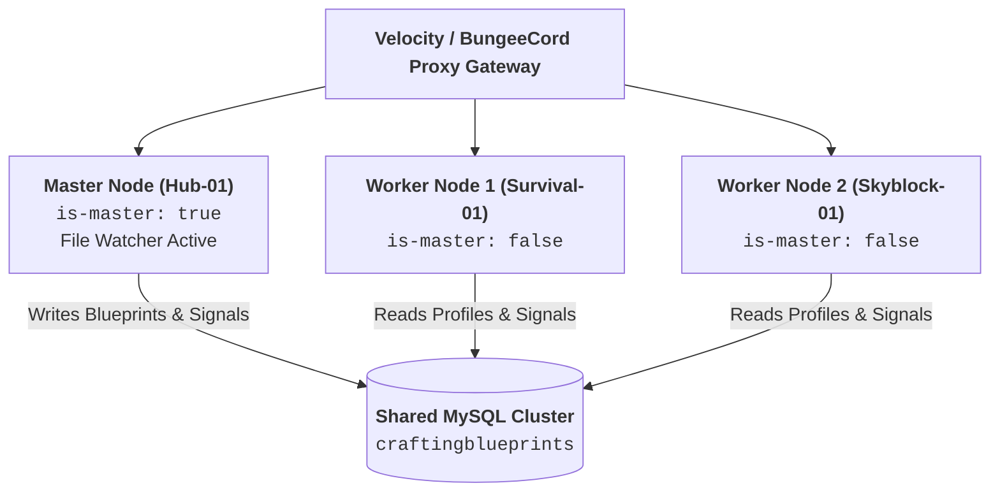
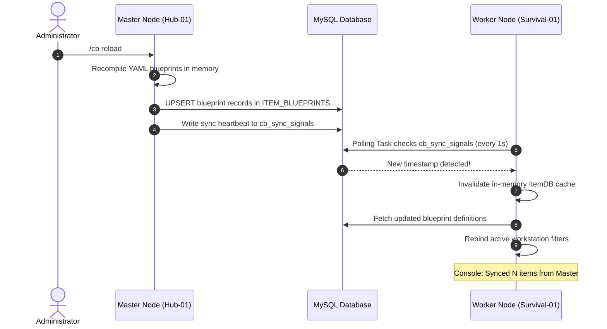
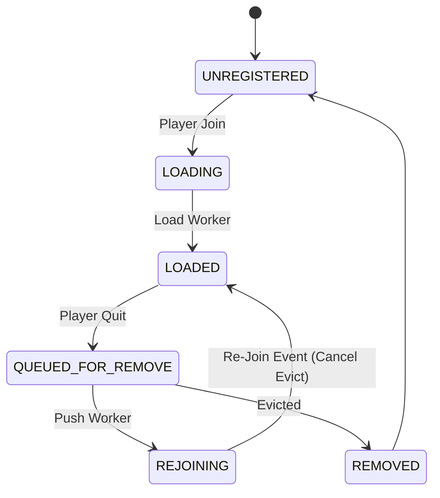

# Multi-Server MySQL Synchronization

CraftingBlueprints provides enterprise-grade multi-server synchronization for Minecraft networks running behind **Velocity**, **BungeeCord**, or **RedisBungee**. By connecting all backend Paper or Purpur instances to a centralized **MySQL** or **MariaDB** database, player progression (unlocked blueprints, remaining craft usage counts, and expiration dates) is seamlessly synchronized across hubs, survival worlds, skyblock realms, and minigames.

---

## Multi-Server Network Architecture

In a distributed network topology, backend server instances are categorized into two distinct operational roles: **Master Node** and **Worker Nodes**.



---

## Master vs. Worker Node Roles

To prevent split-brain database divergence, race conditions, and corrupted recipe states, CraftingBlueprints enforces strict role separation across the cluster.

!!! important "The Golden Rule of Network Clusters"
    **Exactly ONE server** in your entire network must be designated as the Master node (`is-master: true`). Every other backend server (Hubs, Survival, Skyblock, Factions, Prison) must be configured with `is-master: false`.

### Role Comparison Matrix

| Capability / Responsibility | Master Node (`is-master: true`) | Worker Nodes (`is-master: false`) |
| :--- | :---: | :---: |
| **Blueprint YAML Compilation** |  Compiles local YAML files into database | ❌ Blocked (loads directly from MySQL) |
| **Database Schema Migrations** |  Executes $V_1 \dots V_5$ under distributed lock | ❌ Awaits schema finalization |
| **Mutating Commands (`/cb preset`)** |  Full execution authority | ❌ Blocked (safeguards against divergence) |
| **Scaffolding (`/cb generate`)** |  Compiles & writes rows to MySQL | ❌ Blocked |
| **Signal Broadcasting (`cb_sync_signals`)** |  Emits `BLUEPRINT_RELOAD` / `CLUSTER_FILES_SYNC` | ❌ Read-only signal listener |
| **Cluster Asset Publishing** |  Uploads tracked files to `cb_cluster_files` | ❌ Blocked (pulls from database) |
| **Player Progression Persistence** |  Saves local player data on quit/interval |  Saves local player data on quit/interval |
| **Workstation Interception** |  Enforces recipe restrictions |  Enforces recipe restrictions |

### Configuration Example

#### Master Node (`plugins/CraftingBlueprints/config.yml`):
```yaml
database-type: mysql
database-host: "mysql.internal.network"
database-port: 3306
database-name: "craftingblueprints"
database-user: "cb_master"
database-password: "SecureMasterPasswordHere"

# Authoritative Master node
is-master: true
```

#### Worker Node (`plugins/CraftingBlueprints/config.yml`):
```yaml
database-type: mysql
database-host: "mysql.internal.network"
database-port: 3306
database-name: "craftingblueprints"
database-user: "cb_worker"
database-password: "SecureWorkerPasswordHere"

# Read-only Worker node
is-master: false
```

---

## Heartbeat & Signal Propagation (`cb_sync_signals`)

Whenever an administrator executes `/cb reload` or edits blueprint definitions on the Master node, the changes must immediately propagate to all Worker nodes without requiring a manual `/reload` or server reboot across the network.

CraftingBlueprints accomplishes this via the `cb_sync_signals` database table:

```sql
CREATE TABLE IF NOT EXISTS cb_sync_signals (
    signal_id VARCHAR(64) NOT NULL,
    sender_server VARCHAR(36) NOT NULL,
    signal_type VARCHAR(32) NOT NULL,
    payload TEXT,
    last_update TIMESTAMP DEFAULT CURRENT_TIMESTAMP ON UPDATE CURRENT_TIMESTAMP,
    PRIMARY KEY (signal_id)
);
```

### Signal Propagation Workflow



!!! note "Zero External Broker Dependency"
    This heartbeat bus functions entirely through standard SQL queries. You do not need to install, configure, or maintain external message brokers such as Redis, RabbitMQ, or Kafka.

---

## HikariCP Connection Pool Tuning (Production Reference)

CraftingBlueprints integrates **HikariCP 5.1.0**, the industry standard for high-performance, low-latency JDBC connection pooling.

### Recommended Production Connection Pool Settings

The default settings configured in `DatabaseConfig` are optimized for high-capacity Minecraft networks:

| Parameter | Recommended Value | Description |
| :--- | :---: | :--- |
| `maximumPoolSize` | `10` – `20` | Maximum number of active and idle connections in the pool. For nodes with 150+ concurrent players, set to `15`–`20`. |
| `minimumIdle` | `2` – `5` | Minimum number of idle connections maintained. Prevents cold-start connection latency during sudden player join spikes. |
| `connectionTimeout` | `30000` (30s) | Maximum milliseconds a worker thread will wait for a connection from the pool before throwing a timeout exception. |
| `idleTimeout` | `600000` (10m) | Maximum milliseconds an idle connection is permitted to remain in the pool before being retired. |
| `maxLifetime` | `1800000` (30m) | Maximum lifetime of a connection in the pool. Set strictly below MySQL's `wait_timeout` (typically 8 hours) to prevent broken socket exceptions. |
| `leakDetectionThreshold` | `10000` (10s) | Threshold for connection leak warnings. Warns in console if a thread holds a connection longer than 10 seconds without closing it. |

### JDBC Connection String Optimizations

CraftingBlueprints constructs the JDBC URL using production flags that guarantee resilience and prevent handshake stalls:

```text
jdbc:mysql://<host>:<port>/<database>?useSSL=false&allowPublicKeyRetrieval=true&serverTimezone=UTC&characterEncoding=utf8&createDatabaseIfNotExist=true&tcpKeepAlive=true
```

* `allowPublicKeyRetrieval=true`: Ensures smooth authentication with MySQL 8.0 `caching_sha2_password` plugins.
* `serverTimezone=UTC`: Guarantees deterministic timestamp handling for blueprint expiration timestamps across servers in different physical regions.
* `tcpKeepAlive=true`: Prevents cloud firewall and proxy timeouts from terminating idle JDBC TCP connections.

---

## Quick-Relog Race Condition Safety

In a proxy network (BungeeCord/Velocity), players frequently switch between servers using `/server`, `/hub`, or portal commands. During a server switch:

1. The player disconnects from the source server (`PlayerQuitEvent`).
2. Concurrently (often within 50 milliseconds), the player connects to the target server (`PlayerJoinEvent`).

Without strict concurrency controls, this creates two catastrophic race conditions:

* **Torn Read**: The target server queries the database before the source server has finished persisting remaining craft counts, causing lost item durability.
* **Double Spend**: A player exploits the 50ms window to craft expensive recipes on both servers simultaneously.

### The 6-State Player Lifecycle State Machine

CraftingBlueprints eliminates cross-server desynchronization using an atomic player lifecycle state machine coordinated between `WaitingManager` and `PlayerDB`:



### 1. `SOFT` Eviction vs. `IMMINENT` Eviction

* **`SOFT` Eviction (Grace Period: 5s)**: When a player disconnects normally from a server, their profile is retained in RAM for 5 seconds (`cache.players.disconnect-grace-period-seconds`). If the player quickly reconnects to the *same* server (e.g. after a client crash or timeout), eviction is cancelled instantly, avoiding unnecessary database round-trips.
* **`IMMINENT` Eviction (Zero-Grace Override: 0s)**: When the player switches to a *different* network server, the target server records a claim in `cb_requests`. The source server detects this claim, **instantly cancels the 5-second grace period (0ms delay)**, pushes modified data to MySQL immediately, and evicts the player profile.

### 2. Distributed Reservation Locks (`cb_reservations`)

* When a server loads a player, it inserts an active lease into `cb_reservations`.
* **Lock Retention Invariant**: The source server retains its reservation lock *until* all in-memory changes are fully written to `cb_player_data`. Only after the write is confirmed does it delete the reservation.
* **Lock-Gated Loading**: If a target server attempts to load a player whose reservation is still held by another server, the player is kept in `LOADING` state, and workstation rules (`CheckCraftUserLoadedRule`) momentarily intercept crafting until the handover completes cleanly.

### 3. Atomic Serialization (`User.lock`)
All player mutations (`addBlueprints`, `tryUse`) and serialization snapshots (`User.toHashMap()`) acquire an internal `ReentrantLock` (`User.lock`). This guarantees that when player data is serialized for MySQL persistence, list collections and timestamp metadata are captured in a single atomic snapshot, preventing torn reads caused by concurrent background tasks.

---

## Split-Brain Conflict Detection

If an administrator accidentally configures multiple servers with `is-master: true`, both nodes would attempt to compile YAML files, run schema migrations, and overwrite database records simultaneously.

CraftingBlueprints continuously monitors the `cb_servers` heartbeat table:

```text
[CraftingBlueprints] CONFLICT: Multiple Master nodes detected!
Local Node: [Hub-01] (Master)
Conflicting Remote Node: [Survival-01] (Master)
To prevent data corruption, set 'is-master: false' on secondary nodes immediately!
```

If this alert appears in your server console, follow the remediation procedure in the [Cluster Recovery Runbook](cluster-recovery-runbook.md).

---

## Diagnostic Verification (`/cb status`)

To verify network synchronization and database pool metrics on any Master or Worker server, run:

```text
/cb status
```

Example output on a Worker node:

```text
--------------------------------------------------
 CraftingBlueprints - Storage Engine Diagnostics
--------------------------------------------------
 Node Role: Worker (Read-Only Mirror)
 Database Engine: MYSQL (jdbc:mysql://10.0.0.5:3306/cb)
 Pool State: ACTIVE (HikariPool-1)
 Active Connections: 2 / 10 (Idle: 3)
 Latency: 2 ms ping to MySQL
 Heartbeat Status: IN SYNC (Last signal: 4s ago from Hub-01)
 Cached Player Profiles: 84 resident in RAM
 Registered Blueprint Items: 142 synchronized from DB
--------------------------------------------------
```
